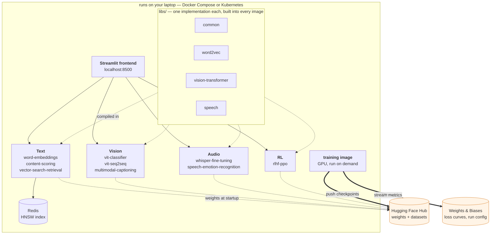

# AI Residency — ML systems, built end to end

[](https://github.com/RoshBeed/ai-residency/actions/workflows/ci.yml) [](LICENSE)

Nine machine-learning systems, each taken from scratch to a containerized service, plus the
frontend and the deployment that run all of them. The point isn't only the models — it's the
engineering around them: real architectures implemented from the ground up, four shared
libraries, one lockfile, and the same images running on three runtimes (a laptop, docker-compose,
Kubernetes).

Every image is public and every checkpoint resolves from the Hugging Face Hub at startup, so
none of this needs credentials, a GPU, or a build.

## Run one, right now

No clone, no build, no credentials. This pulls a published image, waits for it to report ready,
asks it a question, and cleans up after itself:

```bash
docker run --rm -d --pull always --name word-embeddings -p 8000:8000 \
  roshb/ai-residency-word-embeddings-serve

curl -fsS --retry 60 --retry-delay 1 --retry-all-errors \
  http://localhost:8000/ready >/dev/null

curl -sS -X POST http://localhost:8000/nearest \
  -H 'Content-Type: application/json' \
  -d '{"word":"king","k":3}'

docker stop word-embeddings >/dev/null
docker rmi roshb/ai-residency-word-embeddings-serve
```

```json
{"query":"king","nearest":[["kings",0.63],["throne",0.62],["fitzalan",0.62]],
 "checkpoint_source":"hub"}
```

### With the UI

The same backend plus the Streamlit page for it. They need a shared network so the
frontend can resolve the backend by name, and `AI_RESIDENCY_PAGES` makes the UI a
single-system app rather than the nine-system hub:

```bash
docker network create ai-residency >/dev/null

docker run --rm -d --network ai-residency --name word-embeddings \
  roshb/ai-residency-word-embeddings-serve

docker run --rm -d --network ai-residency --name frontend -p 8500:8501 \
  -e AI_RESIDENCY_PAGES=word-embeddings \
  -e WORD_EMBEDDINGS_API_URL=http://word-embeddings:8000 \
  roshb/ai-residency-frontend
```

Then open http://localhost:8500. The page waits on `/ready`, and on a cold run the backend is
fetching a 165 MB checkpoint, so give it a couple of minutes.

```bash
docker stop frontend word-embeddings >/dev/null
docker network rm ai-residency >/dev/null
docker rmi roshb/ai-residency-word-embeddings-serve roshb/ai-residency-frontend
```

From a clone, `docker compose up -d --no-deps frontend word-embeddings` does the same
through Compose, and without `--no-deps` it starts all nine behind the hub.

The container starts with an empty disk and fetches its own checkpoint from the Hugging Face Hub,
which is why the `--retry` loop is there rather than a fixed sleep: `/ready` answers **503** until
the weights are loaded, so curl retries until the service can genuinely serve.

`--pull always` matters for the same reason. `docker run` reuses a local `latest` and never
re-checks it, so an image cached from an earlier visit keeps serving — and a checkpoint the Hub
has since re-uploaded can stop matching the reader that old image carries. `--rm` removes the
container but not the image, which is why the last line deletes it: 1.8 GB, mostly torch.

Swap the image name for any other system — every one is independently deployable and answers plain
HTTP on `:8000`:

```
roshb/ai-residency-content-scoring-serve            roshb/ai-residency-vit-classifier-serve
roshb/ai-residency-vector-search-retrieval-serve    roshb/ai-residency-vit-seq2seq-serve
roshb/ai-residency-whisper-fine-tuning-serve        roshb/ai-residency-multimodal-captioning-serve
roshb/ai-residency-speech-emotion-recognition-serve roshb/ai-residency-rlhf-ppo-serve
```

`GET /openapi.json` on any of them lists its endpoints and request shapes.

Images are published for **`linux/amd64` and `linux/arm64`**, so that runs natively on an Apple
Silicon Mac as well as on a cloud box.

### Or build it yourself

Nothing above needs the source. If you want to read it, change it, or run a version that isn't
published yet, this clones the repo and gives you one system plus its UI, built on your machine:

```bash
git clone https://github.com/RoshBeed/ai-residency && cd ai-residency/deploy
make local-up SERVICES="word-embeddings"     # builds natively, starts it + the UI
open http://localhost:8500
make down                                    # stop it
```

`make local SERVICE=<name>` builds a single image without running anything, and
`make -C deploy local-cluster` does the same for the Kubernetes path. Expect the first build to
take a few minutes — the base image is a full torch install — which is exactly why the published
images are the faster way in.
`vector-search-retrieval` is the one exception to running solo — it queries a Redis index, so it
wants the compose form below, with `redis` named alongside it.

## Run all of them, behind the UI

The frontend needs the compose file, so this one does want a clone. It still builds nothing —
compose pulls the same published images.

```bash
git clone https://github.com/RoshBeed/ai-residency && cd ai-residency/deploy/compose
docker compose --env-file images.env up -d   # all nine + the UI on http://localhost:8500
docker compose down                          # stop everything
```

`--env-file images.env` is what pins the digests: `docker-compose.yml` carries
`${<SERVICE>_REF:-:latest}` and that file supplies the `@sha256:...` half. Drop the flag and
every service falls back to `:latest`. It is not named `.env` because that name is gitignored
repo-wide for credentials, and a committed generated file wearing it would be a trap.

No credentials are needed: the Hub repos are public, and the compose file defaults both
`HF_TOKEN` and `WANDB_API_KEY` to empty. `make -C deploy up` is a shortcut for the same
command that also picks up a token from a local `.env` if you have one, and
`make -C deploy status` adds the one thing compose has no equivalent for — it curls `/health`
and `/ready` on all nine ports, which is the difference between a container being up and it
being able to answer.

Expect a few minutes on a cold run while each container fetches its weights; each page starts
working as its backend finishes.

If compose reports `Bind for 0.0.0.0:8500 failed`, something else already holds that port —
most likely a Helm release of this same chart, whose `LoadBalancer` Service claims it even with
its pods scaled to zero. `make -C deploy helm-uninstall` frees it.

### One system at a time, or if you don't have ~17GB of RAM

Everything at once is heavy. Name the systems you want and you get a UI for those, not a hub
with eight dead pages:

```bash
AI_RESIDENCY_PAGES="word-embeddings vit-classifier" \
  docker compose --env-file images.env up -d --no-deps \
  frontend word-embeddings vit-classifier
```

`--no-deps` is what makes the subset a subset: the frontend's `depends_on` names all nine, so
without it compose drags the other seven back in. The frontend handles the absent ones on its
own — each page checks `/ready` and says that backend is not running. Add `redis` to the list
for `vector-search-retrieval`, which cannot serve without it.

`make -C deploy up SERVICES="word-embeddings vit-classifier"` is that line with redis added
for you.

The frontend image is the same one the hub runs — it is told which pages to show through
`AI_RESIDENCY_PAGES`. **No backend contains any UI.**
Streamlit runs in exactly one container whether you start one system or all nine, and the
backends stay pure HTTP APIs that anything can call. That is also why the single-service
`docker run` further up needs no frontend at all to be useful: `/docs` on any backend is a
working interface generated from its own OpenAPI schema.

| Service | Resident once loaded | Notes |
|---|--:|---|
| `vector-search-retrieval` | 0.3 GB | Lightest. Pulls in Redis automatically |
| `vit-classifier` | 0.45 GB | Draw a digit, see the real patch grid |
| `vit-seq2seq` | 0.45 GB | Multi-digit, streams tokens as it decodes |
| `content-scoring` | 1.3 GB | |
| `whisper-fine-tuning` | 1.8 GB | Fine-tunes live, per request |
| `word-embeddings` | 2.3 GB | Nearest neighbours and analogies |
| `speech-emotion-recognition` | — | No trained checkpoint yet, so it answers 503 by design |
| `rlhf-ppo` | 4.6 GB | Heaviest, and the most interesting trace |
| `multimodal-captioning` | 5.4 GB | CLIP + Qwen3 |
| the frontend | 0.4 GB | Always started |

Those are cgroup peaks read after each service had loaded its models and answered a real request,
not estimates.

## How it fits together



Everything inside the box is yours and disposable; the two stores outside it are the only state
that survives. A GPU box trains, pushes weights to the Hub and streams metrics to Weights &
Biases; cheap CPU containers pull those weights and serve. No service calls another at request
time, and nothing depends on a file that happens to sit on one machine — which is what lets the
same images run unchanged on a laptop, under compose, and on a cluster.

The four libraries under `libs/` are the other half of that shape. Each holds one implementation
of something more than one service needs, so a fix lands once rather than in three places — the
argument that produced them, and the bugs it surfaced, are in [Working on it](#working-on-it).

Each backend exposes two endpoints a deployment cares about, from one shared helper in
`libs/common`:

| | meaning | answers |
|---|---|---|
| `/health` | the process is up | always 200 — a missing checkpoint must not restart a pod |
| `/ready` | this instance can serve | **503** until weights are loaded, so an unusable pod stays out of the load balancer |

The Helm chart points `livenessProbe` at the first and `readinessProbe` at the second. Pointing
both at `/health` gives a readiness probe that cannot fail, which is the same as having none.

## The systems

Each links to its own write-up — architecture, method, results and references.

| System | Architecture | What it demonstrates |
|---|---|---|
| [Word embeddings](services/word-embeddings) | CBOW and skip-gram word2vec with negative sampling, from scratch | The whole unsupervised loop written directly — vocabulary, subsampling, negative sampling, training — with no `gensim` and no pretrained vectors |
| [Content scoring](services/content-scoring) | Regression head over frozen CBOW embeddings | Transfer learning onto an encoder this repo produced itself; the head is the only thing trained |
| [Dual-encoder retrieval](services/vector-search-retrieval) | Two-tower retrieval (CBOW + GRU encoders), triplet loss | The offline/online split a real retrieval system has: documents encoded once into an ANN index, queries encoded per request |
| [ViT classifier](services/vit-classifier) | Encoder-only ViT: patch embedding, self-attention, encoder blocks | Attention written out rather than called — no `nn.TransformerEncoderLayer` anywhere |
| [ViT seq2seq](services/vit-seq2seq) | Encoder–decoder ViT: causal decoder, cross-attention, per-sequence EOS | The decoder half — causal masking and cross-attention — sharing one encoder with the classifier through `libs/vision-transformer` |
| [Image captioning](services/multimodal-captioning) | CLIP vision encoder → adapter → Qwen3 decoder | Late fusion across two frozen pretrained backbones, with only the projection adapter trained, and tokens streamed to the browser as they are generated |
| [Whisper fine-tuning](services/whisper-fine-tuning) | Whisper fine-tuned live, per request | A training loop as an HTTP endpoint: five gradient steps, each one streamed as it happens |
| [Speech emotion recognition](services/speech-emotion-recognition) | Emotion as a token Whisper's decoder emits | Extending a pretrained tokenizer with new tokens instead of bolting a classifier head onto the encoder |
| [RLHF / PPO](services/rlhf-ppo) | PPO from scratch — generation, KL penalty, reward, advantage, policy and value updates | All twelve stages of a PPO step written out and exposed one stage at a time, against a real preference-trained reward model |

## Deployment

The same images orchestrated two ways, on top of the single `docker run` above.

```bash
docker compose --env-file images.env up -d   # from deploy/compose, frontend on :8500
make -C deploy helm-install                 # Kubernetes, frontend on :8500
```

The chart adds what compose has no equivalent for: liveness and readiness probes, measured memory
requests, a non-root pod security context, a ServiceAccount with no mounted API token, and
NetworkPolicies restricting the backends to the frontend.

A push to `main` builds the images whose service actually changed, **smoke-tests each one before
pushing it** — non-root, both probe endpoints registered, working directory writable — and
publishes those. A change to a shared library, the lockfile or a root Dockerfile rebuilds everything,
because it is in everything.

`deploy/images.yaml` is what actually deploys: each image pinned by immutable digest. It is a
Helm values file, so `helm upgrade -f deploy/images.yaml` consumes it directly and nothing is
generated on the chart side at all. CI updates it for whatever it rebuilt, so
`git log deploy/images.yaml` is the deployment history and `git revert` is the rollback.

```bash
make pin-images     # regenerate the compose env file from the manifest
make local-cluster  # build natively and run the cluster from those images
```

See [`deploy/README.md`](deploy/README.md) for cluster details and the Terraform that provisions a
spot GPU box for training, and [`libs/common/README.md`](libs/common/README.md) for what every
service shares.

## Working on it

Everything above runs published images and needs nothing installed. Building or
testing the source needs [uv](https://docs.astral.sh/uv/), which owns the workspace,
the lockfile and the virtualenv:

```bash
curl -LsSf https://astral.sh/uv/install.sh | sh   # if you do not have it

uv sync --all-packages    # one venv for the whole workspace
make check                # ruff, then mypy and pytest per member
```

`make check` is a loop rather than an alias: mypy runs per workspace member instead of once
over the tree, because nine services each define a top-level `config` package and a single
invocation sees nine modules by that name and refuses to start. Narrow it to one with
`make check SERVICE=word-embeddings`.

Four shared libraries, because three services had grown their own word2vec and two their own
Whisper layer — one per team that worked on them. Consolidating those found real bugs, not
just duplication: a CBOW that crashed on a batch of one, and a Whisper label sequence that
trained the decoder one position out of step with what it was asked at inference.

Strict mypy over every member of the workspace, with no `type: ignore` anywhere in the repo.

```
ai-residency/
├── libs/
│   ├── common/              device, logging, checkpoints, config, Hub, health/ready — used by all
│   ├── vision-transformer/  attention, encoder, decoder, patch embedding — the two ViTs
│   ├── word2vec/            CBOW and skip-gram, negative sampling or softmax
│   └── speech/              Whisper loading, features, labels, decoding
├── services/                one directory per service — package, config, serving, tests, write-up
│   └── frontend/            the Streamlit app, one module per system under views/
├── deploy/                  docker-compose, the Helm chart, Terraform for a GPU training host
├── notebooks/               exploratory notebooks, one folder per system
├── Dockerfile.base          the two base images: CPU torch for serving, CUDA for training
├── Dockerfile.serve         every backend's serving image, selected by --build-arg SERVICE=
├── Dockerfile.train         every service's training image, same shape
├── pyproject.toml           the uv workspace: one lockfile, one ruff and mypy configuration
└── Makefile                 install / check / build / push, dispatching on SERVICE=
```

---

*These systems originated as projects in the [Machine Learning Institute](https://ml.institute/)
residency.*
