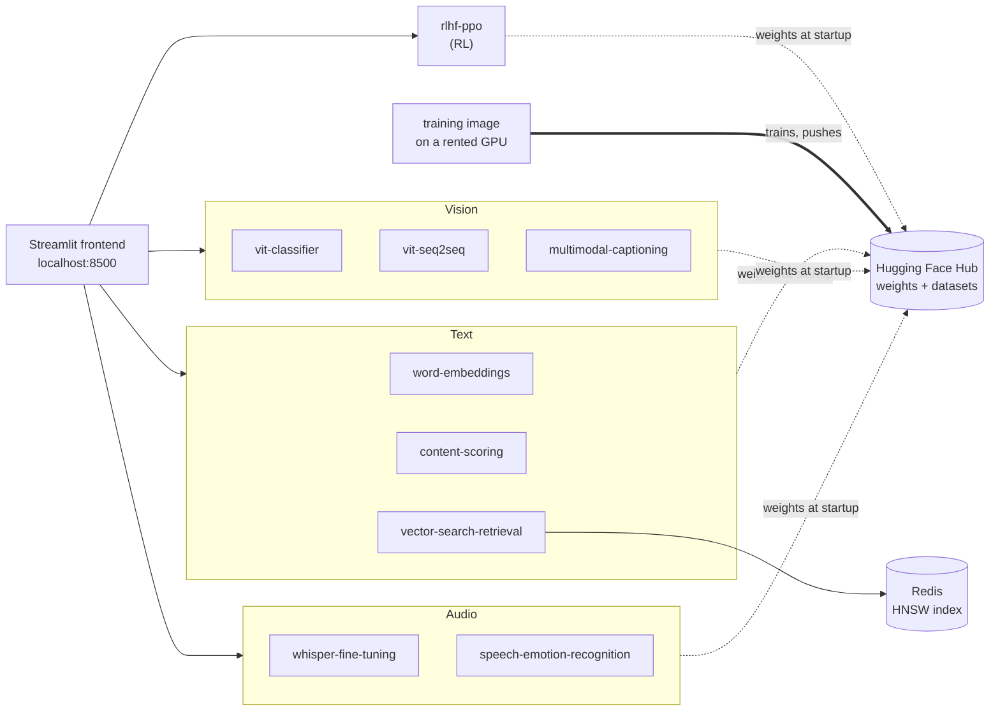

# AI Residency — ML systems, built end to end

Nine machine-learning systems, each taken from scratch to a containerized service, plus the
frontend and the deployment that run all of them. The point isn't only the models — it's the
engineering around them: real architectures implemented from the ground up, one shared library,
one lockfile, and the same images running on three runtimes (a laptop, docker-compose,
Kubernetes).

Every image is public and every checkpoint resolves from the Hugging Face Hub at startup, so
none of this needs credentials, a GPU, or a build.

## Run it

One command. It pulls ten published images and serves all nine systems behind one UI at
**http://localhost:8500**.

```bash
git clone https://github.com/RoshBeed/ai-residency && cd ai-residency/deploy
make up
```

Nothing is built locally — compose pulls `roshb/ai-residency-*` straight from Docker Hub, and
each container fetches its own weights on first start. Expect a few minutes on a cold run while
those downloads happen; each page works as its backend finishes.

```bash
make status     # which backends are up (/health) and which can serve (/ready)
make down       # stop everything
```

If `make up` reports `Bind for 0.0.0.0:8500 failed`, something else already holds that port —
most likely a Helm release of this same chart, whose `LoadBalancer` Service claims it even with
its pods scaled to zero. `make helm-uninstall` frees it.

### If you don't have ~17GB of RAM

Everything at once is heavy, so run the frontend against a subset instead. The pages you didn't
start say so rather than erroring.

```bash
make up SERVICES="word-embeddings vit-classifier"
```

| Service | Resident once loaded | Notes |
|---|--:|---|
| `vector-search-retrieval` | 0.3 GB | Lightest. Pulls in Redis automatically |
| `vit-classifier` | 0.45 GB | Draw a digit, see the real patch grid |
| `vit-seq2seq` | 0.45 GB | Multi-digit, streams tokens as it decodes |
| `content-scoring` | 1.3 GB | |
| `whisper-fine-tuning` | 1.8 GB | Fine-tunes live, per request |
| `word-embeddings` | 2.3 GB | Nearest neighbours and analogies |
| `speech-emotion-recognition` | — | No trained checkpoint yet, so it answers 503 by design |
| `rlhf-ppo` | 4.6 GB | Heaviest, and the most interesting trace |
| `multimodal-captioning` | 5.4 GB | CLIP + Qwen3 |
| the frontend | 0.4 GB | Always started |

Those are cgroup peaks read after each service had loaded its models and answered a real request,
not estimates.

### A single backend, no UI

Each service is independently deployable and answers plain HTTP:

```bash
docker run -p 8000:8000 roshb/ai-residency-word-embeddings-serve
curl -s localhost:8000/ready
curl -s -X POST localhost:8000/nearest \
  -H 'content-type: application/json' -d '{"word": "king", "k": 3}'
```

That container starts with an empty disk, pulls its own checkpoint, and answers.

## How it fits together



A GPU box trains and pushes weights to the Hub; cheap CPU containers pull them and serve. No
service calls another at request time, and nothing depends on a file that happens to sit on one
machine — which is what lets the same images run unchanged on a laptop, under compose, and on a
cluster.

Each backend exposes two endpoints a deployment cares about, from one shared helper in
`libs/common`:

| | meaning | answers |
|---|---|---|
| `/health` | the process is up | always 200 — a missing checkpoint must not restart a pod |
| `/ready` | this instance can serve | **503** until weights are loaded, so an unusable pod stays out of the load balancer |

The Helm chart points `livenessProbe` at the first and `readinessProbe` at the second. Pointing
both at `/health` gives a readiness probe that cannot fail, which is the same as having none.

## The systems

Each links to its own write-up — architecture, method, results and references.

| System | Architecture | What it demonstrates |
|---|---|---|
| [Word embeddings](services/word-embeddings) | CBOW word2vec with negative sampling, from scratch | The whole unsupervised loop written directly — vocabulary, subsampling, negative sampling, training — with no `gensim` and no pretrained vectors |
| [Content scoring](services/content-scoring) | Regression head over frozen CBOW embeddings | Transfer learning onto an encoder this repo produced itself; the head is the only thing trained |
| [Dual-encoder retrieval](services/vector-search-retrieval) | Two-tower retrieval (CBOW + GRU encoders), triplet loss | The offline/online split a real retrieval system has: documents encoded once into an ANN index, queries encoded per request |
| [ViT classifier](services/vit-classifier) | Encoder-only ViT: patch embedding, self-attention, encoder blocks | Attention written out rather than called — no `nn.TransformerEncoderLayer` anywhere |
| [ViT seq2seq](services/vit-seq2seq) | Encoder–decoder ViT: causal decoder, cross-attention, per-sequence EOS | The decoder half — causal masking and cross-attention — sharing one encoder with the classifier through `libs/vision-transformer` |
| [Image captioning](services/multimodal-captioning) | CLIP vision encoder → adapter → Qwen3 decoder | Late fusion across two frozen pretrained backbones, with only the projection adapter trained, and tokens streamed to the browser as they are generated |
| [Whisper fine-tuning](services/whisper-fine-tuning) | Whisper fine-tuned live, per request | A training loop as an HTTP endpoint: five gradient steps, each one streamed as it happens |
| [Speech emotion recognition](services/speech-emotion-recognition) | Emotion as a token Whisper's decoder emits | Extending a pretrained tokenizer with new tokens instead of bolting a classifier head onto the encoder |
| [RLHF / PPO](services/rlhf-ppo) | PPO from scratch — generation, KL penalty, reward, advantage, policy and value updates | All twelve stages of a PPO step written out and exposed one stage at a time, against a real preference-trained reward model |

## Deployment

The same images orchestrated two ways, on top of the single `docker run` above.

```bash
cd deploy
make up                  # docker-compose, frontend on :8500
make helm-install        # Kubernetes, frontend on :8500
```

The chart adds what compose has no equivalent for: liveness and readiness probes, measured memory
requests, a non-root pod security context, a ServiceAccount with no mounted API token, and
NetworkPolicies restricting the backends to the frontend.

Every push to `main` builds all ten images, **smoke-tests each one before pushing it** — non-root,
both probe endpoints registered, working directory writable — and publishes them under a single
`sha-<commit>` tag. `deploy/` pins that tag, so one identifier names a set that was built and
verified together.

```bash
make pin-images TAG=sha-abc123    # repoint compose and the chart together
```

See [`deploy/README.md`](deploy/README.md) for cluster details and the Terraform that provisions a
spot GPU box for training, and [`libs/common/README.md`](libs/common/README.md) for what every
service shares.

## Working on it

```bash
make install    # one venv for the whole workspace
make check      # ruff, strict mypy, pytest — every service
```

Four shared libraries, because three services had grown their own word2vec and two their own
Whisper layer — one per team that worked on them. Consolidating those found real bugs, not
just duplication: a CBOW that crashed on a batch of one, and a Whisper label sequence that
trained the decoder one position out of step with what it was asked at inference.

Strict mypy over every member of the workspace, with no `type: ignore` anywhere in the repo.

```
ai-residency/
├── libs/
│   ├── common/              device, logging, checkpoints, config, Hub, health/ready — used by all
│   ├── vision-transformer/  attention, encoder, decoder, patch embedding — the two ViTs
│   ├── word2vec/            CBOW and skip-gram, negative sampling or softmax
│   └── speech/              Whisper loading, features, labels, decoding
├── services/                one directory per service — package, tests, Dockerfiles, write-up
│   └── frontend/            the Streamlit app, one page per system
├── deploy/                  docker-compose, the Helm chart, Terraform for a GPU training host
├── notebooks/               exploratory notebooks, one folder per system
├── pyproject.toml           the uv workspace: one lockfile, one ruff and mypy configuration
└── Makefile                 install / check / build / push, dispatching on SERVICE=
```

---

*These systems originated as projects in the [Machine Learning Institute](https://ml.institute/)
residency.*
