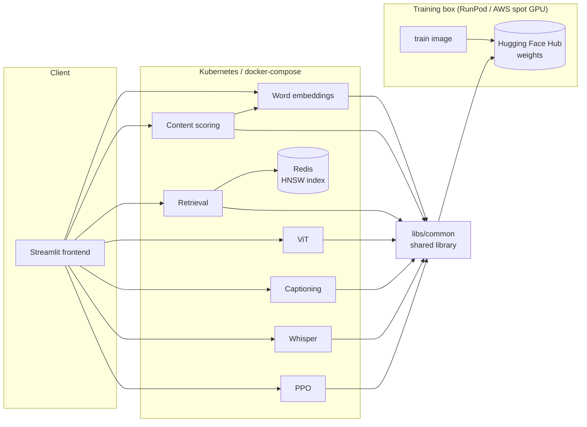

# AI Residency — ML systems, built end to end

Seven machine-learning systems, each taken from scratch to a containerized service, plus the
frontend and deployment that run all of them. The point isn't only the models — it's the
engineering around them: real architectures implemented from the ground up, one shared library,
one lockfile, and identical deployment on three runtimes (macOS, docker-compose, Kubernetes).



A GPU box trains and pushes weights to the Hub; a cheap CPU box pulls them and serves. Neither
needs anything but the image and a token.

## The systems

Each links to its own full write-up — architecture, method, results, references.

| System | Architecture | Demonstrated |
|---|---|---|
| [Word embeddings](services/word-embeddings) | CBOW word2vec with negative sampling, from scratch | Real unsupervised structure in the trained vectors (t-SNE clusters, analogy and similarity checks) |
| [Content scoring](services/content-scoring) | Regression head over frozen CBOW embeddings | Trained end to end on real Hacker News post data |
| [Dual-encoder retrieval](services/vector-search-retrieval) | Two-tower retrieval (CBOW + GRU encoders), triplet loss | Trained towers served through Redis/RediSearch ANN search |
| [Vision Transformer](services/vision-transformers) | From-scratch ViT — a single-digit classifier and a seq2seq multi-digit variant | 95% classifier accuracy, 68% seq2seq exact-match |
| [Image captioning](services/multimodal-captioning) | CLIP vision encoder → adapter → Qwen3 decoder | Full pipeline trained and serving captions end to end |
| [Whisper fine-tuning](services/audio-fine-tuning) | Whisper fine-tuning with emotion-token support | Fine-tuning and data pipeline running end to end, served through FastAPI |
| [RLHF / PPO](services/rlhf-ppo) | From-scratch PPO — generation, KL penalty, reward, advantage, policy and value updates | Full PPO step runs end to end against Qwen3-0.6B-Base |

## Layout

```
ai-residency/
├── libs/common/          shared library: device, logging, checkpoints, config, Hub, tracking
├── services/             one directory per service — package, tests, Dockerfiles, write-up
│   ├── _template/        what `make new-service` copies; a working service, not a skeleton
│   └── frontend/         the Streamlit app, one page per system
├── deploy/               docker-compose, the Helm chart, Terraform for a GPU training host
├── notebooks/            exploratory notebooks, one folder per system
├── pyproject.toml        the uv workspace: one lockfile, one ruff and mypy configuration
└── Makefile              install / check / build / push, dispatching on SERVICE=
```

Every service is independently deployable — its own image, its own Deployment, its own memory
limits. What it is *not* is independently versioned: one commit tags all nine images, and
`deploy/` pins that tag, so the whole system is reproducible from a single identifier.

## Running it

```bash
make install                              # one venv for the whole workspace
make check                                # ruff, strict mypy, pytest, every service
make serve SERVICE=word-embeddings        # one backend on :8000
```

The whole stack, both runtimes:

```bash
cd deploy
make up                                   # docker-compose; frontend on :8500
make helm-install                         # Kubernetes; frontend on :8500
```

See [`deploy/README.md`](deploy/README.md) for the cluster details, and
[`libs/common/README.md`](libs/common/README.md) for what every service shares.

## Adding a service

```bash
make new-service NAME=my-thing
```

Copies `services/_template/`, renames its package and project, and re-locks. The result is
already in the workspace, already linted and type-checked, already picked up by CI.

---

*These systems originated as projects in the [Machine Learning Institute](https://ml.institute/) residency.*
