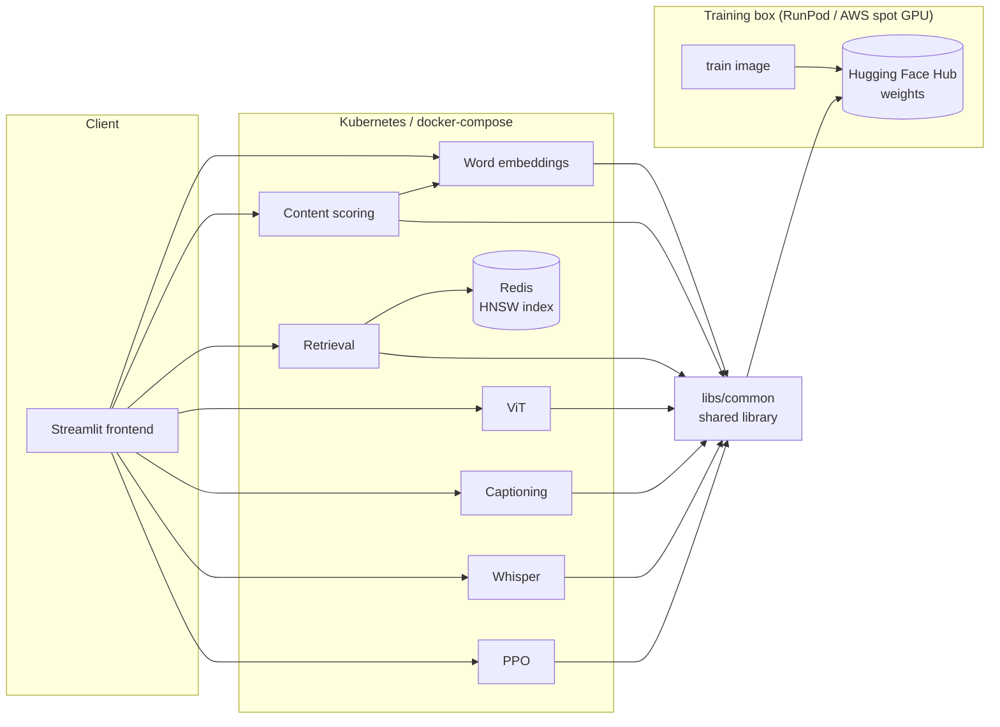

# AI Residency — ML systems, built end to end

Nine machine-learning systems, each taken from scratch to a containerized service, plus the
frontend and deployment that run all of them. The point isn't only the models — it's the
engineering around them: real architectures implemented from the ground up, one shared library,
one lockfile, and identical deployment on three runtimes (macOS, docker-compose, Kubernetes).



A GPU box trains and pushes weights to the Hub; a cheap CPU box pulls them and serves. Neither
needs anything but the image and a token.

## The systems

Each links to its own full write-up — architecture, method, results, references.

| System | Architecture | Demonstrated |
|---|---|---|
| [Word embeddings](services/word-embeddings) | CBOW word2vec with negative sampling, from scratch | Real unsupervised structure in the trained vectors (t-SNE clusters, analogy and similarity checks) |
| [Content scoring](services/content-scoring) | Regression head over frozen CBOW embeddings | Trained end to end on real Hacker News post data |
| [Dual-encoder retrieval](services/vector-search-retrieval) | Two-tower retrieval (CBOW + GRU encoders), triplet loss | Trained towers served through Redis/RediSearch ANN search |
| [ViT classifier](services/vit-classifier) | Encoder-only ViT from scratch: patch embedding, self-attention, encoder blocks | 91.78% on the MNIST test set, against an 11.35% majority baseline |
| [ViT seq2seq](services/vit-seq2seq) | Encoder–decoder ViT: causal decoder, cross-attention, per-sequence EOS | 68.00% exact-sequence match, against 0.10% random |
| [Image captioning](services/multimodal-captioning) | CLIP vision encoder → adapter → Qwen3 decoder | Full pipeline trained and serving captions end to end |
| [Whisper fine-tuning](services/whisper-fine-tuning) | Whisper fine-tuned live on a single clip | `"My name is Roosh."` → `"My name is Rosh"`, in five gradient steps |
| [Speech emotion recognition](services/speech-emotion-recognition) | Emotion as a token Whisper's decoder emits, not a classifier head | Corpus pipeline, extended tokenizer, fine-tuning and serving end to end |
| [RLHF / PPO](services/rlhf-ppo) | From-scratch PPO — generation, KL penalty, reward, advantage, policy and value updates | Full PPO step runs end to end against Qwen3-0.6B-Base |

## Layout

```
ai-residency/
├── libs/
│   ├── common/           device, logging, checkpoints, config, Hub, tracking — used by all
│   └── vision-transformer/  attention, encoder, decoder, patch embedding — used by the two ViTs
├── services/             one directory per service — package, tests, Dockerfiles, write-up
│   ├── _template/        the shape a new service starts from; a working one, not a skeleton
│   └── frontend/         the Streamlit app, one page per system
├── deploy/               docker-compose, the Helm chart, Terraform for a GPU training host
├── notebooks/            exploratory notebooks, one folder per system
├── pyproject.toml        the uv workspace: one lockfile, one ruff and mypy configuration
└── Makefile              install / check / build / push, dispatching on SERVICE=
```

Every service is independently deployable — its own image, its own Deployment, its own memory
limits. What it is *not* is independently versioned: one commit tags every image, and
`deploy/` pins that tag, so the whole system is reproducible from a single identifier.

## Running it

```bash
make install                              # one venv for the whole workspace
make check                                # ruff, strict mypy, pytest, every service
make serve SERVICE=vit-classifier         # one backend on :8000
```

The whole stack. Images are not published yet, so build them locally first — the same
`roshbeed/…:latest` names compose and the Helm chart already reference:

```bash
make base        # roshbeed/ai-residency-base-serve (CPU)
make base-train  # roshbeed/ai-residency-base-train (CUDA)
for s in $(ls services | grep -vE '^(_template)$'); do make build SERVICE=$s; done
```

Serving images carry the CPU build of torch — ~1.6GB, and the right thing for a Kubernetes node.
Training images add the CUDA build on top and target `linux/amd64`, since they run on a rented
NVIDIA box; they are ~10GB and slow to build under emulation, so CI or the GPU host itself is the
better place for them.

```bash
cd deploy
make up                                   # docker-compose; frontend on :8500

make load-images                          # Kubernetes only: see below
make helm-install                         # frontend on :8500
```

docker-compose reads the host's images directly. **Kubernetes does not** — Docker Desktop runs its
node as a kind container with its own containerd store, and `imagePullPolicy: IfNotPresent` means
it silently keeps whatever it already had. `make load-images` imports them; run it after every
rebuild.

See [`deploy/README.md`](deploy/README.md) for the cluster details, and
[`libs/common/README.md`](libs/common/README.md) for what every service shares.

## Adding a service

Copy `services/_template/` to `services/<name>/`, rename its package directory and the
`template` references inside it, then `uv lock`. It is a working service — it trains, serves and
passes its own checks — so the copy runs before you have changed anything.

Everything else picks it up on its own: `SERVICES` in the Makefile is derived from the directory
listing, CI's matrix from the same, and the Dockerfiles copy manifests by glob.

---

*These systems originated as projects in the [Machine Learning Institute](https://ml.institute/) residency.*
