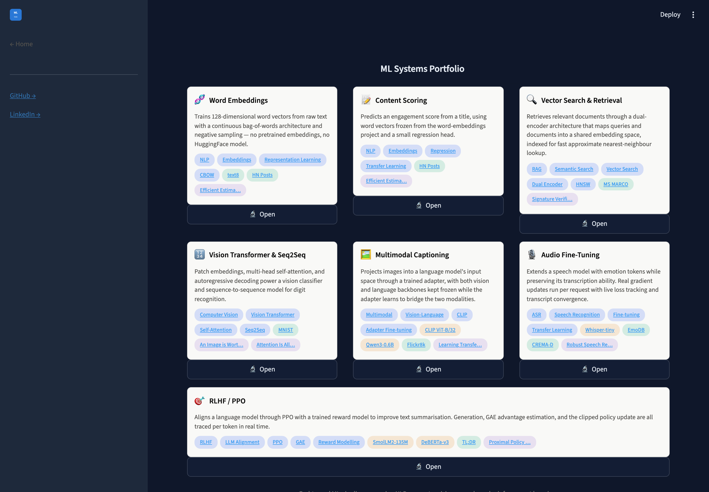
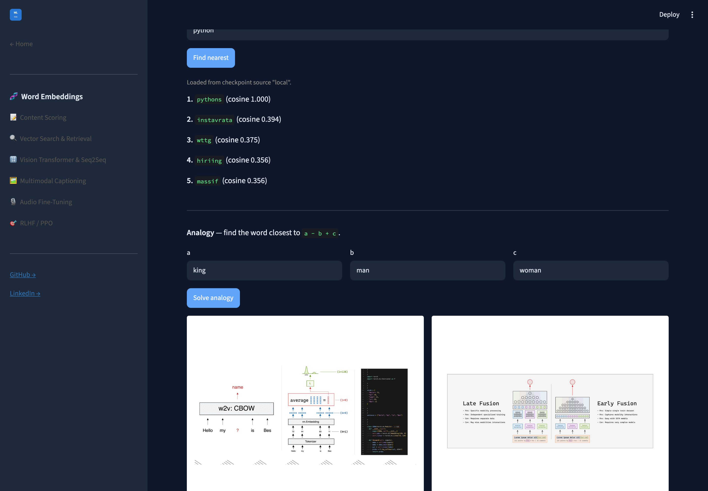

# Deployment

How the portfolio runs: a docker-compose stack for a single `docker compose up`, and a Helm chart
for a real Kubernetes cluster. Same ten containers either way — nine backends, the frontend, and
the Redis the retrieval service indexes into.

Nothing here builds from source. It consumes images built at the repository root
(`make build SERVICE=<name>`), so the deployment description and the code that produced it move
together in one commit.

| | |
|---|---|
| [`../services/`](../services) | The services this deploys, one directory each |
| [`../libs/common`](../libs/common) | Shared helpers every backend depends on |
| [`../services/frontend`](../services/frontend) | The Streamlit frontend that calls them |

## Layout

```
deploy/
├── compose/docker-compose.yml   every backend + Redis + the frontend, one command
├── helm/ai-residency/           the same services as a Helm chart
├── terraform/aws-training/      AWS spot GPU training, an alternative to RunPod
├── Makefile                     up / down / status / load-images / helm-* targets
└── .env.example                 HF_TOKEN, WANDB_API_KEY (optional — both degrade gracefully)
```

## Images come from Docker Hub

Every container is pulled as `roshb/ai-residency-<service>-serve:latest` (or `-train`, or
`roshb/ai-residency-frontend`). They are built and published from the repository root:

```bash
make build SERVICE=word-embeddings
make push  SERVICE=word-embeddings
```

Serving images are published by CI when the service they belong to changes; training images on
demand, by the `Publish training images` workflow.

Backend image names are derived from each `backends` key rather than listed — `image:` is an
override, not a requirement — and `containerPort` / `cpuRequest` come from `backendDefaults`. Which
services mount the Hugging Face cache is a list on `hfCache`; the mountPath is given once and has
to match the `HF_HOME` that `Dockerfile.base` sets, which a test asserts.

The compose file uses `x-` extension fields for the blocks every backend shares — the readiness
healthcheck and the Hub credentials — aliased per service and merged with `<<:` where one needs
extra variables. Compose ignores `x-` keys, which is what they exist for.

**What deploys is `deploy/images.yaml`.** It names each image by immutable digest, and both tools
read it without anything in between:

* It **is** a Helm values file. `helm upgrade -f ../images.yaml` merges it over the chart's
  defaults, so `values.yaml` holds no digests and cannot fall out of step with the manifest.
* Compose substitutes from an env file. The image lines read
  `<repo>${<SERVICE>_REF:-:latest}`, and `make pin-images` writes the digests into
  `compose/images.env` — the only generated artifact left, and the only thing `--check` guards.

This used to rewrite `values.yaml` and `docker-compose.yml` in place with regular expressions and
keep a third generated file to undo the pinning for local builds. CI updates the manifest for
whatever it rebuilt, so `git log deploy/images.yaml` is the deployment history and `git revert` is
the rollback.

Images are published for `linux/amd64` and `linux/arm64`, so the cluster pulls them natively on
either. To run it from images built here instead — for a change that is not published yet, or
just to iterate:

```bash
make local-cluster                              # everything, built natively
make local-cluster SERVICES="word-embeddings"   # or just one
```

That builds the base first (the root `Dockerfile.serve` builds `FROM` it), imports each image into
the node's own store — a `docker build` on the host is invisible to it — and installs *without*
the `images.yaml` overlay, so the chart falls back to `image.tag`. Locally-built images have their
own digests and would never match the ones the manifest names.

That is enough for docker-compose, which reads the host's images directly. **Kubernetes does
not.** Docker Desktop runs its node as a kind container with its own containerd image store, so
a `docker build` on the host is invisible to the cluster — and since `imagePullPolicy` is
`IfNotPresent`, the node keeps running whatever image it already had, with no error and nothing
in `kubectl describe` to say the image is stale. After building, import them:

```bash
make load-images          # docker save | ctr -n k8s.io images import, per image
kubectl rollout restart deployment -n ai-residency
```

Trained checkpoints are a separate concern from the images. Each backend mounts
`../services/<name>/checkpoints` as the fast local path, and also
falls back to pulling weights from the Hugging Face Hub when the mount is empty or absent (see
`libs/common`'s `resolve_checkpoint`). It reports which happened via `checkpoint_source` on
`/health`.

## Quickstart

```bash
docker compose pull       # pull every image from Docker Hub (once pushed)
docker compose up -d
```

Then open http://localhost:8500. Each backend is also reachable directly for debugging:
word-embeddings `:8001`, content-scoring `:8007`, then vector-search-retrieval `:8002` … rlhf-ppo `:8006`.
`make status` curls each one's `/health`, which all seven expose.

**One-time step for vector-search-retrieval:** this stack runs its own independent Redis (`redis`), separate
from — and starting empty, unlike — the original vector-search-retrieval repo's own persistent one. Populate it once
after the first `up`:

```bash
docker compose exec vector-search-retrieval uv run python -m retrieval.save_doc_embeddings_to_redis
```

Without this, vector-search-retrieval's `/query` page returns an empty result set (not an error — just nothing to
retrieve yet).

All seven backends answering `/health` under compose, and the frontend serving the portfolio
at `:8500`:



**Known constraint, confirmed empirically, not just theoretical:** Docker Desktop's VM has a fixed
memory ceiling (~7.65GB on the machine this was built on — check `docker stats`/Docker Desktop's
resource settings on yours). Running all the backends for an extended period eventually OOM-kills
one of the heavier ones (observed here: multimodal-captioning after ~25 hours, rlhf-ppo shortly after that) —
`docker compose ps -a` will show `Exited (137)` for whichever one got killed. This isn't a bug in
this repo — it's Docker Desktop's own memory ceiling. Fix: `docker compose up -d <service>` restarts
just that one; give Docker Desktop more memory in its settings if you want long sustained uptime
for the full stack; or don't run all of them for days at a stretch on a constrained host.

**Checkpoint mounts are writable on purpose.** The Hub fallback downloads into the same directory
it looked in, so mounting `checkpoints` read-only turns "fall back to the Hub" into a guaranteed
`[Errno 30] Read-only file system` on exactly the hosts that have no local copy.

## Kubernetes (Helm)

`helm/ai-residency/` is the Kubernetes analog of `docker-compose.yml` — the same ten containers
(nine backends + frontend) plus the retrieval service's Redis, expressed as Deployments/Services instead of compose
services.

```bash
make helm-install         # helm install ... -f images.yaml, so the release is pinned to the manifest
```

Then open http://localhost:8500 — Docker Desktop's Kubernetes auto-binds `LoadBalancer` services to
localhost, so the frontend Service is reachable with no port-forward needed. The backends are
deliberately `ClusterIP`-only (mirrors the real shape: only the frontend talks to them directly) —
reach one directly for debugging with `kubectl port-forward -n ai-residency svc/word-embeddings 8001:8000`
(repeat per backend, ports 8001–8007 to match compose's numbering). Same one-time step as the compose
version to populate vector-search-retrieval's (independent, starts-empty) Redis index:

```bash
kubectl exec -n ai-residency deploy/vector-search-retrieval -- uv run python -m retrieval.save_doc_embeddings_to_redis
```

`make helm-upgrade` re-applies the chart *and* runs `kubectl rollout restart deployment` afterward —
needed because a fixed `latest` tag means the manifest itself never changes when the underlying
image is rebuilt, so `helm upgrade` alone wouldn't actually roll already-running pods onto a freshly
pulled image. `make helm-uninstall` tears the release down (the namespace is left in place);
`make helm-status` shows pod/service state.

**No hostPath mounts, and no checkpoint volumes.** Every service resolves its weights and
datasets from the Hugging Face Hub at startup, so there is nothing on the node for a pod to depend
on. That is what lets the same release install on a cluster that has never trained anything.

The one volume left is the Hugging Face cache, and it is a convenience rather than a dependency —
an empty cache only means a slower cold start. It defaults to an `emptyDir`, per pod, discarded on
restart:

```yaml
hfCache:
  mode: none        # or "hostPath" (single-node) or "pvc" (anywhere)
```

`hostPath` is faster on a single-node cluster but carries a constraint found by deploying rather
than by reading: the pods run as UID 1000, `fsGroup` does not apply ownership to hostPath volumes,
and a cache directory owned by root is then readable but **not** writable. That fails only when
the cache misses — so it appears to work on a machine whose cache is already warm and breaks on a
fresh one. Use it only with a directory the pod's UID owns:

```bash
mkdir -p /srv/hf-cache && sudo chown -R 1000:1000 /srv/hf-cache
helm upgrade ... --set hfCache.mode=hostPath --set hfCache.hostPath=/srv/hf-cache
```

A PersistentVolumeClaim is the multi-node answer, and does honour `fsGroup`.

**Health probes gate traffic, and the two paths are different on purpose.** `/health` is liveness
and always answers 200, so a model that is slow to load — or absent — never gets a pod restarted.
`/ready` answers 503 until the service can actually serve, which is what takes an unusable pod out
of its Service's endpoints instead of routing traffic it can only reject. Pointing both at
`/health`, which this chart used to do, gives a readiness probe that cannot fail — the same as
having none. The startup probe carries a deliberately generous
budget (up to 10 minutes) because a cold start may pull weights from the Hub, and Kubernetes
suppresses the liveness probe while it runs, so a slow-but-healthy load is never mistaken for a
hang and restarted in a loop.

**Deployments use `strategy: Recreate`, not the default `RollingUpdate`.** A rolling update starts
the replacement pod before retiring the old one, so the node needs two copies' worth of memory at
once. These pods request 1.5–6GiB each and the full set already sits near a single node's
allocatable, so the surge pod stays `Pending` — and since the old pod is only retired once the new
one is Ready, the rollout deadlocks instead of finishing (observed on `make helm-upgrade`: vector-search-retrieval,
multimodal-captioning and rlhf-ppo all stuck on `Insufficient memory`). A few seconds of downtime per deploy is the
right trade here. On a real multi-node cluster, drop it. Note that switching an existing release to
`Recreate` needs a reinstall, since the live Deployment still carries `rollingUpdate` fields.

**Memory ceiling — confirmed empirically, worse under Kubernetes than under compose:** under
compose an OOM-killed container just stays stopped, but under Kubernetes a Deployment's default
`restartPolicy: Always` immediately recreates the pod, which re-competes for the same scarce
memory and is killed again — confirmed on first install: 8 pods starting simultaneously with no
resource requests produced an infinite crash loop across the whole namespace. Every container now
sets `resources.requests.memory` and `resources.limits.memory` (`memoryRequest`/`memoryLimit` in
`values.yaml`), so the scheduler refuses to place what does not fit and a pod sits `Pending`
instead of the set thrashing.

The requests total roughly 17.5GiB, so whether all nine pods fit depends entirely on how much
memory Docker Desktop is given — its default leaves the node well short, and some pods stay
`Pending` until it is raised. Read the real budget rather than trusting a number here:

```bash
kubectl get node -o jsonpath='{.items[0].status.allocatable.memory}'
```

At 23.4GiB allocatable all nine schedule and stay `Running` with zero restarts. Otherwise, either
raise Docker Desktop's memory (the VM restart bounces every pod, and one that was already
`Pending` beforehand may need a `kubectl delete pod <name>` nudge to be re-evaluated) or free room
with `kubectl scale deploy/multimodal-captioning -n ai-residency --replicas=0`.

Real inference through the cluster — the frontend on the `LoadBalancer`, calling word-embeddings'
`ClusterIP` Service, which resolved its checkpoint and returned genuine nearest neighbours:



**If anything is also running outside the cluster, stop it first — confirmed to actually happen:**
this repo's own `docker compose up` stack, *and* any standalone container left running from
`docker compose up` (leftover containers from verifying a service on its own) both
stand up real, heavy containers that compete for the exact same memory budget as the cluster.
`docker ps` shows Kubernetes-managed containers with a `k8s_<container>_<pod>_<namespace>_...` name
prefix — anything without that prefix is running outside the cluster. `docker compose down` (from
either one) clears it.

## Deploying to real hosts (RunPod / AWS / Hetzner)

The portfolio is built to split across two machines that share no filesystem: a GPU box that trains
and a cheap VM that serves. What connects them is the Hugging Face Hub — training pushes a
checkpoint, serving pulls it. Neither box needs anything from this Mac. This was rehearsed locally
before spending anything on it: every backend was started with its checkpoint deliberately hidden
and confirmed to pull from the Hub and return identical output.

### Credentials

Both boxes read a `.env` (see `.env.example`). `libs/common` loads it on import, walking up from the
working directory, so one file beside several repos covers all of them.

```bash
HF_TOKEN=hf_...          # write on the training box, read on the inference box
WANDB_API_KEY=...        # training box only; without it runs go offline, not missing
```

**The model repos are private.** An inference box without `HF_TOKEN` will not fail loudly — it will
warn, serve an untrained model, and report `checkpoint_loaded: false`. Check `/health` after a
deploy rather than assuming a 200 means it is working.

### Training box

```bash
git clone https://github.com/RoshBeed/ai-residency && cd ai-residency
cp .env.example .env      # fill in both tokens
uv sync
AI_RESIDENCY_NUM_EPOCHS=50 make train
```

Any config field is overridable as `AI_RESIDENCY_<FIELD_NAME>`, so a real run needs no code edit. On a new
best checkpoint the run saves locally, pushes to the Hub, and logs to W&B; a failed push is logged
and does **not** end the run.

Per-repo caveats worth knowing before you rent anything:

| Repo | Caveat |
|---|---|
| `word-embeddings` | `train-corpus` needs a Hacker News Postgres mirror that is not publicly reachable; `train-cbow` works from data on the Hub. |
| `content-scoring` | Trains only the regression head; pulls the frozen CBOW vectors from the word-embeddings Hub checkpoint. |
| `vector-search-retrieval` | Needs Redis for serving (not for training). `make serve` is the HTTP service; `make query` is an interactive CLI. |
| `vit-classifier` / `vit-seq2seq` | Separate epoch caps — the classifier reads `AI_RESIDENCY_CLASSIFIER_EPOCHS`, not `AI_RESIDENCY_NUM_EPOCHS`. |
| `multimodal-captioning` | `make train` overwrites a **committed** adapter. Set `AI_RESIDENCY_CHECKPOINT_NAME` to something else. Pins itself to CPU: MPS training here was non-reproducible. |
| `whisper-fine-tuning` / `speech-emotion-recognition` | Nothing special. They used to need the system `ffmpeg` binary, which `openai-whisper` shelled out to; both are on `libs/speech` now and read audio through libsndfile. |
| `rlhf-ppo` | One PPO step, deliberately — there is no epoch loop, because nothing here trains the reward model. |

### AWS EC2 spot GPU — alternative to RunPod

`infra/aws-training/` is Terraform that provisions a single AWS spot GPU instance, pulls a pushed
`roshb/ai-residency-<service>-train` image (built from the root `Dockerfile.train`,
`make push SERVICE=<name>`), runs it, and terminates itself when training finishes or times out. It
moved here from the vision-transformer work (where it started as a single-service script) because it isn't specific to one service
infrastructure — `train_image` picks which service's already-built image to run.

```bash
cd infra/aws-training
cp terraform.tfvars.example terraform.tfvars   # at minimum: train_image, hf_token
terraform init
terraform plan      # review before spending anything
terraform apply     # provisions a real, billable spot instance
```

`terraform output` prints the shell and log commands for a running instance; `terraform destroy`
tears it down by hand, though it terminates itself on completion. Full detail — including two real bugs found while
generalizing this out of one service's own copy (a Terraform template referencing undefined variables, and a
duplicate output definition — either alone means the original could never have passed
`terraform validate`) — is in `infra/aws-training/README.md`.

### Inference box

```bash
git clone https://github.com/RoshBeed/ai-residency && cd ai-residency
cp .env.example .env      # HF_TOKEN alone is enough
uv sync
make serve
curl localhost:8000/health
```

No checkpoint needs copying. The first request resolves it: local file if present, Hub otherwise.
Expect `"checkpoint_source": "hub"` on a fresh box — that is the whole mechanism working. A
container works the same way, with no volume at all: `docker pull roshb/ai-residency-<service>:latest`
then `docker run -e HF_TOKEN="$HF_TOKEN" -p 8000:8000 roshb/ai-residency-<service>:latest`.

## Related

The frontend and the full write-up for every service live in `services/frontend`. The
backend services are container source only: they share the repository's two root Dockerfiles
(`Dockerfile.train` for a RunPod/AWS GPU host, `Dockerfile.serve` for Kubernetes), each selected
by `--build-arg SERVICE=<name>`, plus a short technical README:

[Word embeddings](https://github.com/RoshBeed/ai-residency/tree/main/services/word-embeddings) ·
[Content scoring](https://github.com/RoshBeed/ai-residency/tree/main/services/content-scoring) ·
[Dual-encoder retrieval](https://github.com/RoshBeed/ai-residency/tree/main/services/vector-search-retrieval) ·
[ViT classifier](https://github.com/RoshBeed/ai-residency/tree/main/services/vit-classifier) ·
[ViT seq2seq](https://github.com/RoshBeed/ai-residency/tree/main/services/vit-seq2seq) ·
[Image captioning](https://github.com/RoshBeed/ai-residency/tree/main/services/multimodal-captioning) ·
[Whisper fine-tuning](https://github.com/RoshBeed/ai-residency/tree/main/services/whisper-fine-tuning) ·
[Speech emotion recognition](https://github.com/RoshBeed/ai-residency/tree/main/services/speech-emotion-recognition) ·
[RLHF / PPO](https://github.com/RoshBeed/ai-residency/tree/main/services/rlhf-ppo)
