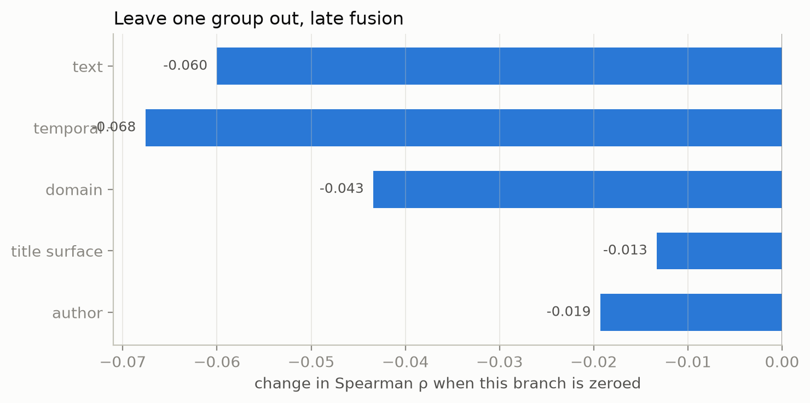

# Hacker News Score Prediction (Early vs Late Fusion)

## TL;DR

- **What it is:** predicting a Hacker News post's score from its title and the metadata you have at
  submission time, built four ways — text alone, metadata alone, early fusion, late fusion — so the
  comparison between them is a measurement rather than an assertion.
- **The data:** 872,554 posts, Nov 2023 – Aug 2026, split by time. The corpus and the pipeline that
  builds it both run from scratch with no credentials.
- **The vocabulary:** the sibling project's text8 vectors extended onto the Hacker News title
  corpus. Out-of-vocabulary tokens fall from **11.3%** of a title to **3.2%**.
- **Result today:** see [Results](#1-results).

This is the second half of Week 1. The [word-embeddings
project](https://github.com/RoshBeed/ai-residency/tree/main/services/word-embeddings) trains the
word vectors; this one puts them to work on a task where the title is only part of the story, and
asks where the text and the metadata should meet.

## Contents

1. [Results](#1-results) — the comparison, the slices, what the features contribute
2. [The data](#2-the-data) — where it comes from and why the split is by time
3. [Extending the vocabulary](#3-extending-the-vocabulary) — text8 has never heard of `gpt-4`
4. [The four architectures](#4-the-four-architectures) — early, late, and the two ablations
5. [Evaluation](#5-evaluation) — what is measured, and against what floor
6. [Usage](#6-usage) — run it, sweep it, deploy it
7. [Implementation](#7-implementation) — the file map

## 1. Results

Held-out test period, 69,275 posts from June to August 2026, never seen during training or
tuning. Each architecture trained at three seeds with every hyperparameter held equal; ± is half
the seed range.

| model | test ρ | NDCG@10 | top-decile lift |
|---|---|---|---|
| predict the mean | n/a | 0.034 | 1.01 |
| hour mean | 0.111 | 0.026 | 1.11 |
| domain mean | 0.217 | 0.079 | 2.41 |
| TF-IDF + Ridge | 0.246 | 0.088 | 2.07 |
| text only | 0.271 ±0.003 | 0.074 | 1.80 |
| features only | 0.317 ±0.004 | 0.099 | 1.91 |
| early fusion | 0.359 ±0.004 | 0.106 | 2.11 |
| **late fusion** (served) | **0.368** ±0.002 | 0.106 | 2.19 |

**Figure 2.** The four architectures against the four baselines.


Predict-the-mean has **no** Spearman rather than a Spearman of zero: a constant prediction cannot
order anything, so the correlation is undefined. Reporting 0.0 there would assert something the
metric does not say.

### The result the comparison was built for

Each modality alone lands near 0.27–0.32. Together they reach 0.37. The title and the metadata
carry substantially different information rather than the same signal twice — which is the claim
the two ablations exist to test, and it would have been unfalsifiable without them.

The seed spread is 0.002–0.004, so those gaps are real: fusion beats the stronger ablation by 0.05,
and that is fourteen times the noise.

**Both fusion models beat TF-IDF + Ridge by about 0.12**, which is the number that says the neural
work earned its keep. Not every result here is flattering, though — see the honest reading below.

### Late fusion wins, but only where capacity is scarce

Late fusion leads by 0.0095 at the tuned configuration, about five times the seed spread. But that
configuration is one hidden layer per branch, and depth is exactly the axis the two architectures
should differ on: late fusion is *handed* the group structure, early fusion has to discover it.

**Figure 3.** Depth against test Spearman, three seeds a point.


| layers | early fusion | late fusion | |
|---|---|---|---|
| 1 | 0.3605 ±0.0026 | **0.3683** ±0.0019 | late by 0.0079 |
| 2 | 0.3596 ±0.0049 | 0.3598 ±0.0027 | tied |
| 3 | 0.3538 ±0.0068 | 0.3514 ±0.0032 | early by 0.0024 |
| 4 | **0.3577** ±0.0009 | 0.3430 ±0.0094 | early by 0.0147 |

The ordering flips, and it flips in the direction the mechanism predicts. But the honest reading is
not "early fusion gets better with capacity" — **neither does.** Both are worse at four layers than
at one. Early fusion overtakes by *degrading more slowly*, not by improving, and the best result on
this page belongs to the smallest late-fusion model.

The parameter panel makes that sharper. Late fusion carries five branches and a head, so at equal
width and depth it is roughly four times the size: 1.15M parameters at four layers against early
fusion's 290k. It is the larger model and it loses at depth, which is the opposite of a capacity
story. What the depth axis is really measuring here is how gracefully each architecture absorbs
parameters it does not need — and a structure that partitions its input tolerates that worse than
one flat MLP.

So: late fusion is what ships, and the architectural advantage it has is real but narrow and
confined to the small-model regime. On this dataset the interesting finding is not which fusion
wins; it is that fusing at all is worth 0.05 while the choice between the two is worth 0.01.

### What the model is actually using

**Figure 4.** Leave one branch out of the late-fusion model.



| branch removed | test ρ | change |
|---|---|---|
| nothing | 0.3660 | — |
| temporal | 0.2984 | **−0.068** |
| text | 0.3059 | −0.060 |
| domain | 0.3225 | −0.043 |
| author | 0.3467 | −0.019 |
| title surface | 0.3527 | −0.013 |

**When a post was submitted matters slightly more than what it says.** That is a genuinely
uncomfortable result for a project about titles, and it is the strongest argument in the README for
having built `features_only` at all.

Author history contributes only −0.019, which surprised me — it is supposed to be the strongest
single signal on Hacker News. The causal window is the reason: a feature restricted to an author's
*strictly earlier* posts is far weaker than one computed over the whole dataset, and the latter is
what a leaky implementation would have measured. The low number is the correct one.

### Where it works and where it does not

**Figure 5.** Test Spearman by slice.


Three things worth naming:

- **`Show HN` posts are much harder** — 0.17 against 0.38 for plain titles. They compete on what
  was built rather than on how it is described, and the title carries less of that.
- **Ranking within a score quartile is close to hopeless** (0.05–0.10). Nearly all the model's
  power is in separating the bands, not in ordering inside one. The second quartile is undefined:
  a quarter of Hacker News posts score exactly 3, and there is no order to recover.
- **The vocabulary extension paid off where it was supposed to.** Titles with no out-of-vocabulary
  tokens score 0.37, those with more than a quarter unknown score 0.25. The gap is what the
  extension narrows, and it is why the OOV slice is in the harness at all.

### What I would not claim

The published checkpoint for each architecture is the last of its three seeds, not the best — the
table above reports the mean and spread across all three, which is the honest summary, but the
served weights are one draw from that distribution rather than a cherry-picked one.

`NDCG@10` separates the architectures far less than Spearman does (0.106 for both fusion models).
Ranking the top ten of a given day is a harder and noisier problem than ranking the whole period,
and I would not use it to choose between architectures on this evidence.

**The predictions are compressed, and the service reports them as if they were not.** Asking the
running API for four very different posts returns 2.1 to 4.5 upvotes — a clickbait Medium link at
2.1, an `Ask HN` at 3.9, an arXiv paper at 3.6. The *ordering* is right, which is what ρ = 0.37
measures and what the task asks. The magnitudes are not: an MSE on `log1p` against a distribution
with a median of 3 and a maximum of 5,710 pulls almost everything toward the middle, so the model
essentially never predicts a front-page score.

That makes "predicted score" a slightly dishonest label on the API and the UI. It is a *ranking*,
presented in upvote units because upvotes are the unit people think in. The right fix is to
calibrate the output — isotonic regression on the validation split would map the compressed
predictions back onto the score distribution without touching the ranking — and until that exists
the number should be read as "this post ranks like a 2" rather than "this post will get 2 upvotes".

## 2. The data

872,554 Hacker News stories from **4 November 2023 to 9 August 2026**, carrying `id`, `title`,
`url`, `score`, `time`, `author` and `comments`.

The corpus is mirrored at
[`roshbeed/ai-residency-hn-posts`](https://huggingface.co/datasets/roshbeed/ai-residency-hn-posts).
Mirroring rather than reading the upstream directly is not ceremony: the upstream says it updates
regularly, so a published number measured against it would quietly stop meaning anything the next
time it did. The mirror is written once and never moves.

**What this replaces.** The service used to train on 782 posts — a slice pulled from a Postgres
mirror the course provided, cleaned, and uploaded. That host is unreachable now and the slice is
gone, so the corpus could not be rebuilt; the config said as much in a comment. Reproducing *that
file* was never the goal. Being able to go from a raw corpus to a trained model on any machine
was, and that is what `make etl && make extend-vocab && make train && make evaluate` now does,
with no credentials at any step.

### Only the raw corpus is published

Cleaning and splitting are deterministic code over an input that never changes, so the splits are
reproducible without being uploaded. Publishing a cleaned copy as well would create a second
artifact that can drift from the code that produces it, and buy nothing — `data/` is a local cache
and deleting it costs a few minutes.

Two things have to actually be deterministic for that to hold, and both have a test:

- Rows are sorted by `(time, id)`, not by `time`. The author features are an expanding window over
  that order, so posts sharing a timestamp would otherwise be ordered arbitrarily and the feature
  would differ between machines.
- The domain vocabulary and the scaling statistics are fitted on the training split alone.

### Reproducible means re-derivable

`make etl` reads the mirror. `make etl-verify` reads the **Hacker News API** — the real upstream,
unauthenticated — and checks the mirror against it. On a 600-post sample, 597 were still present
and 591 titles matched byte for byte; the six that differ are moderator edits made after the
snapshot, which is what you would expect and worth knowing rather than assuming.

Crawling all 872k items that way takes hours and buys nothing a spot check does not, so the API
path is bounded by `--max-items`. The point is that the corpus *can* be re-derived from source,
not that it is re-derived nightly.

### Split by time, not at random

| split | period | posts |
|---|---|---|
| train | 2023-11-04 → 2026-02-28 | 710,722 |
| val | 2026-03-01 → 2026-05-31 | 92,557 |
| test | 2026-06-01 → 2026-08-09 | 69,275 |

A random split leaks. Scores drift over three years, and posts from the same day compete for the
same front page — so a model trained on a random 80% has seen the neighbourhood of every test row
it will be asked about. It reports a number that will not survive contact with a real post.

### The target is `log1p(score)`

Scores run from 1 to 5,710 with a **median of 3** and a mean of 19.2; 24.4% of posts score exactly
1. A squared error on that raw scale is dominated by a few hundred front-page posts, and the model
learns to predict the tail. In log space the residuals are roughly symmetric and every post
contributes.

**Figure 1.** The score distribution, raw and logged.


The left panel is on log-log axes rather than clipped, because clipping the tail into a final bin
draws a spike that reads as a mode the data does not have.

**`comments` is never a feature.** The comment count correlates strongly with the score and is not
known when a post is submitted. A model using it would score beautifully offline and answer a
question nobody asked.

## 3. Extending the vocabulary

text8 is lowercase, alphabetic Wikipedia from 2006. It has no `gpt-4`, no `kubernetes`, no
`postgres`, no `llm` — and those are most of what a Hacker News title is about. Scoring a title
through that vocabulary throws away the part that carries the signal.

So this service extends it, without touching the sibling project:

1. Count tokens over the **training** titles only — vocabulary is fitted state, and building it
   over val or test would leak the evaluation into the model.
2. Keep the pretrained ids exactly where they are, `0..71289`, and append new words above them.
   Every existing row keeps its meaning, so the extended matrix is still readable by anything that
   understood the original.
3. Continue training skip-gram on the titles, starting from the pretrained weights.

| | before | after |
|---|---|---|
| vocabulary | 71,290 | **86,438** |
| out-of-vocabulary tokens per title | 11.33% | **3.18%** |

The tokeniser keeps `gpt-4`, `c++`, `node.js`, `f#` and `k8s` whole. Splitting on every non-letter
would discard exactly the vocabulary this stage exists to add — and did, at first: the pattern
required an alphanumeric after every `+`, so `c++` tokenised to `c`. A test caught it.

**The negative sampler uses Hacker News counts only.** A word absent from the titles has count
zero, so it is never drawn as a negative and never appears as a centre — its row simply does not
move. 27,631 of the 71,290 pretrained rows are in that position. That is the behaviour a freeze
mask would be written to produce, and here it falls out of the counts instead.

**Windows do not cross title boundaries.** Titles average eight tokens, so a sliding window over a
concatenated stream would spend much of its context on the previous, unrelated headline. Pairs are
built per title: 36.9M of them, from 5.7M in-vocabulary tokens.

### Continuing training damages the vectors it started from

The extension stage re-runs the sibling project's own benchmarks on the extended matrix, because
"did adding 15,148 rows break the 71,290 that were already there" is a question with an answer and
not a thing to assume. It is the check that earned its keep fastest in this project.

| | WordSim-353 ρ | SimLex-999 ρ | extend loss | title OOV |
|---|---|---|---|---|
| text8 only, before extending | 0.726 | 0.297 | — | 11.33% |
| extended, all rows trainable | **0.577** | 0.262 | 2.43 | 3.18% |
| extended, pretrained rows frozen | 0.726 | 0.295 | 3.50 | 3.18% |

Letting every row train fits the Hacker News corpus better — the loss is a full point lower — and
costs **0.149 of WordSim-353** doing it. 5.7M tokens of headlines is not enough signal to re-place
71,290 vectors, so what it mostly does is drag them toward title co-occurrence and away from the
general relatedness the benchmark measures.

Freezing the pretrained rows keeps them exactly where the sibling project left them, at the *same*
out-of-vocabulary rate — the new words are still learned, they are just learned into the existing
space rather than alongside a moving one. That is what ships.

The small SimLex-999 movement under freezing, 0.297 → 0.295, is not the frozen rows drifting; they
cannot. Coverage rose from 99.30% to 99.60% as the added vocabulary made three more pairs
scoreable, so the two numbers are over slightly different sets. Reporting coverage beside every
correlation is what makes that visible rather than mysterious.

## 4. The four architectures

All four see the same inputs, the same target and the same widths. The only thing that differs is
where the title and the metadata meet.

```
text_only        title -> pool -> MLP ------------------> score
features_only                     MLP(features) --------> score
early            title -> pool -> MLP(concat(both)) ----> score
late             title -> pool -> MLP ---.
                 temporal  -> MLP -------|
                 domain    -> MLP -------+-> head MLP --> score
                 surface   -> MLP -------|
                 author    -> MLP -------'
```

**Early versus late is a question about capacity, not about information.** Both see everything.
Early fusion has one MLP over the lot, so it can model any interaction between a word in the title
and the hour it was posted — but it has to discover the group structure itself, and spends
parameters doing so. Late fusion hands each group its own tower, so each learns a representation
without interference and the head sees four summaries. Cheaper, and better when the groups really
are separable; worse when the interactions matter.

**The two ablations are not filler.** `features_only` is a genuinely strong model on Hacker News —
the domain and the hour carry a lot — so the fusion models have to beat *it* before "the title
matters" is a claim rather than an assumption. `text_only` says how much the title carries alone.

### The features

Everything here is knowable at submission time.

| group | features |
|---|---|
| `temporal` | hour and weekday as sin/cos pairs, weekend flag, and a normalised drift term |
| `domain` | the site the post links to, as a learned embedding; `has_url` |
| `title_surface` | word and character count, mean word length, digits, question mark, capitalised words, bracket tags like `[pdf]`, and a `Show HN` / `Ask HN` / `Tell HN` / `Launch HN` prefix |
| `author` | mean `log1p(score)` over the author's **strictly earlier** posts, prior post count, and a first-post flag |

Hour and weekday are cyclic encodings because hour 23 and hour 0 are adjacent, and a raw integer
tells the model they are twenty-three apart.

A text post is `<none>`, a real category rather than a missing value: 5.6% of posts are self-posts
and they behave differently from linked ones. A domain unseen in training becomes `<rare>` rather
than being dropped — a new site appearing in the test period is exactly the case the model has to
handle.

### The author feature is the leak in this problem

An author's mean score is the single strongest signal on Hacker News, and computing it the obvious
way is how you accidentally read the answer off the feature. `author_history` walks the corpus
forward in time and, for each row, uses only what was already published:
`expanding().mean().shift(1)` per author, over a frame sorted by `(time, id)`.

The `shift(1)` is the whole thing. Without it a row's own score is inside its own mean. With it, an
author's first post has no history at all, which a flag marks so the model can tell "no history"
from "history of zero".

Val and test rows legitimately see train-era history — that is information a real submitter would
have had. What they cannot see is the future, and there is a test that appends a 5,000-point post
and asserts the earlier rows' features are unchanged.

## 5. Evaluation

`make evaluate` is the single source of every number in this section. `train.py` calls the same
harness each epoch and streams all of it to W&B alongside the loss, so a chart and this table
cannot disagree — there is nowhere for them to drift.

**Spearman ρ** is the headline: the task is a ranking question, and a model that predicts every
score 20% low ranks perfectly while its RMSE says it failed.

**Per-day NDCG@10 and precision@10** are the honest version of that. A global ρ over three months
rewards a model for learning the drift, which is real but is not what anyone wants to know.
Ranking within each day asks whether, among the posts competing for one front page, the model
picks the ones that made it.

**Four baselines**, printed as rows of the same table:

| baseline | what it is |
|---|---|
| predict the mean | the floor. ρ = 0 and R² = 0 by construction |
| hour mean | the training mean for that hour of day |
| domain mean | the training mean for that domain |
| **TF-IDF + Ridge** | 1–2 grams over the title, `sparse_cg`. The strong, cheap, conventional text model — the one that decides whether any of the neural work earned its keep |

A metric without its floor is how this repo once shipped a model reporting a loss of 10.02 against
an untrained 11.09. The harness also scores randomly-initialised models, and `make
evaluate-untrained` runs that before any training exists — an eval harness first exercised on a
trained model gives you no way to tell a real score from a bug.

**Slices** say where the model is wrong rather than only how wrong: by score quartile, domain
bucket, `Show HN` / `Ask HN` / plain, weekday, and title OOV fraction. That last one is what says
whether extending the vocabulary helped the titles it was built for or merely added rows.

## 6. Usage

```bash
make -C services/content-scoring etl            # fetch the mirror, build the splits
make -C services/content-scoring extend-vocab   # add the corpus's words to the vectors
make -C services/content-scoring train          # train one architecture
make -C services/content-scoring evaluate       # score every trained architecture
```

Every input is a public Hub repo, so the whole chain runs with no credentials. A token is needed
only to push, and for data that happened once — `make mirror` created the corpus mirror and is not
part of a normal run.

### The comparison table

```bash
make -C services/content-scoring train-all      # four architectures x three seeds
```

The sweep searches the space; these twelve runs hold every hyperparameter equal and vary only the
seed, which is what makes "late beats early by 0.02" a claim rather than a coincidence.

### Sweeps

```bash
wandb sweep services/content-scoring/sweep.yaml
make -C services/content-scoring sweep SWEEP=<id> COUNT=60
```

`fusion` is swept rather than run as four separate jobs, so the head-to-head comes out of one
search with everything else held comparable. `vocab_min_count` and `min_domain_count` are
deliberately **not** swept: both change the input representation rather than the model, so varying
them would change what the test set contains and make runs incomparable.

### Serving

```bash
make -C services/content-scoring serve
curl -s localhost:8000/compare -H 'content-type: application/json' \
  -d '{"title": "Show HN: I built a thing", "url": "https://github.com/me/thing"}'
```

`/predict` scores with one architecture; `/compare` runs all four over the same post; and
`/predict/stream` relays the pipeline a stage at a time, which is what the Streamlit page shows.

## 7. Implementation

```
content_scoring/
├── etl.py           Fetch, clean and split the corpus; the API cross-check
├── vocab.py         Extend the text8 vocabulary onto the title corpus
├── features.py      The four feature groups, and the causal author history
├── data.py          Splits as tensors; padded titles and a mask
├── model.py         The four architectures behind one build_model
├── train.py         The epoch loop; streams the eval harness to W&B
├── evaluate.py      The harness: metrics, baselines, slices, ablation, probes
├── predict.py       Scoring one post, through the same code as the corpus
├── embeddings.py    Loading the extended vectors
└── report.py        The figures, drawn from the harness output
config/__init__.py   Config(BaseConfig) — every hyperparameter and path
serving/api.py       FastAPI: /predict, /compare, /predict/stream
sweep.yaml           The W&B sweep
```

Scoring word vectors lives in [`libs/word2vec`](../../libs/word2vec), not here — two services
measure embeddings now, and the intrinsic check in Section 3 is why.

## Dependencies

`torch`, `pandas`, `pyarrow`, `scikit-learn`, `scipy`, `fastapi`, `wandb`,
[`ai-residency-common`](../../libs/common), [`ai-residency-word2vec`](../../libs/word2vec).
