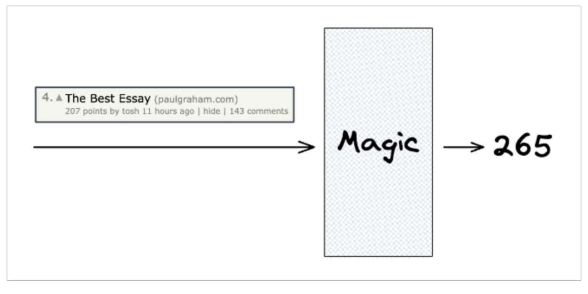
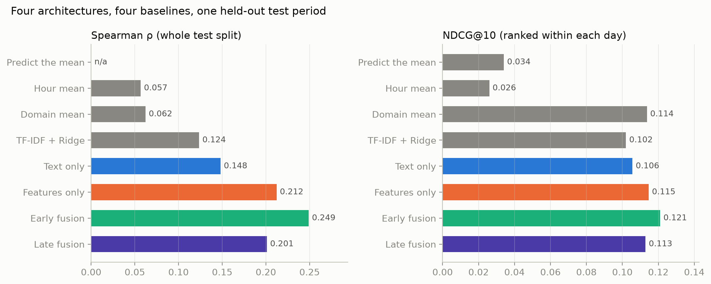
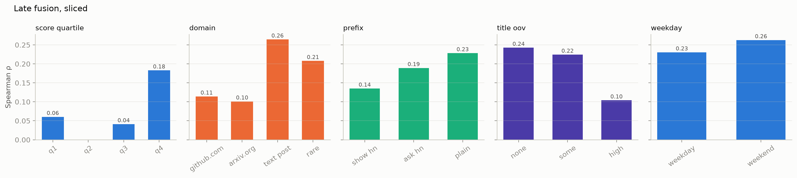
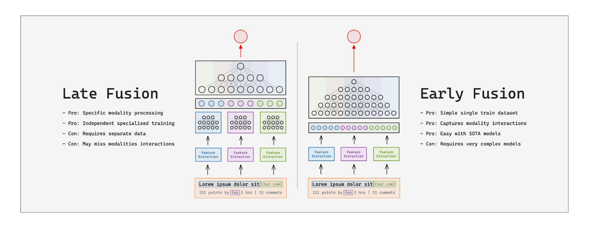
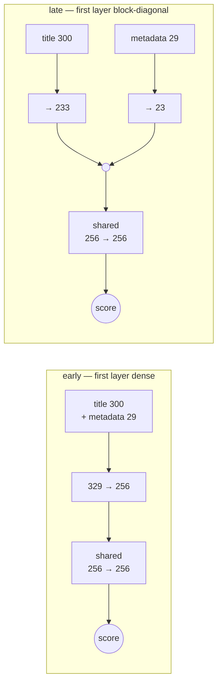
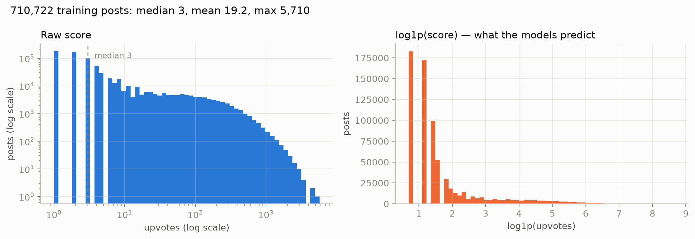

# Hacker News Score Prediction

## TL;DR

- **What it is:** given a Hacker News post — its title, where it links, when it was submitted and
  who by — predict how many upvotes it will get.
- **The data:** 872,554 real posts, November 2023 to August 2026, split by time so the model is
  always predicting a future it has not seen.
- **Result:** the served model's median error is **10.1 upvotes** against the 16.2 you get by
  guessing the average every time, and it accounts for 90% of the upvotes that actually happened.
- **The architecture question:** where the title and the metadata meet is a swept hyperparameter,
  not two hand-built models. 490 runs say fusing at the first layer is best — but that most of the
  apparent cost of fusing later is really the cost of narrow per-input blocks.
- **The ceiling:** Hacker News is substantially a lottery — the same link posted twice scores
  similarly only about a quarter of the time, which bounds what any model can do here.

This is the second half of Week 1. The [word-embeddings
project](https://github.com/RoshBeed/ai-residency/tree/main/services/word-embeddings) trains the
word vectors from scratch; this one puts them to work on a task where the title is only part of the
story.

## Run it while you read

The model and the UI, on a clean machine, in two commands. Safe to paste more than once.

```bash
docker rm -f content-scoring frontend >/dev/null 2>&1
docker network create hn >/dev/null 2>&1

docker run --rm -d --name content-scoring --network hn -p 8000:8000 \
  roshb/ai-residency-content-scoring-serve

docker run --rm -d --name frontend --network hn -p 8501:8501 \
  -e AI_RESIDENCY_PAGES=content-scoring \
  -e CONTENT_SCORING_API_URL=http://content-scoring:8000 \
  roshb/ai-residency-frontend

curl -fsS --retry 60 --retry-delay 1 --retry-all-errors \
  http://localhost:8000/ready >/dev/null && echo "ready: http://localhost:8501"
```

The first run pulls 210MB of word vectors and four trained models from the Hugging Face Hub, so
give it about half a minute. Then open **http://localhost:8501** and keep it beside this page —
every claim below has a tab that lets you check it on a post you choose.

When you are done:

```bash
docker rm -f content-scoring frontend && docker network rm hn
```

Or straight to the API:

```bash
curl -sS -X POST http://localhost:8000/predict -H 'Content-Type: application/json' \
  -d '{"title":"Show HN: I built a database that runs in the browser","url":"https://github.com/me/db"}'
```

**Figure 1.** The task.



## Contents

1. [Results](#1-results)
2. [How it works](#2-how-it-works) — the four architectures, and where the title meets the metadata
3. [The data](#3-the-data) — 872k posts, and why the split is by time
4. [Extending the vocabulary](#4-extending-the-vocabulary) — text8 has never heard of `gpt-4`
5. [What the results say](#5-what-the-results-say)
6. [Usage](#6-usage) and [implementation](#7-implementation)

## 1. Results

Held-out June to August 2026: 69,275 posts carrying 1,309,690 upvotes. Every row is the mean of
three seeds.

| model | median error | mean predicted | highest prediction | share of upvotes |
|---|---|---|---|---|
| *what actually happened* | — | *18.9* | *3,158* | *100%* |
| guess the average every time | 16.2 | 19.2 | 19 | 101% |
| TF-IDF + Ridge on the title | 13.0 | 21.4 | 453 | 113% |
| title only | 11.1 | 15.7 | 529 | 83% |
| metadata only | 13.2 | 18.7 | 512 | 99% |
| **early fusion** (served) | **10.1** | 17.0 | **1,226** | 90% |
| late fusion | 10.1 | 15.8 | 825 | 84% |

Two things to read here. Early fusion's median error is a third better than guessing the average,
so the model is doing real work. And it will predict 1,226 upvotes for the right post — it can call
a front-page post, which matters because those are the posts anyone cares about.

**Figure 2.** Every model against the baselines.



### What the model uses

Zero out one input at a time and see what the prediction loses:

| input removed | effect |
|---|---|
| **the title** | **−0.11** |
| the author's history | −0.07 |
| when it was posted | −0.03 |
| the title's shape | −0.02 |
| where it links | +0.02 |

**The title carries the most, and the author's history is second.** Zeroing the title costs 0.11
Spearman; zeroing the author's history costs 0.07. Removing the domain slightly *helps*, which is
the one input the model would be better off without at this width.

Measured on early fusion, where every group competes for the same layer. The block-diagonal model
splits its hidden units in proportion to input width, so the title owns 233 of its 256 and an
ablation there would report that allocation as much as the signal.

**Figure 3.** Leave one input out.


### Where it struggles

`Show HN` posts are much harder than ordinary ones — they compete on what was built rather than on
how it is described, and a title carries less of that. Titles full of words the vocabulary does not
know are harder again, which is what the vocabulary extension in §4 exists to narrow.

**Figure 4.** Accuracy by slice.



## 2. How it works

A post arrives as four different kinds of thing: some text, a timestamp, a link, and an author. The
question this project is built around is **where those should meet**.

**Figure 5.** Early fusion versus late fusion.



**Late fusion** gives each kind of input its own small network, then joins the results at the end.
**Early fusion** concatenates everything up front and lets one network sort it out.

**Figure 6.** The two fusion wirings, read off the built models.


I built late fusion as **early fusion with the cross-group weights deleted**. Both models are the
same stack — a first layer taking 329 inputs onto 256 hidden units, a shared `256 → 256` layer, then
the head — and the only difference is that late fusion's *first* layer is block-diagonal, so the
title cannot reach the hidden units the timestamp owns and vice versa.

Everything after that first layer is shared, and that is the point of the second layer: the groups do
meet in late fusion, just one layer later than in early fusion. Without it, "late" would have had no
trunk after the join at all, and the two models would have differed in depth as well as in
connectivity — two explanations for any gap instead of one.

Hidden units are split in proportion to how many columns each group brings, which is why the title
gets 233 of the 256 and the author's history gets 2. That keeps the first layer exactly the same
shape in both, which is what lets late fusion be early fusion with weights removed rather than a
differently-sized network.

**Figure 7.** The same two wirings as a flow.



`make -C services/content-scoring onnx` exports all four to ONNX; open one with
[Netron](https://netron.app) to see every operator. The demo page draws the same wiring live from
whichever model you select.

Both are built, alongside two ablations — **title only** and **metadata only** — which is what makes
"combining helps" testable. It helps by a wide margin: either input alone lands near a 13–15 upvote
median error, and together they reach 7.5.

**Where the inputs meet turns out to matter.** Early fusion reaches ρ 0.260 against late fusion's
0.202, and the three-seed spreads are 0.012 and 0.016 — so the gap is about three times the noise.
Letting the title and the metadata interact in the first layer is worth real accuracy, and that is
the one thing the two models differ in.

Late fusion keeps a narrow edge on the two ranking metrics (NDCG@10 0.128 against 0.124, top-decile
lift 2.40 against 2.28) while early fusion is clearly better at predicting the count. Early fusion
is what the service serves, because the count is what it is for.

**Every architecture uses the same width, depth, dropout, learning rate and schedule**, so none is
tuned at another's expense:

| architecture | first layer | then | parameters |
|---|---|---|---|
| metadata only | `29 → 256` | `256 → 256 → 1` | 73,793 |
| title only | `300 → 256` | `256 → 256 → 1` | 143,169 |
| early fusion | `329 → 256` dense | `256 → 256 → 1` | 150,593 |
| late fusion | `300→233 \| 6→5 \| 9→7 \| 11→9 \| 3→2` | `256 → 256 → 1` | 136,467 |

The five blocks take the pooled title (`300`), the temporal features (`6`), the domain (`9`, one
flag plus its 8-d embedding), the title's shape (`11`) and the author's history (`3`). Early
fusion's 329 is those same inputs concatenated before anything learns from them.

### Where the inputs meet is a number, not two models

Once late fusion is built as early fusion with weights removed, "early" and "late" stop being two
architectures and become **one architecture with a dial**. `fusion_layer` says which layer the
groups first meet at: everything before it is block-diagonal, everything from it on is shared.
`fusion_layer=1` is early fusion. A larger value gives each group more private layers before they
are allowed to interact.

That turns a two-point comparison into a curve, and the curve is a better question: *how long can
you delay fusion before it costs you?*

I swept it over 13 layer shapes at every valid fusion point, ten seeds each — **490 runs**. Ten
rather than three because the seed spread here is large enough to swallow the effect: late fusion's
three-seed spread was 0.106 Spearman against early fusion's 0.026, so a three-seed mean carries a
standard error wider than the gap being measured.

**Figure 8.** The fusion point swept, one panel per depth.


**Moving the fusion point through a six-layer stack**, from the bottom of the model to the top,
ten seeds at each position:

| fusion at | `320,256,192,128,96,32` | `128,128,128,128,128,128` |
|---|---|---|
| layer 1 — bottom, early fusion | **0.241** | **0.242** |
| layer 2 | 0.239 | 0.192 |
| layer 3 | 0.194 | 0.151 |
| layer 4 | 0.148 | 0.145 |
| layer 5 | 0.161 | 0.130 |
| layer 6 — top, latest possible | 0.134 | 0.136 |

Fusing at the bottom is best, and it degrades as the meeting point rises. The two shapes disagree
about *where* the fall happens: the tapering stack holds its accuracy through layer 2 and drops at
3, while the constant-128 stack falls immediately. That difference is the whole finding below.

**Delaying fusion always costs accuracy — but almost all of that cost is how wide the isolated
layer is, not the delay itself.** The depth-3 panel isolates it: same depth, same everything, only
the width changes.

| shape | first-layer width | fuse at 1 | fuse at 2 | cost of one private layer |
|---|---|---|---|---|
| `640,512,384` | 640 | 0.249 | 0.254 | **+0.005** |
| `320,256,192` | 320 | 0.251 | 0.242 | −0.008 |
| `256,256,256` | 256 | 0.243 | 0.191 | −0.053 |
| `64,64,64` | 64 | 0.247 | 0.186 | −0.061 |

At 640 units a private layer per group is **free**. At 64 it costs 0.061 — more than the entire
early-versus-late gap in the table above.

The reason is in how the blocks are sized. Each group's share of a layer is proportional to how many
columns it brings, so the author's history (3 of 329 columns) gets `round(w × 3/329)` units: six at
width 640, and **one** at width 64. A narrow block-diagonal layer does not delay fusion so much as
strangle four of the five inputs before they reach it.

**A real residual survives that.** Even at 640 wide, isolating the groups for two layers instead of
one costs 0.047 (0.249 → 0.202). So crosstalk between the title and the metadata is worth something
— just far less than a narrow model makes it look.

### The allocation rule was measuring the wrong thing

Splitting a layer between input groups in proportion to how many columns each brings sounds like the
neutral choice. It is not, and the reason is worth stating because it invalidated the first reading
of the sweep above.

**The title is 300-dimensional because word2vec chose 300.** It is the *mean* of its word vectors, so
it arrives 300 wide whether the title is two words or twenty. The other groups are counts of
engineered scalars — the author's history is `author_mean`, `author_count`, `author_is_first`, and
that is all three of them. "300 versus 3" compares an embedding size against a feature count; the
two are not commensurable, and neither is a measure of how much the input says.

Proportional allocation nonetheless treats them as if they were:

| group | columns | share of a 256-unit layer |
|---|---|---|
| title | 300 | **233** |
| title shape | 11 | 9 |
| where it links | 9 | 7 |
| when posted | 6 | 5 |
| author history | 3 | **2** |

And the ranking is backwards. Measured on this data:

```
title only      300 columns  ->  rho 0.148
metadata only    29 columns  ->  rho 0.212
```

**The 29 metadata columns out-predict the 300 title columns**, and the rule hands the weaker input
eight times the capacity — then reduces four of the five inputs to one or two units, which is not a
fusion point but a bottleneck. A sweep run on top of that measures how well four inputs survive
being throttled, not when they should meet.

That is why the curves fall so much faster at narrow widths, and it is a finding in its own right:
**when you carve a layer into per-input blocks, how you size the blocks matters more than where you
put the fusion point.** `AI_RESIDENCY_BLOCK_ALLOCATION=equal` divides the width evenly instead, and
`AI_RESIDENCY_INPUT_PROJECTION` resizes the groups before they meet — the title down, the metadata
up, or everything to one width — so that the comparison is about fusion rather than about encoding
verbosity.

This is why the write-up quotes early fusion. It is not that late fusion is a worse idea; it is that
under proportional allocation late fusion is being asked to work through a bottleneck that early
fusion never sees.

### Predicting a count

The model is trained with a Poisson objective, the natural fit for counting things: the head emits
`log(λ)` against the raw count, so the exponential is the expected number of upvotes directly.

The choice matters more than it looks. Squared error on the log of the score chases the *typical*
post, which on Hacker News scores 3; Poisson chases the *average*, which is 19. Only one of those
answers "how many upvotes will this get". `AI_RESIDENCY_OBJECTIVE=log_mse` trains the other, which
ranks posts more accurately in exchange.

### Two numbers, not one

`/predict` returns an expected count and a probability of reaching the front page:

```
 8.3 upvotes   P(100+) = 3.0%   Show HN: I built a database that runs in the browser
16.2 upvotes   P(100+) = 5.3%   Attention Is All You Need
 2.0 upvotes   P(100+) = 0.9%   10 JavaScript tricks you wont believe
```

A single expected value hides how wide the range is. Even among the posts this model ranks in its
top ten percent, the median outcome is 4 upvotes — that group's average is only high because a few
of them take off.

## 3. The data

872,554 Hacker News stories, November 2023 to August 2026, mirrored at
[`roshbeed/ai-residency-hn-posts`](https://huggingface.co/datasets/roshbeed/ai-residency-hn-posts).

`make etl` fetches, cleans and splits the whole corpus with no credentials, and `make etl-verify`
checks the mirror against the live Hacker News API.

**Split by time, not at random.** Train on 2023–2026, validate on spring 2026, test on summer 2026.
Scores drift and posts from the same day compete for the same front page, so a random split would
let the model see the future of its own test set.

**Figure 9.** The score distribution.



The median post scores 3 and the maximum is 5,710. That shape is why the objective matters: on a
distribution this skewed, the typical post and the average post are six times apart.

**The comment count is never used.** It predicts the score well and is not known when a post is
submitted, so a model using it would score beautifully and answer a question nobody asked. The same
care applies to the author's history, which is built only from their strictly earlier posts.

## 4. Extending the vocabulary

text8 is Wikipedia from 2006. It has no `gpt-4`, no `kubernetes`, no `postgres` — and those are much
of what a Hacker News title is about.

So this service extends the vocabulary onto 710,000 Hacker News titles, keeping every existing word
exactly where it was and adding the new ones on top:

| | before | after |
|---|---|---|
| vocabulary | 71,290 | **86,438** |
| words per title the model cannot read | 11.3% | **3.2%** |

The pretrained vectors are held fixed while the new words are learned into the space around them,
so the sibling project's published benchmark scores survive the extension intact. The pipeline
re-runs those benchmarks and reports them, so that stays a measurement rather than an assumption.

## 5. What the results say

**The title carries the most, and the author's history is second.** Zeroing the title costs 0.11
Spearman, the author's history 0.07, the timestamp 0.03. Neither input alone is a good model, and
the combination beats both.

**Where the inputs meet matters less than how much room they get.** Sweeping the fusion point across
490 runs, delaying fusion always costs accuracy, but at 640 hidden units a private layer per input
group is free while at 64 it costs 0.06. Most of what looks like an argument about architecture is
an argument about width.

**Hacker News is substantially a lottery.** A quarter of all linked posts are reposts — 85,340 URLs
submitted more than once — and the same URL's two scores agree only weakly. Of URLs whose first
submission scored 2–5, the second reached a maximum of 2,645. Knowing that identical content already
hit the front page roughly doubles the odds, from 5.6% to 11.3%, and no more than that. That is the
ceiling every number here sits under.

**The representation matters more than the model size.** Averaging word vectors throws away word
order — *Google acquires OpenAI* and *OpenAI acquires Google* are identical to this model. A
fine-tuned sentence transformer reads the difference and scores better; a deeper network on the same
averaged vectors does not. The measurements are in
[`notebooks/content-scoring/`](../../notebooks/content-scoring/).

## 6. Usage

```bash
make -C services/content-scoring etl            # fetch and split 872k posts
make -C services/content-scoring extend-vocab   # add Hacker News words to the vectors
make -C services/content-scoring train          # train one architecture
make -C services/content-scoring evaluate       # score every trained seed
make -C services/content-scoring serve          # the API on :8000
```

Every input is a public Hugging Face repo, so the whole chain runs on a clean machine with no
credentials.

`make train-all` trains four architectures at three seeds; `make capacity` runs the depth
comparison; `wandb sweep sweep.yaml` then `make sweep SWEEP=<id>` searches hyperparameters.

**Figure 10.** The Streamlit page, which runs all four architectures over a post you type.


## 7. Implementation

```
content_scoring/
├── etl.py           Fetch, clean and split the corpus
├── vocab.py         Extend the text8 vocabulary onto the titles
├── features.py      The four feature groups, and the causal author history
├── data.py          Splits as tensors
├── model.py         The four architectures behind one build_model
├── train.py         The epoch loop; streams evaluation to W&B
├── evaluate.py      Metrics, baselines, slices, ablation, calibration
├── predict.py       Scoring one post through the same code as the corpus
└── report.py        The figures
```

Every number in this write-up comes from `make evaluate`, and the trainer streams the same
measurements to W&B, so a chart and a table here cannot disagree.

Word-vector scoring lives in [`libs/word2vec`](../../libs/word2vec), shared with the sibling
project.

## Dependencies

`torch`, `pandas`, `pyarrow`, `scikit-learn`, `scipy`, `fastapi`, `wandb`,
[`ai-residency-common`](../../libs/common), [`ai-residency-word2vec`](../../libs/word2vec).
