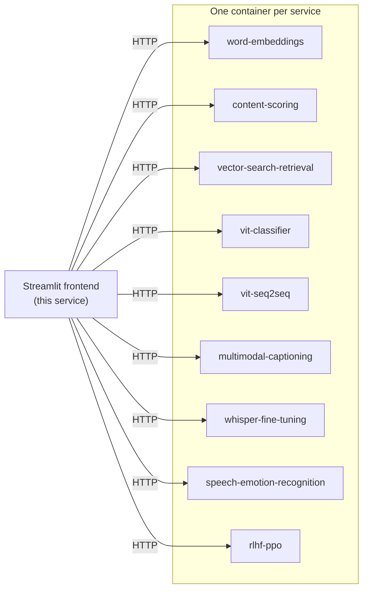
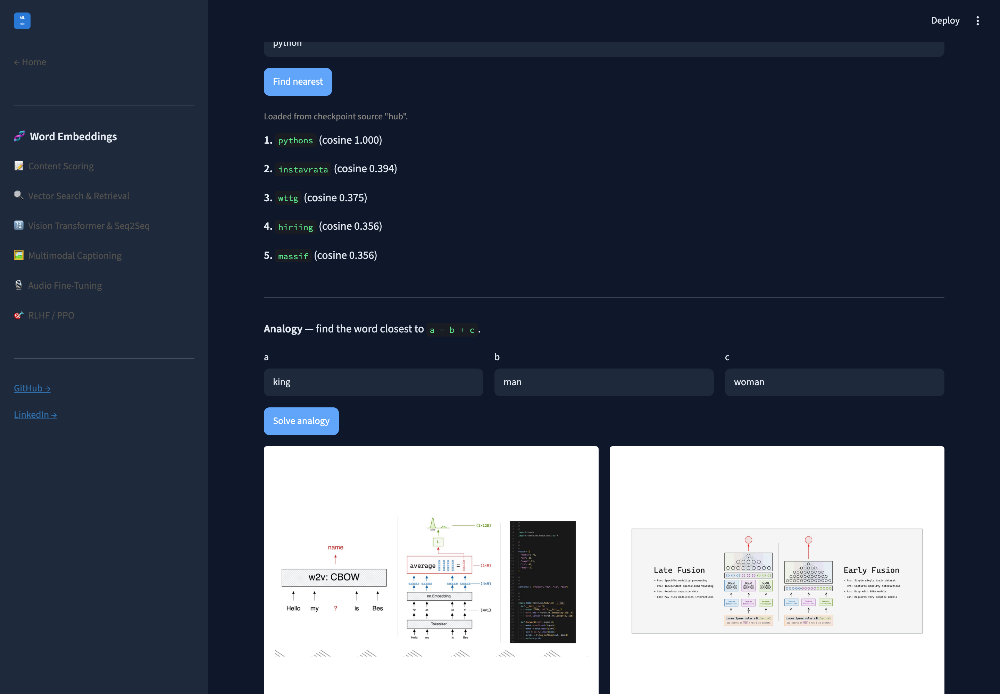

# `services/frontend` — the Streamlit app

One page per system, each a thin HTTP client calling that system's own backend. **No inference
logic lives here** — only request/response wiring and display. The models run in their own
containers; this renders.

The portfolio overview lives in the [root README](../../README.md); this file is about the app.



## What each system does

| System | Architecture | Demonstrated |
|---|---|---|
| [Word embeddings](https://github.com/RoshBeed/ai-residency/tree/main/services/word-embeddings) | CBOW word2vec with negative sampling, trained from scratch | Real unsupervised structure in the trained vectors (t-SNE clusters, analogy/similarity checks) |
| [Content scoring](https://github.com/RoshBeed/ai-residency/tree/main/services/content-scoring) | Regression head over frozen CBOW embeddings | Trained end-to-end on real Hacker News post data |
| [Dual-encoder retrieval](https://github.com/RoshBeed/ai-residency/tree/main/services/vector-search-retrieval) | Two-tower retrieval (CBOW + GRU encoders), triplet loss | Trained towers served via Redis/RediSearch ANN search |
| [Vision Transformer](https://github.com/RoshBeed/ai-residency/tree/main/services/vision-transformers) | From-scratch ViT — single-digit classifier and a seq2seq multi-digit variant | 95% classifier accuracy, 68% seq2seq exact-match |
| [Image captioning](https://github.com/RoshBeed/ai-residency/tree/main/services/multimodal-captioning) | CLIP vision encoder → adapter → Qwen3 decoder | Full pipeline trained and serving captions end-to-end |
| [Whisper fine-tuning](https://github.com/RoshBeed/ai-residency/tree/main/services/audio-fine-tuning) | Whisper fine-tuning with emotion-token support | Fine-tuning and data pipeline running end-to-end, served via FastAPI |
| [RLHF / PPO](https://github.com/RoshBeed/ai-residency/tree/main/services/rlhf-ppo) | From-scratch PPO — generation, KL penalty, reward, advantage, policy/value updates | Full PPO step runs end-to-end against Qwen3-0.6B-Base |

## The write-ups

Each system's write-up — architecture, method, results, references — is that service's own
`README.md`, so it is both the GitHub landing page for the service and the document this app links
to. They used to live here, in a separate repo from the code they describe, because relative links
between repos 404 on GitHub.

| System | Write-up |
|---|---|
| Word embeddings (CBOW from scratch) | [`services/word-embeddings`](../word-embeddings) |
| Content scoring (regression head over frozen vectors) | [`services/content-scoring`](../content-scoring) |
| Dual-encoder document retrieval | [`services/vector-search-retrieval`](../vector-search-retrieval) |
| ViT classifier (single digit) | [`services/vit-classifier`](../vit-classifier) |
| ViT seq2seq (multi-digit) | [`services/vit-seq2seq`](../vit-seq2seq) |
| Image captioning (CLIP + Qwen3) | [`services/multimodal-captioning`](../multimodal-captioning) |
| Whisper fine-tuning | [`services/whisper-fine-tuning`](../whisper-fine-tuning) |
| Speech emotion recognition | [`services/speech-emotion-recognition`](../speech-emotion-recognition) |
| RLHF / PPO | [`services/rlhf-ppo`](../rlhf-ppo) |

The exploratory notebooks live at [`notebooks/`](../../notebooks), one folder per service.

## The app

`app.py` is one Streamlit app, one page per system. Each page is a thin HTTP client calling that
system's own backend container — **no inference logic lives here**, only request/response wiring and
display. That's deliberate: the models run in their own services, and this repo just renders.


Each page calls its backend live. Here the word-embeddings page returns real nearest neighbours,
with the cosine scores and the `checkpoint_source` the backend reported:



## Run locally

```bash
make install          # uv sync
make run              # uv run streamlit run app.py
```

Each page reads its backend's URL from an environment variable named after the service —
`WORD_EMBEDDINGS_API_URL`, `VIT_CLASSIFIER_API_URL`, `SPEECH_EMOTION_RECOGNITION_API_URL` and so
on, defaulting to `http://localhost:8001`–`:8009`. Point them at whichever backends are up: the
compose stack, the Helm cluster via `kubectl port-forward`, or individual `make serve` processes.

The Helm chart derives these names from its `backends` keys, so adding a service needs no
frontend-side wiring beyond a page.

```bash
WORD_EMBEDDINGS_API_URL=http://localhost:8001 make -C services/frontend run
```

## Docker

```bash
# from the repository root
docker build -f services/frontend/Dockerfile.serve -t roshbeed/ai-residency-frontend:latest .
docker push roshbeed/ai-residency-frontend:latest
```

It does not build `FROM ai-residency-base-serve`, deliberately — that image carries a torch install this
one has no use for.

The image is deliberately lightweight — `streamlit` + `requests` + `pillow` only. Every model runs in
its own backend container.

## Layout

```
services/frontend/
├── app.py            the whole app, one page per system
├── assets/           figures the pages render inline
├── Dockerfile        the published roshbeed/ai-residency-frontend image
├── Makefile          run
└── pyproject.toml    streamlit + requests + pillow — no ML dependencies
```

## Related

- [`deploy`](https://github.com/RoshBeed/ai-residency/tree/main/deploy) — compose, Helm, Terraform to run all of it.
- [`libs/common`](https://github.com/RoshBeed/ai-residency/tree/main/libs/common) — the shared helper library all the backends depend on.
- The backend repos linked in the table above.

---

*These systems originated as projects in the [Machine Learning Institute](https://ml.institute/) residency.*
