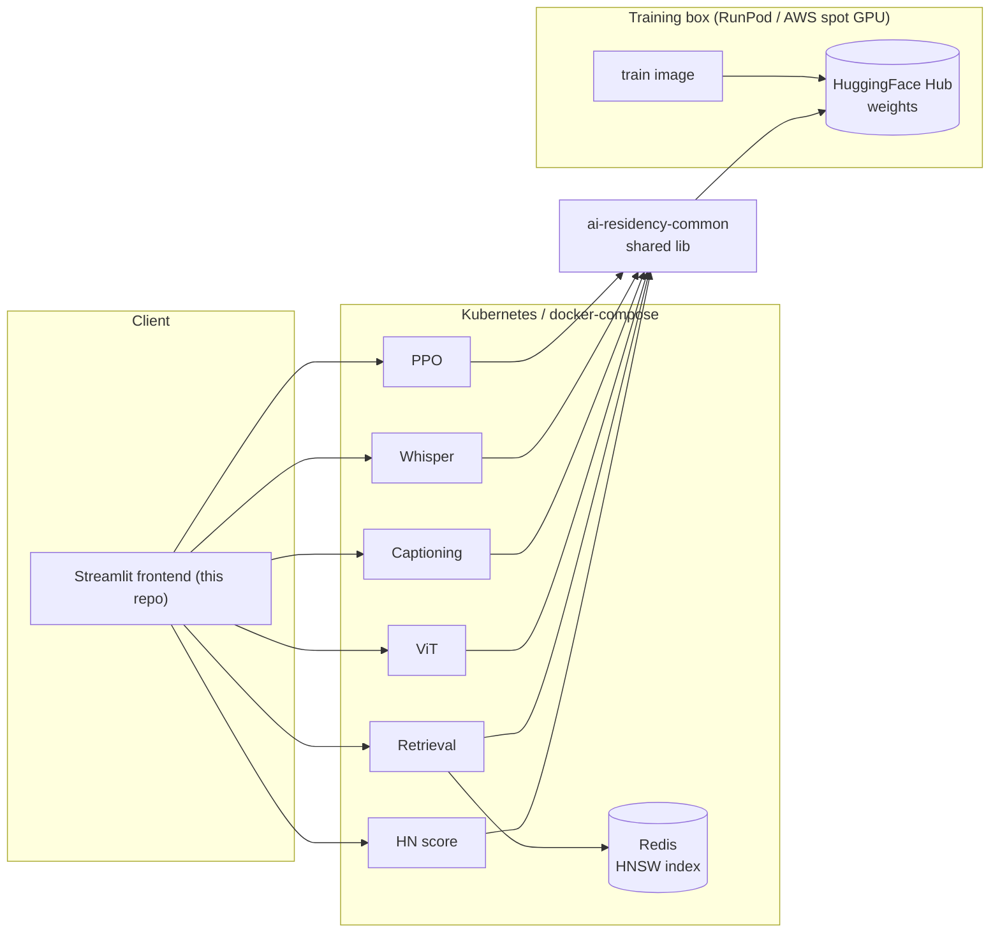

# ML Systems Portfolio — built end to end

Machine-learning systems, each taken from scratch to a containerized microservice, plus the
frontend and deployment infrastructure that run them all. The point isn't just the models — it's the
engineering: real architectures implemented from the ground up, one shared library across the
repos, and identical deployment on three runtimes (macOS, docker-compose, Kubernetes).

This repo is the human-facing entry point: the Streamlit UI that talks to all the backends, and the
full write-up for each system.



## What each system does

| System | Architecture | Demonstrated |
|---|---|---|
| [Word embeddings](https://github.com/RoshBeed/ai-residency/tree/main/services/word-embeddings) | CBOW word2vec with negative sampling, trained from scratch | Real unsupervised structure in the trained vectors (t-SNE clusters, analogy/similarity checks) |
| [Content scoring](https://github.com/RoshBeed/ai-residency/tree/main/services/content-scoring) | Regression head over frozen CBOW embeddings | Trained end-to-end on real Hacker News post data |
| [Dual-encoder retrieval](https://github.com/RoshBeed/ai-residency/tree/main/services/vector-search-retrieval) | Two-tower retrieval (CBOW + GRU encoders), triplet loss | Trained towers served via Redis/RediSearch ANN search |
| [Vision Transformer](https://github.com/RoshBeed/ai-residency/tree/main/services/vision-transformers) | From-scratch ViT — single-digit classifier and a seq2seq multi-digit variant | 95% classifier accuracy, 68% seq2seq exact-match |
| [Image captioning](https://github.com/RoshBeed/ai-residency/tree/main/services/multimodal-captioning) | CLIP vision encoder → adapter → Qwen3 decoder | Full pipeline trained and serving captions end-to-end |
| [Whisper fine-tuning](https://github.com/RoshBeed/ai-residency/tree/main/services/audio-fine-tuning) | Whisper fine-tuning with emotion-token support | Fine-tuning and data pipeline running end-to-end, served via FastAPI |
| [RLHF / PPO](https://github.com/RoshBeed/ai-residency/tree/main/services/rlhf-ppo) | From-scratch PPO — generation, KL penalty, reward, advantage, policy/value updates | Full PPO step runs end-to-end against Qwen3-0.6B-Base |

## The write-ups

Each system has a full write-up — architecture, method, results, references — in `docs/`:

| System | Write-up |
|---|---|
| Word embeddings (CBOW from scratch) | [`docs/word-embeddings.md`](docs/word-embeddings.md) |
| Content scoring (regression head over frozen vectors) | [`docs/content-scoring.md`](docs/content-scoring.md) |
| Dual-encoder document retrieval | [`docs/dual-encoder-retrieval.md`](docs/dual-encoder-retrieval.md) |
| Vision Transformer for digit recognition | [`docs/vision-transformer.md`](docs/vision-transformer.md) |
| Image captioning (CLIP + Qwen3) | [`docs/image-captioning.md`](docs/image-captioning.md) |
| Whisper fine-tuning | [`docs/whisper-finetuning.md`](docs/whisper-finetuning.md) |
| RLHF / PPO | [`docs/rlhf-ppo.md`](docs/rlhf-ppo.md) |

The week repos are container source only, so their exploratory notebooks and module-level
documentation live here too: `notebooks/` (one folder per week) and `docs/vision-transformer-modules/`
(the per-module READMEs from Week 3's `datasets/`, `models/`, `serving/` and `transformer/` packages).

## The app

`app.py` is one Streamlit app, one page per system. Each page is a thin HTTP client calling that
system's own backend container — **no inference logic lives here**, only request/response wiring and
display. That's deliberate: the models run in their own services, and this repo just renders.


Each page calls its backend live. Here the word-embeddings page returns real nearest neighbours,
with the cosine scores and the `checkpoint_source` the backend reported:


## Run locally

```bash
make install          # uv sync
make run              # uv run streamlit run app.py
```

The app talks to each backend at `WEEK1_API_URL` … `WEEK6_API_URL` (default `http://localhost:8001`
… `:8006`), so point them at whichever backends are up — the compose stack, the Helm cluster (via
port-forward), or individual `make serve` processes.

```bash
WEEK1_API_URL=http://localhost:8001 make run
```

## Docker

```bash
make docker-build     # docker build -t roshbeed/ai-residency-frontend .
make docker-push      # docker push roshbeed/ai-residency-frontend:latest
```

The image is deliberately lightweight — `streamlit` + `requests` + `pillow` only. Every model runs in
its own backend container.

## Layout

```
ai-residency-frontend/
├── app.py                    the whole Streamlit app, one page per system
├── assets/                   figures rendered inline by the app
├── docs/                     each system's full write-up + assets/ + week-3 module docs
├── notebooks/                the week repos' exploratory notebooks, one folder per week
├── Dockerfile                the published roshbeed/ai-residency-frontend image
├── Makefile                  run / docker-build / docker-push
└── pyproject.toml            streamlit + requests only — no ML dependencies
```

## Related

- [`ai-residency-infrastructure`](https://github.com/RoshBeed/ai-residency/tree/main/deploy) — compose, Helm, Terraform to run all of it.
- [`ai-residency-common`](https://github.com/RoshBeed/ai-residency/tree/main/libs/common) — the shared helper library all the backends depend on.
- The backend repos linked in the table above.

---

*These systems originated as projects in the [Machine Learning Institute](https://ml.institute/) residency.*
