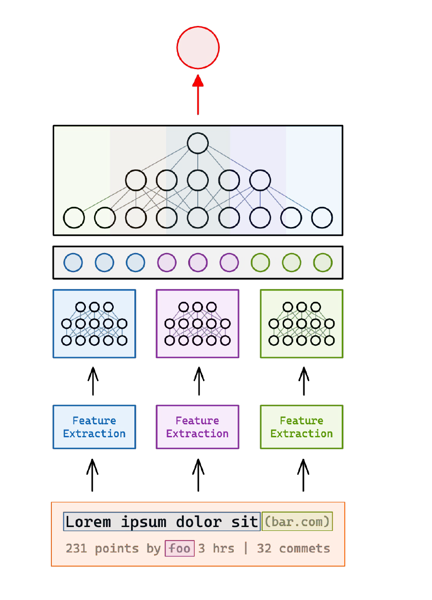
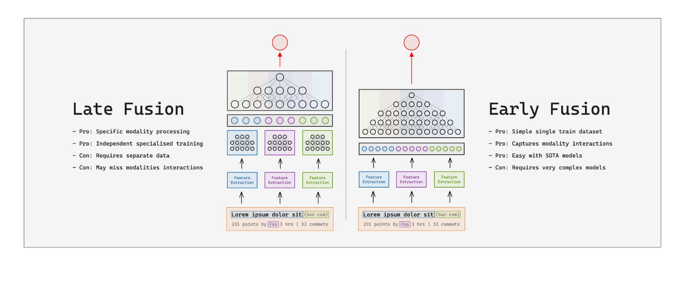
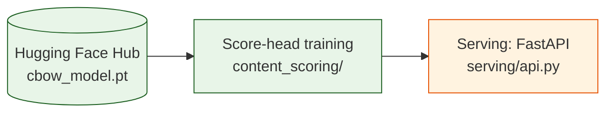
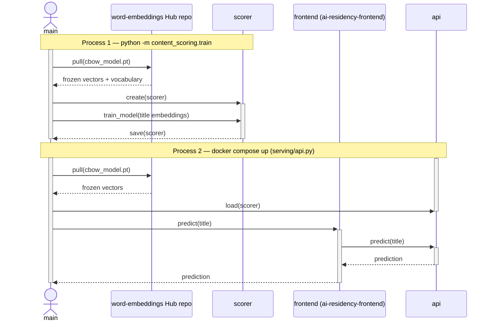
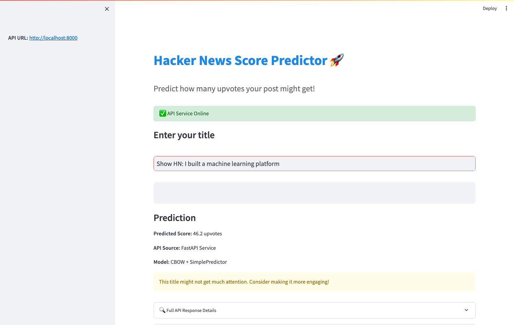

# Content Scoring from Frozen Word Embeddings

## TL;DR

- **What it is:** a small regression head (128 → 128 → 64 → 1 MLP) that predicts an engagement
  score from a post's title, on top of word embeddings frozen from the
  [word-embeddings project](https://github.com/RoshBeed/ai-residency-week1-word-embeddings).
- **Architecture:** late-fusion design — the title branch is fully built and trained end-to-end
  over frozen CBOW embeddings, served via FastAPI, and built to scale to more labeled data and
  more post features without code changes.

Score-from-content is a pattern I keep running into: ranking feeds, filtering spam, prioritizing a
crowded inbox. It's also literally what a reward model does in RLHF — scoring generated text to
supervise a policy model (see the [RLHF/PPO project](https://github.com/RoshBeed/ai-residency-week6-rlhf-ppo)
for that side of it). Here I'm applying it to a concrete instance: predicting how many upvotes a
Hacker News post title will get, from the title alone. This doc covers the method, how it's wired
together, and the results.

## Quickstart

```bash
make install
make docker-up   # builds and starts the FastAPI backend
```

Then open http://localhost:8000 (API docs at `/docs`). Without Docker: `make serve` in one
terminal. The Streamlit UI is a separate repo (`ai-residency-frontend`) that calls this API. The
frozen CBOW checkpoint this repo consumes is pulled from the word-embeddings project's Hugging Face
repo — see [Usage](#4-usage) for training the head from scratch.

## Table of Contents

1. [Introduction](#1-introduction)
2. [System Architecture](#2-system-architecture)
3. [Method](#3-method)
4. [Usage](#4-usage)
5. [Experimental Results](#5-experimental-results)
6. [Related Work](#6-related-work)
7. [References](#references)
8. [Acknowledgments](#acknowledgments)
9. [Dependencies](#dependencies)

## 1. Introduction

The full problem is bigger than just the title. Several raw features of a post (title, domain,
score/author/time/comments) each get their own feature-extraction step and embedding, get
concatenated, and get pushed through a shared stack of dense layers down to a single predicted
value.

**Figure 1.** General reward-model architecture for content scoring.



I only built one of those branches end to end — the title one — and skipped the other two. The word
embeddings that branch uses are trained from scratch in the
[word-embeddings project](https://github.com/RoshBeed/ai-residency-week1-word-embeddings); this repo
freezes them and trains only the scalar head on top.

There are two ways to wire branches like this together: **late fusion**, where each feature gets
its own encoder and they're combined at the end (the diagram above), or **early fusion**, where
everything gets concatenated raw up front and one model learns the interactions itself.

**Figure 2.** Late fusion versus early fusion. This repo is a Late Fusion system with only the
title branch actually built — the other branches from Figure 1 stay unimplemented.



Late fusion means each encoder can be built and swapped independently — you pay for that with
per-feature engineering. Early fusion needs less wiring but leaves one model to learn all the
interactions itself. I went with late fusion because it's the only one where building just the
title branch and stopping there is still a coherent, testable system rather than a half-built
model. Either way, the title branch — turning free text into a vector — is the word-embeddings
project's job; this repo's job is the head.

## 2. System Architecture

Three stages: pull the frozen vectors, train the head, serve it.

**Figure 3.** Pipeline architecture.


Same pipeline as a sequence diagram. Each `Note over` label marks a separate process run, matching
the commands in [Section 4](#4-usage):

**Figure 4.** Sequence diagram of the pipeline.


The dependency is the point, not a wart: the vectors are trained once, published, and consumed
frozen. The head that consumes them is ~17K parameters, which is the whole reason a 782-example
dataset can train anything at all.

## 3. Method

### 3.1 Averaging Word Vectors

A title is a variable-length sequence of words. To feed a fixed-size MLP, each title's words are
looked up in the frozen embedding table and averaged into a single vector, matching exactly how
the word-embeddings project's own evaluation pooled vectors. Words outside the vocabulary are
skipped; a title with no known words becomes the zero vector.

Late fusion means the averaging happens *before* the head, not inside it — the head sees one vector
per title, never the raw token sequence. That's the "late" in the name: feature combination is
deferred to the very last step, so the head is a pure scalar regressor.

### 3.2 The Regression Head

`ScorePredictor` in `content_scoring/model.py` is a three-layer MLP:

```
input (embedding_dim) → Linear 128 → ReLU → Dropout 0.2 → Linear 64 → ReLU → Dropout 0.2 → Linear 1
```

~17K parameters. The loss is mean squared error against the upvote count. Dropout is on at 0.2
because with 782 examples the model overfits around epoch 5 — the dropout doesn't stop that, but it
slows it enough that early stopping catches the best checkpoint before it diverges.

### 3.3 Baseline Comparison

`content_scoring/evaluate.py` also computes a baseline — predicting the training-set mean score
for every example — alongside the model's own test loss, so the two are always reported together
in [Section 5](#5-experimental-results).

## 4. Usage

```bash
make install
cp .env.example .env   # HF_TOKEN, WANDB_API_KEY

make train             # train the regression head (over the frozen CBOW vectors)
make serve             # FastAPI on :8000 (POST /predict, GET /health)
make predict TITLE="your title here"   # one-shot score from the CLI
```

`make train` pulls the frozen CBOW checkpoint (and the vocabulary inside it) from the
word-embeddings project's Hugging Face repo unless a local copy is present at
`checkpoints/cbow/cbow_model.pt`, then writes `checkpoints/best_predictor.pth`.

### 4.1 Deployment

Two single-purpose Dockerfiles, both `FROM roshbeed/ai-residency-base`: `Dockerfile.serve` (the FastAPI
inference container Kubernetes runs) and `Dockerfile.train` (what a RunPod/AWS GPU host pulls).
Neither needs a git credential — `ai-residency-common` is already installed in the base image.

```bash
make docker-build-serve   # docker build -f Dockerfile.serve -t ai-residency-week1-content-scoring-serve .
make docker-build-train   # docker build -f Dockerfile.train -t ai-residency-week1-content-scoring-train .
make docker-up            # docker compose up --build serve       -> API at http://localhost:8000
make docker-train         # docker compose --profile train run --rm train
```

The scorer checkpoint isn't baked into the image: serving pulls it from this repo's Hugging Face
repo when none is bind-mounted (see `docker-compose.yml`). The frozen CBOW vectors are pulled the
same way from the word-embeddings project's repo. The training service is gated behind a Compose
*profile*, so a plain `docker compose up` never accidentally kicks off a training run.

Without Docker:

```bash
make serve                # uv run python -m serve
```

The Streamlit UI lives in `ai-residency-frontend`, calling this API the same way.

## 5. Experimental Results

The regression stage trains on 782 cleaned HN post titles, split 625/157 train/test, with a fixed
seed (`torch.manual_seed(42)` in `content_scoring/train.py`) so runs are reproducible.

**Score prediction.** The best checkpoint lands at epoch 5: train loss 1,925.84, test loss 3,641.91
(raw squared-error on the score scale — HN scores are heavy-tailed, so a handful of viral posts
dominate the loss). The baseline — predicting the training-set mean score of 14.10 for every
example — gets test MSE 3,595.90. Sample predictions from the saved checkpoint:

| Title | Predicted | Actual |
|---|---|---|
| "Show HN: To prove other gender and age group can enjoy SciFi I created this site" | 12.96 | 6.00 |
| "Show HN: PromptSecure, browser extension to privacy protect ChatGPT" | 20.24 | 3.00 |
| "If It Works, It's Not AI: A Commercial Look at AI Startups (1999)" | 17.36 | 2.00 |

**Figure 5.** The Streamlit UI (in `ai-residency-frontend`) serving a live prediction from the
trained pipeline.



The pipeline — frozen embeddings in, trained head, live serving — runs end to end. It scales
directly to more labeled data, additional post features (user, domain, timestamp — see the
reward-model diagram in [Section 1](#1-introduction)), and richer title pooling (weighted by
tf-idf, or fed through an RNN — see the
[dual-encoder retrieval project](https://github.com/RoshBeed/ai-residency-week2-vector-search-retrieval),
which does exactly that) without changes to the architecture.

## 6. Related Work

- [the word-embeddings project](https://github.com/RoshBeed/ai-residency-week1-word-embeddings) —
  the CBOW vectors trained from scratch that this head consumes frozen.
- [the dual-encoder retrieval project](https://github.com/RoshBeed/ai-residency-week2-vector-search-retrieval) —
  recurrent (GRU) query/document towers trained with a triplet objective, a better pooling than a
  flat average.
- [the RLHF/PPO project](https://github.com/RoshBeed/ai-residency-week6-rlhf-ppo) — reward modeling and policy optimization, the
  application referenced in [Section 1](#1-introduction).

## References

[1] Mikolov, T., Chen, K., Corrado, G., & Dean, J. (2013). *Efficient Estimation of Word
Representations in Vector Space.* arXiv:1301.3781.

[2] Mikolov, T., Sutskever, I., Chen, K., Corrado, G., & Dean, J. (2013). *Distributed
Representations of Words and Phrases and their Compositionality.* arXiv:1310.4546.

## Acknowledgments

Built with Peter O'Keeffe, Ben Williams, and Miguel Parracho.

## Dependencies

PyTorch · FastAPI · Weights & Biases · Hugging Face Hub · Docker · Docker Compose · Make
