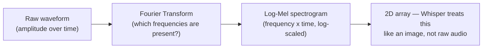
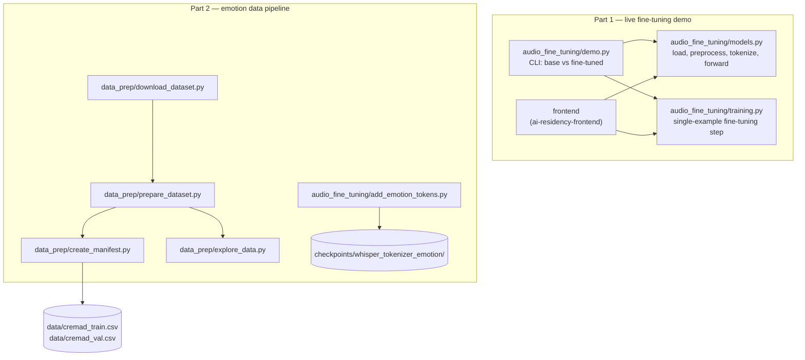
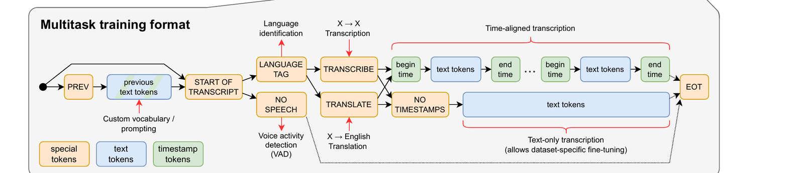
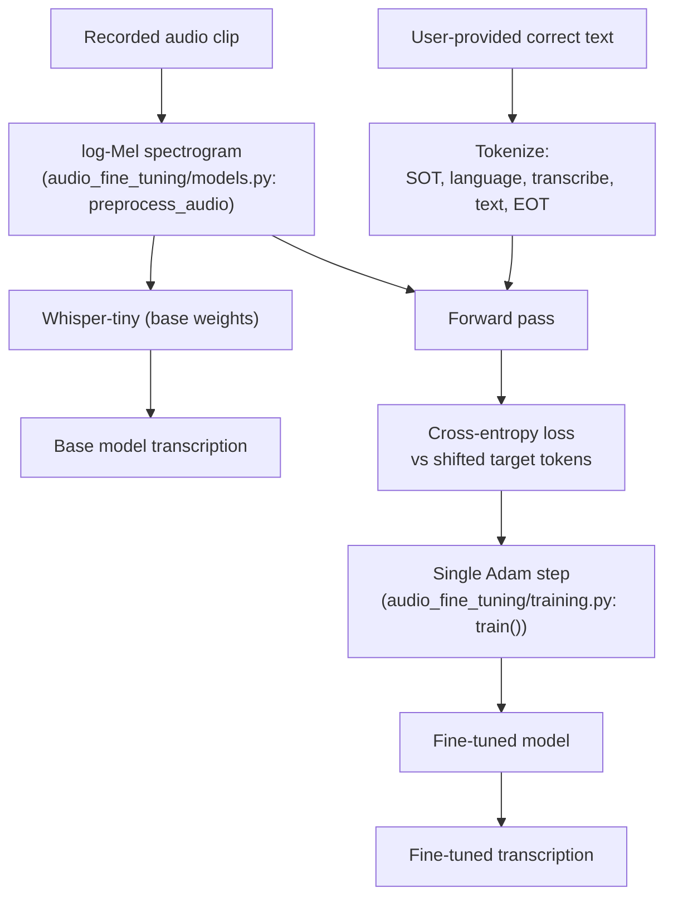
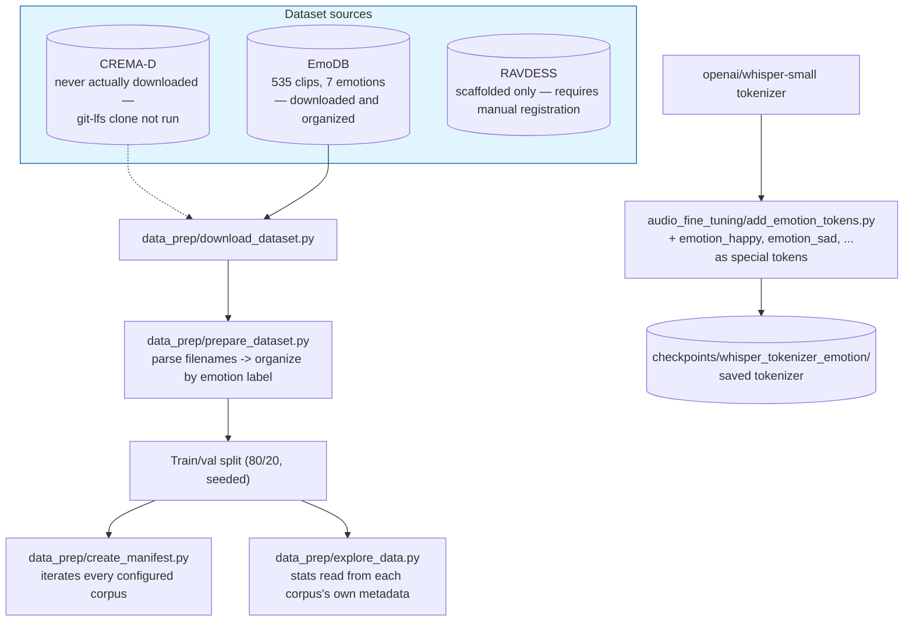
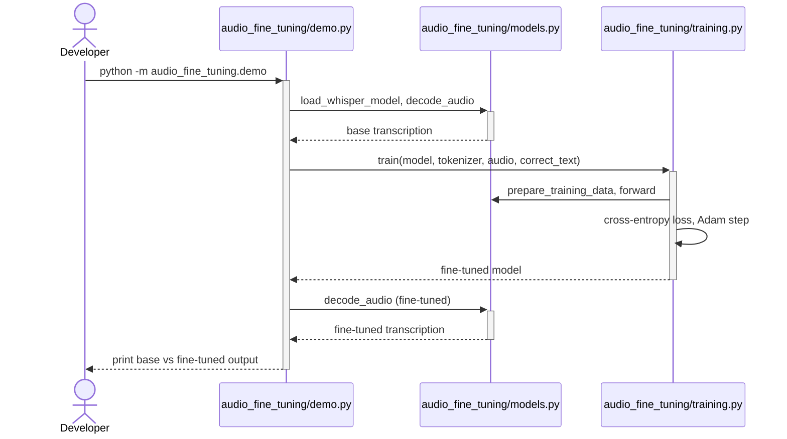
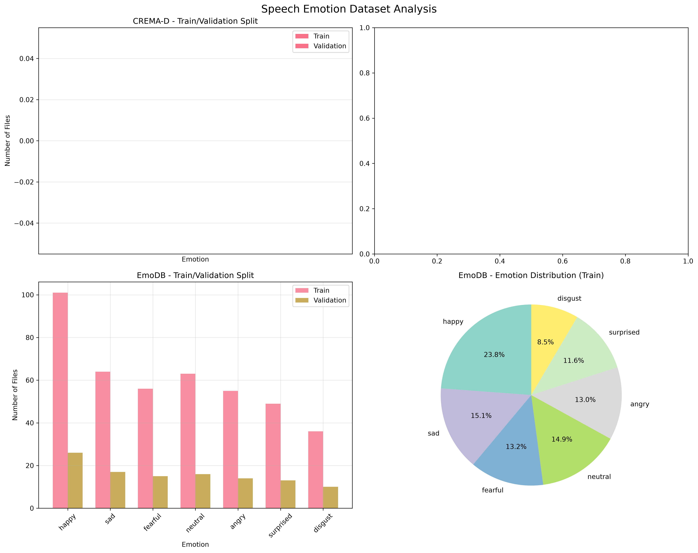
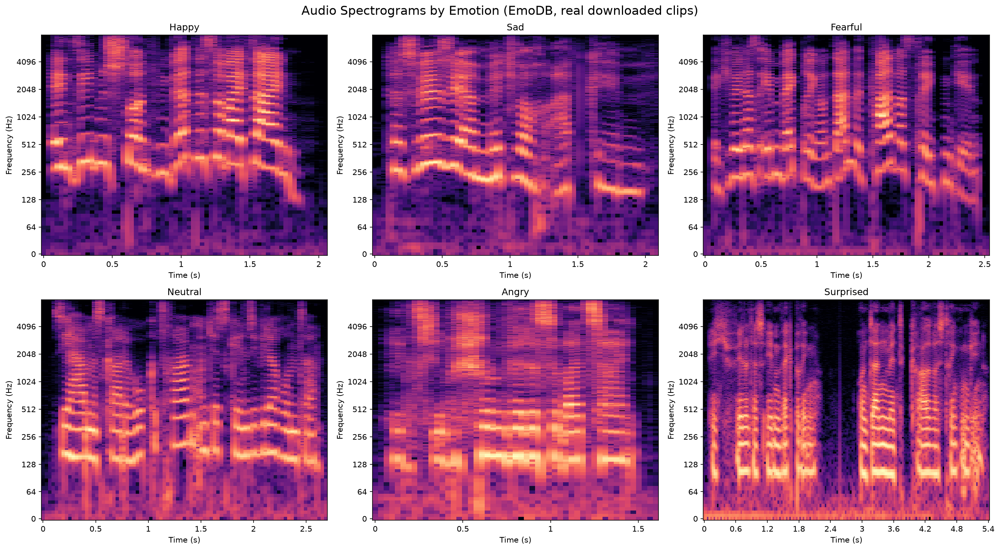
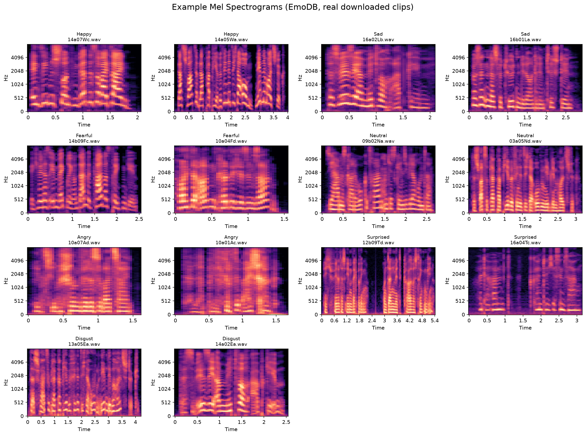

# Whisper Fine-Tuning

## TL;DR

- **What it is:** Whisper fine-tuning, two ways — a live fine-tuning demo, and a data pipeline for emotion-aware transcription that tags how something was said, not just what.
- **Result today:** a real gradient step measurably corrects a genuine mis-transcription (the base model hears "Roosh," the fine-tuned model hears "Rosh"), served via FastAPI.

I built this to fine-tune OpenAI's Whisper [1] speech-to-text model, in two parts: a live demo that
fine-tunes Whisper on a single `(audio, text)` pair in front of you, and a data pipeline for
emotion-aware transcription — teaching Whisper to tag *how* something was said, not just *what*
was said, on real speech-emotion datasets.

## Quickstart

```bash
make install
make demo
```

The CLI demo transcribes `data/audio.mp3` (supply your own — it's gitignored); the first run also
downloads Whisper-tiny's weights over the network. The browser UI is the unified frontend in
`ai-residency-frontend`, which calls this repo's API. `make docker-up` starts the FastAPI backend
in Docker instead, CPU-only regardless of host GPU.

## Table of Contents

1. [Introduction](#1-introduction)
2. [System Architecture](#2-system-architecture)
3. [Method](#3-method)
4. [Implementation](#4-implementation)
5. [Usage](#5-usage)
6. [Experimental Results](#6-experimental-results)
7. [Related Work](#7-related-work)
8. [References](#references)
9. [Acknowledgments](#acknowledgments)
10. [Dependencies](#dependencies)

## 1. Introduction

Every project so far has worked on text or images. Audio is a third modality,
and the first question is how to make it look like something a transformer can already handle.
Raw waveform samples are too dense and too weakly structured to feed a transformer directly at
30,000+ samples per second — the practical move (and the one Whisper itself makes) is to unbundle
the signal into frequencies first.

**Figure 1.** From raw waveform to something transformer-shaped.


A Fourier Transform decomposes a signal into how much each frequency contributes to it; doing that
in short overlapping windows across a clip produces a spectrogram: frequency on one axis, time on
the other, intensity as the value. That's a 2D array, the same shape a small stack of convolutions
(and then a transformer) can consume. This is also, not coincidentally, close to how the
[vision transformer project](https://github.com/RoshBeed/ai-residency-week3-vision-transformers) treats images: turn
the input into patches/tokens a transformer encoder can attend over.

Once the audio is a spectrogram, the actual task ("what words are these" or "what emotion is
this") is a sequence-generation problem no different in kind from the vision transformer project's multi-digit decoding or
the image captioning project's captioning: an encoder makes sense of the input, a decoder generates tokens one at a
time.

## 2. System Architecture

Before the method — here's how the two parts of this repo actually fit together, and how little
they share.

**Figure 2.** Repo layout: the two parts don't share code, only the underlying Whisper model.


## 3. Method

### 3.1 Whisper's Architecture

Whisper [1] is an encoder-decoder transformer trained on 680,000 hours of multilingual,
multitask audio-text data. The encoder side turns a log-Mel spectrogram into a sequence of hidden
states; the decoder side autoregressively generates text tokens, cross-attending to those hidden
states. That's the same encoder-decoder-with-cross-attention pattern as the original Transformer
[2] and the [vision transformer project's seq2seq model](https://github.com/RoshBeed/ai-residency-week3-vision-transformers)'s own decoder.

**Figure 3.** Whisper's architecture — the "Sequence-to-sequence learning" panel of Figure 1 from
the original paper (Radford et al. [1], arXiv:2212.04356).


This repo's `audio_fine_tuning/models.py` builds this graph via `whisper.load_model('tiny')`: a log-Mel
spectrogram goes through the two 1D convolutions plus GELU, gets a sinusoidal positional encoding
added, and runs through the teal encoder blocks; the multitask token sequence gets a learned
positional encoding and runs through the red decoder blocks, cross-attending to the encoder's
output at every layer to produce the next-token prediction shown at top. Every attention block
(both the self-attention inside each stack and the cross-attention bridging them) is the same
mechanism as the original Transformer [2].

Running `whisper-tiny`'s encoder on a real 30-second clip (`n_mels=80`, `n_state=384`) produces
these tensor shapes:

- `(1, 80, 3000)` — the input spectrogram
- `(1, 384, 3000)` — after the first convolution
- `(1, 384, 1500)` — after the stride-2 second convolution, where the sequence length halves
- `(1, 1500, 384)` — after the final permute into `(batch, time, channels)` for the transformer blocks

### 3.2 Multitask Token Format

What makes one Whisper model handle transcription, translation, and language identification is a
structured token prefix, not a different model per task:

**Figure 4.** Whisper's multitask training format — the "Multitask training format" panel of
Figure 1 from the original paper (Radford et al. [1], arXiv:2212.04356).


Every branch in this diagram is a real, still-used code path in `openai-whisper` today: a
`PREV` token plus previous text tokens for optional prompting, a `LANGUAGE TAG` for identification,
`TRANSCRIBE` vs. `TRANSLATE` for the task, and either the timestamp-token branch (for
time-aligned transcription) or `NO TIMESTAMPS` for plain text-only output, all terminating in
`EOT`. This repo only ever exercises the single narrowest path through it: `SOT → language →
TRANSCRIBE → text tokens → EOT`, no previous-text prompting, no translation, no timestamps. That's
what `audio_fine_tuning/models.py`'s `create_tokens()` builds (`sot, language_token, transcribe, *encode(text),
eot`) for a single training example. Concretely, the string
`<|startoftranscript|><|en|><|transcribe|><|notimestamps|>Hello, my name is Bes.<|endoftext|>`
becomes the token sequence `[50258, 50259, 50359, 50363, 15947, 11, 452, 1315, 307, 8190, 13,
50257]`.

### 3.3 Part 1: Fine-Tuning on One Example

The live demo does the smallest possible version of fine-tuning: one audio clip, one corrected
transcript, one gradient step, on the *entire* Whisper-tiny model (no adapter, no frozen layers,
every parameter gets a gradient).

**Figure 5.** The fine-tuning step, end to end.


The original demo ran this mechanism on a spoken "Hello, my name is Bes.": the base model
mis-transcribed the unusual name as "Bass," one Adam step (`lr=0.0001`) dropped the loss from
whatever the base loss was to 0.540 but *still* output "Bass," and a second step dropped it to
0.177 and finally produced "Bes." correctly. Section 6 reproduces this same experiment end to end
with a real spoken phrase, using this repo's actual `train()` function (a single step per call).

### 3.4 Part 2: Emotion-Aware Data Pipeline

The larger goal is teaching Whisper to output an emotion tag alongside the transcript, by adding
special tokens like `<emotion_happy>` to the tokenizer and training on labelled emotional speech.
This part of the repo builds everything up to (but not including) that training run:

**Figure 6.** The emotion data pipeline, and where it actually got to.


CREMA-D (7,442 clips) needs a `git lfs clone` of a multi-gigabyte GitHub repo; EmoDB (535 clips) is
a single ~40MB zip and downloads in seconds. Every stage in this pipeline loops over whichever
configured datasets are present on disk, so pointing it at CREMA-D or RAVDESS instead needs no code
changes. Section 6 runs the real pipeline end to end on EmoDB.

## 4. Implementation

Mapping the architecture from [Section 2](#2-system-architecture) onto the actual file layout:

```
config/__init__.py               Config(BaseConfig) and the dataset specs, in one dataclass
audio_fine_tuning/              The Whisper fine-tuning package
├── models.py                   Whisper loading, audio preprocessing, tokenization, forward pass
├── training.py                 Single-example fine-tuning step
├── demo.py                     CLI: base vs fine-tuned transcription on one audio file
└── add_emotion_tokens.py       Add <emotion_*> special tokens to the Whisper tokenizer
data_prep/
  download_dataset.py           Fetch CREMA-D (git-lfs) / EmoDB (direct zip); scaffold RAVDESS
  prepare_dataset.py            Organize raw audio by emotion label, create train/val split
  create_manifest.py            Build CSV manifests (audio_path, label) — CREMA-D path only
  explore_data.py               EDA: duration/sample-rate stats, spectrogram plots (CREMA-D-only plots)
serving/api.py                  FastAPI: POST /transcribe
checkpoints/
  whisper_tokenizer_emotion/    Saved tokenizer with emotion tokens added (add_emotion_tokens.py's output)

data/
  cremad_train.csv / cremad_val.csv   Generated manifests (paths are user-machine-specific)
  audio.mp3                     User-supplied/synthesized clip for demo.py / serving / train

datasets/                       Raw + organized audio corpora (CREMA-D, EmoDB, RAVDESS scaffold)
```

## 5. Usage

**Figure 7.** Actually running the Part 1 demo.


### Quickstart (Make + Docker)

`make` targets are the primary way to run this repo now: a Docker image build for each stage plus
a local `.venv`-based path, both driving the exact same Python entry points documented below.

```bash
make install        # uv sync -- local .venv from pyproject.toml/uv.lock
make demo           # python -m audio_fine_tuning.demo — CLI demo, base vs fine-tuned transcription
make serve          # python -m serving.api — FastAPI backend
make train          # python -m audio_fine_tuning.training — standalone single-example fine-tuning smoke test
make prepare-data   # Part 2: download → prepare → manifest → tokens → EDA, in sequence
make test           # pytest — 10 tests; 2 skip unless checkpoints/data are present locally

make docker-build-serve   # build the serving image (ffmpeg baked in)
make docker-build-train   # build the training image
make docker-up            # docker compose up -d serve
make docker-train         # docker compose --profile train up — the train service
make docker-down          # stop and remove the compose services
make help           # list all targets
```

Device selection comes from `ai_residency_common.get_device()` — CUDA, then Apple's MPS, then CPU,
in that order. `make train`/`make demo`/`make serve` (local, non-Docker) pick up MPS automatically
on Apple Silicon and run noticeably faster (roughly 3-4x on this repo's tiny/single-example scale)
than `make docker-train`/the containerized path, which is CPU-only regardless — Docker Desktop's
Linux VM has no MPS passthrough.

`make demo` expects a `data/audio.mp3` already sitting in the repo. It's gitignored and
user-supplied, deliberately never baked into the Docker image (the
`train` service needs the same file). There's no live microphone in this environment, or in most
container hosts, so I use the same synthesized-speech stand-in Section 6 below relies on:

```bash
say -o clip.aiff "My name is Rosh"
ffmpeg -y -i clip.aiff data/audio.mp3
```

(macOS-only — on Linux, supply any short spoken `.wav`/`.mp3` and point `audio_fine_tuning/demo.py`'s `target_text`
at whatever it actually says instead.)

### What each target actually runs

```bash
uv sync
# openai-whisper also needs the system ffmpeg binary — `brew install ffmpeg` /
# `apt install ffmpeg` — this is a real binary dependency, not something `uv sync` (or pip)
# installs. The Dockerfile installs it via apt-get automatically; the local venv path above
# still needs it installed by hand.

uv run python -m audio_fine_tuning.demo                   # CLI demo on data/audio.mp3 (not committed — provide your own, see above)
```

For Part 2:
```bash
uv run python -m data_prep.download_dataset   # fetch CREMA-D / EmoDB, scaffold RAVDESS
uv run python -m data_prep.prepare_dataset    # organize audio by emotion, create train/val split
uv run python -m data_prep.create_manifest    # write a CSV manifest per configured corpus
uv run python -m audio_fine_tuning.add_emotion_tokens           # extend the tokenizer with emotion tokens
uv run python -m data_prep.explore_data       # dataset stats + spectrograms (PNGs to data/)
```

A `notebooks/walkthrough.ipynb` notebook runs this same sequence end to end with narration,
importing the real functions from `audio_fine_tuning/models.py`/`training.py` and shelling out to the Part 2
scripts in order. It's useful for stepping through one stage at a time instead of running whole
files.

## 6. Experimental Results

**Part 1.** No microphone is available in this environment, so the demo clip is synthesized with
macOS's built-in text-to-speech (`say -o clip.aiff "My name is Rosh"`, converted to mp3) — genuine
audio through the real pipeline, just not captured live through a browser mic. Running
`audio_fine_tuning/demo.py` end to end:

```
Base model output:       My name is Roosh.
Fine-tuned model output:  == My name is Rosh
```

The base model mishears the uncommon name as "Roosh"; one Adam step (`lr=1e-4`) drops the loss from
**2.882 → 1.574** and corrects it to "Rosh." Whisper-tiny has no dropout anywhere in its
architecture, so the forward/backward pass is deterministic given fixed weights and input — this
result reproduces byte-for-byte on rerun.

**Figure 8.** The Streamlit UI (now in `ai-residency-frontend`).


**Part 2.** The emotion data pipeline runs end to end on EmoDB (535 clips, downloaded and
organized for real). The 80/20 split is seeded via `set_seed(config.seed)`, so these counts are
identical on every rerun:

| Emotion | Total | Train | Val |
|---|---|---|---|
| happy | 127 | 101 | 26 |
| sad | 81 | 64 | 17 |
| neutral | 79 | 63 | 16 |
| fearful | 71 | 56 | 15 |
| angry | 69 | 55 | 14 |
| surprised | 62 | 49 | 13 |
| disgust | 46 | 36 | 10 |

**Figure 9.** Real output from `data_prep/explore_data.py`'s structure analysis.


Real audio characteristics, computed from the downloaded clips: mean duration 2.89s (min 1.48s,
max 5.98s, std 1.10s), uniformly 16kHz. Per-emotion average duration ranges from 1.91s (angry) to
4.02s (surprised).

**Figure 10.** Real log-frequency spectrograms, one per emotion.


**Figure 11.** Real mel-spectrograms, two examples per emotion.


`audio_fine_tuning/add_emotion_tokens.py` loads `openai/whisper-small`'s tokenizer, adds the six
`<emotion_*>` tokens as special tokens, and saves the extended tokenizer to
`checkpoints/whisper_tokenizer_emotion/`. The demo above used EmoDB; the same pipeline runs
unchanged against CREMA-D or RAVDESS once those datasets are downloaded locally.

## 7. Related Work

- [The vision transformer project](https://github.com/RoshBeed/ai-residency-week3-vision-transformers) — the same
  encoder-decoder-with-cross-attention pattern (Figure 3), and the same "turn the input into a 2D
  array a transformer can consume" move (Figure 1) applied to images instead of audio.
- [The image captioning project](https://github.com/RoshBeed/ai-residency-week4-multimodal-captioning) —
  another frozen-pretrained-model fine-tuning project; where the image captioning project trains a small adapter and
  freezes everything else, this repo's Part 1 fine-tunes the entire (much smaller) Whisper-tiny
  model directly.

## References

[1] Radford, A., Kim, J. W., Xu, T., Brockman, G., McLeavey, C., & Sutskever, I. (2022). *Robust
Speech Recognition via Large-Scale Weak Supervision.* arXiv:2212.04356.

[2] Vaswani, A., Shazeer, N., Parmar, N., Uszkoreit, J., Jones, L., Gomez, A. N., Kaiser, Ł., &
Polosukhin, I. (2017). *Attention Is All You Need.* NeurIPS.

[3] Burkhardt, F., Paeschke, A., Rolfes, M., Sendlmeier, W., & Weiss, B. (2005). *A Database of
German Emotional Speech.* Interspeech. — EmoDB, the dataset actually used in Section 6.

[4] Cao, H., Cooper, D. G., Keutmann, M. K., Gur, R. C., Nenkova, A., & Verma, R. (2014). *CREMA-D:
Crowd-Sourced Emotional Multimodal Actors Dataset.* IEEE Transactions on Affective Computing. — the
dataset this repo scaffolds but never actually downloads in this environment.

## Acknowledgments

Built with Ben Bethell and Felipe Lavratti. Figures 3 and 4 reproduce the two panels of Figure 1 from the
original Whisper paper [1] (arXiv:2212.04356) directly.

## Dependencies

PyTorch · OpenAI `whisper` · Hugging Face `transformers` (`WhisperTokenizer`) · Streamlit ·
`streamlit-audiorec` · librosa · matplotlib / seaborn · ffmpeg (system binary) · CREMA-D / EmoDB
datasets
