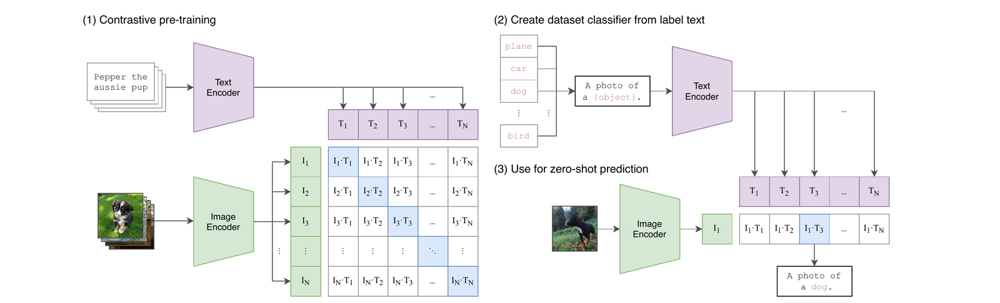
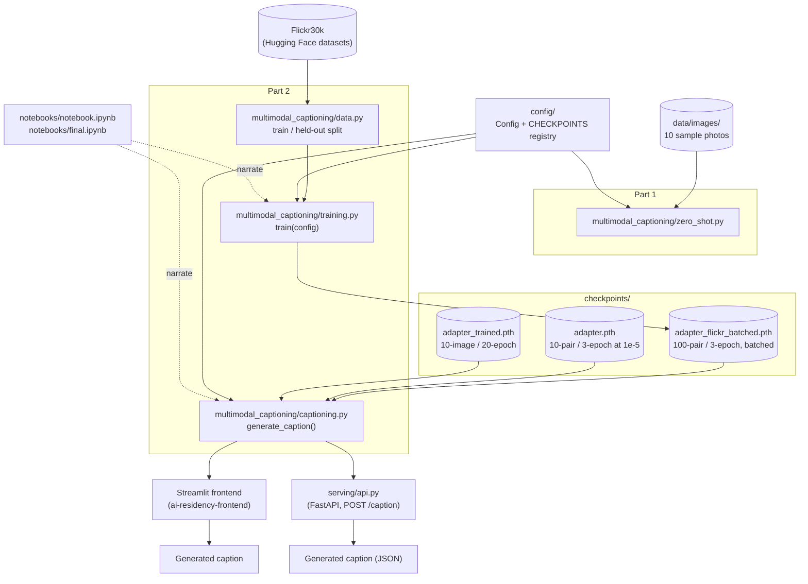
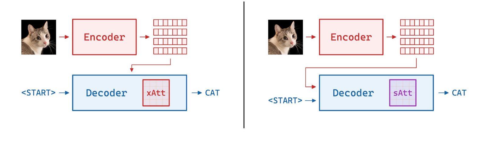
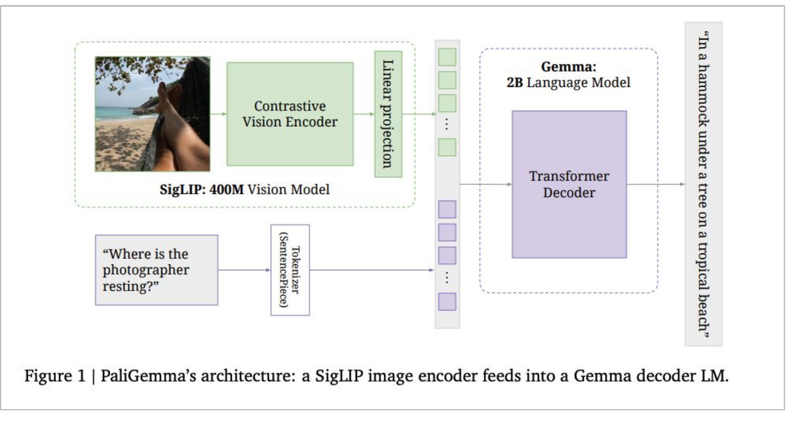
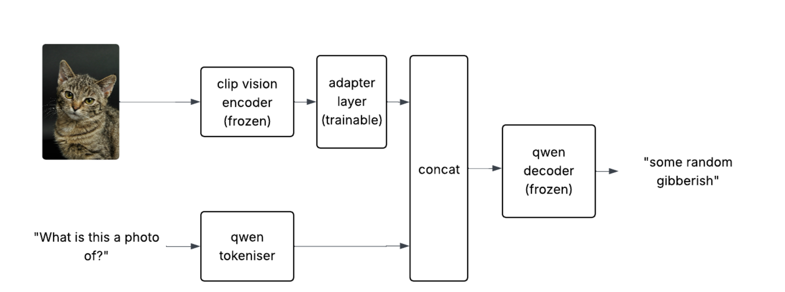
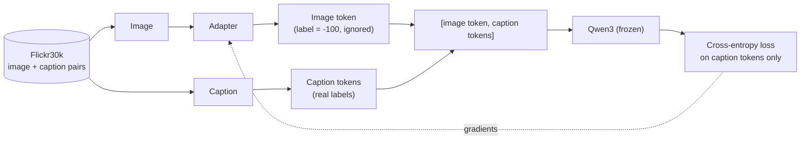
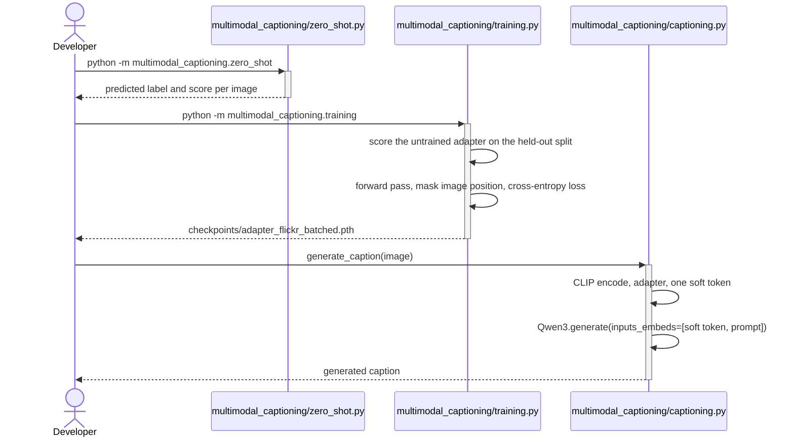
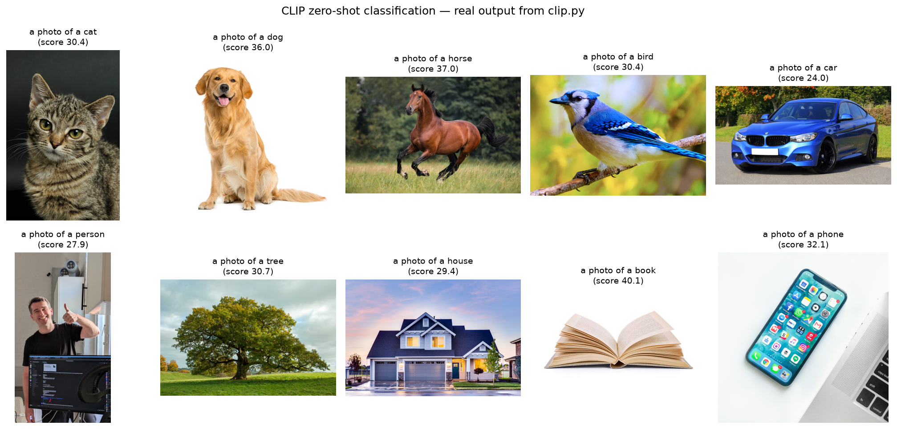
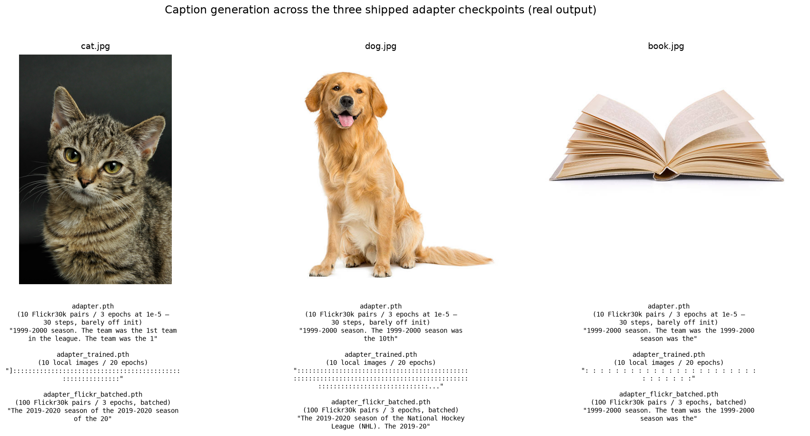

# Image Captioning — Bridging a Frozen CLIP Vision Encoder to a Frozen Qwen3 Language Model

## TL;DR

- **What it is:** image captioning via a small trainable adapter bridging a frozen CLIP vision encoder to a frozen Qwen3 language model (the LLaVA/PaLiGemma recipe).
- **What's built:** the full pipeline — data loading, adapter training with a held-out baseline, checkpointing, and a served inference path (FastAPI + Streamlit) — runs end to end, with three trained checkpoints shipped and comparable.

This repo has two parts: a warm-up exercise doing zero-shot image classification with CLIP, and
the main project — an image captioning model I built the way LLaVA and PaLiGemma do it: freeze a
large pretrained vision encoder and a large pretrained language model, and train only a small
adapter in between that translates image embeddings into the language model's embedding space.
The vision side is CLIP ViT-B/32 [1], the language side is [Qwen3-0.6B-Base](https://huggingface.co/Qwen/Qwen3-0.6B-Base),
and only the adapter's ~1.58M parameters ever receive a gradient.

## Quickstart

```bash
# one venv for the whole workspace
make install

# FastAPI on :8000, interactive docs at /docs
make serve SERVICE=multimodal-captioning

# read Usage first -- some stages run for hours
make train SERVICE=multimodal-captioning
```

Stages specific to this service live in its own Makefile (`make -C services/multimodal-captioning help`):

- `zero-shot` — Run Part 1: CLIP zero-shot classification over data/images/ (exits when done)

Checkpoints are resolved locally first, then from the Hugging Face Hub, so serving works on a host that has never trained anything.

## Table of Contents

1. [Introduction](#1-introduction)
2. [System Architecture](#2-system-architecture)
3. [Method](#3-method)
4. [Implementation](#4-implementation)
5. [Usage](#5-usage)
6. [Experimental Results](#6-experimental-results)
7. [Related Work](#7-related-work)
8. [References](#references)
9. [Acknowledgments](#acknowledgments)
10. [Dependencies](#dependencies)

## 1. Introduction

[The vision transformer project](https://github.com/RoshBeed/ai-residency/tree/main/services/vision-transformers) built a Vision Transformer from
scratch and trained the whole thing end to end on MNIST. That works when the target task is small
and cheap to supervise. It doesn't work when the target task is "describe any photo in fluent
English": there's no dataset large enough to teach both vision and language from scratch cheaply,
so I went with transfer learning instead: reuse two models that already understand their
respective modalities (CLIP already understands images, Qwen3 already understands language), keep
both frozen, and learn only the small piece that translates between them.

**Figure 1.** CLIP's own Figure 1 [1]: contrastive pretraining on image/caption pairs (left), then
reusing the trained encoders for zero-shot classification by turning class names into prompts
(right) — build a "dataset classifier" out of text embeddings, then pick the highest-scoring one for
a new image.


Part 1 of this repo (`multimodal_captioning/zero_shot.py`) *is* the right-hand half of this diagram, almost exactly:
`data/images/` stands in for "New image," the ten class names become `"a photo of a {label}"`
prompts, and `argmax` over the cosine similarities picks the label. See Figure 8 for what that
produces on the real 10-image set. That's classification, where the output is one label out of a
known set. Captioning is harder: the output is free-form text, generated by an autoregressive
language model, which raises the actual question this project answers. Given a frozen vision
encoder and a frozen language model, how do you actually connect them?

## 2. System Architecture

Before the method — here's how this repo is actually laid out and wired together. Everything runs
out of a flat set of modules at the repo root. Part 1 is
`multimodal_captioning/zero_shot.py`, a self-contained CLIP demo with no training in it. Part 2 splits along the seam the
pipeline already had: `multimodal_captioning/training.py` fits the adapter, `multimodal_captioning/captioning.py` is the single inference path,
and the FastAPI service (and the unified frontend, through it) calls its `generate_caption()`
rather than each carrying their own copy of model loading and `generate()`. One `Config` dataclass
supplies the
model names, the prompt, the sample size and the checkpoint paths to all of them, so a training run
and the service that loads its output cannot disagree about where anything lives.

**Figure 2.** Repo layout: the two parts, the three checkpoints, and the one inference path the UI
and the API share.


The two notebooks import and call the package rather than defining anything themselves.
`notebook.ipynb` walks the whole pipeline end to end; `final.ipynb` is the presentation-facing one
(caption the sample images, burn the captions onto them). Both call the same `train()` that
`make train` runs, so there's one training loop, not two drifting copies.

## 3. Method

### 3.1 Two Ways to Bridge a Vision Encoder to a Language Model

There are two established patterns. The original Transformer decoder [2] — and this repo's own
[the vision transformer project's seq2seq model](https://github.com/RoshBeed/ai-residency/tree/main/services/vision-transformers) — uses **cross-attention**:
a dedicated attention layer inside the decoder that attends to the encoder's output at every
generation step. LLaVA [4] and PaLiGemma [3] use something simpler: project the image into the
language model's embedding space and **concatenate** it as if it were just another token, then let
ordinary self-attention do the rest. No architectural change to the language model at all.

**Figure 3.** Cross-attention (`xAtt`, left) versus self-attention concatenation (`sAtt`, right) as
a vision-language bridge.


The left half is the original Transformer decoder / the vision transformer project's seq2seq pattern: the encoder's patch
features feed a dedicated `xAtt` layer inside the decoder at every generation step. The right half
is what this repo actually builds: the image features get folded straight into the decoder's input
sequence, and ordinary self-attention (`sAtt`, no architectural change to the decoder at all) does
the rest. I took the second path. It's the cheaper option in every sense that matters here: no
change to the language model's architecture, no cross-attention weights to initialize or train, and
the only new parameters are whatever sits between the vision encoder's output dimension and the
language model's embedding dimension.

**Figure 4.** PaliGemma [3] — the reference architecture this design borrows most directly: a
frozen contrastive vision encoder, a linear projection, and a frozen decoder LM.


This repo's Section 3.2 adapter follows this same shape (frozen vision encoder, projection, frozen
decoder LM), just with a different encoder/decoder pair:

### 3.2 This Repo's Adapter

The actual implementation swaps PaliGemma's SigLIP/Gemma pair for CLIP ViT-B/32 and Qwen3-0.6B-Base,
and swaps the single linear projection for a slightly deeper adapter:

```python
def build_adapter(clip_dim, qwen_dim, *, final_layer_norm=False):
    layers = [
        nn.Linear(clip_dim, qwen_dim),  # 512 → 1024
        nn.LayerNorm(qwen_dim),
        nn.GELU(),
        nn.Linear(qwen_dim, qwen_dim),  # 1024 → 1024
    ]
    if final_layer_norm:
        layers.append(nn.LayerNorm(qwen_dim))
    return nn.Sequential(*layers)
```

`final_layer_norm` is there because one of the three shipped checkpoints was trained with a
trailing `LayerNorm` and the other two weren't. Every checkpoint records which shape produced it,
so the loader reads the architecture off the artifact instead of guessing.

**Figure 5.** This repo's actual captioning architecture: CLIP vision encoder → adapter →
concatenated soft token → Qwen3 decoder.


The actual implementation follows this shape directly, with the dimensions filled in: CLIP
ViT-B/32's vision encoder and visual projection (both frozen) produce a 512-dim vector, the
trainable adapter maps it into Qwen3's 1024-dim embedding space as a single "soft token," and that
gets concatenated with the tokenized text prompt before Qwen3-0.6B-Base (frozen) decodes
autoregressively. A single CLIP pooled-image-embedding becomes exactly one soft token — unlike
ViT-style patch tokens (the vision transformer project's approach), the language model never sees
per-patch visual detail, only one 512-then-1024-dimensional summary vector per image.

### 3.3 Training: A Captioning Loss That Only Scores the Caption

Training only updates the adapter: CLIP and Qwen3 stay in `eval()` with `requires_grad = False`.
For a batch of (image, caption) pairs, the image is turned into one soft token, the caption is
tokenized, the two are concatenated, and the label at the image position is set to `-100` so
PyTorch's cross-entropy loss ignores it. The model is never asked to "predict" the image, only to
predict caption tokens conditioned on it.

**Figure 6.** The training signal, end to end.


## 4. Implementation

Mapping the architecture from [Section 2](#2-system-architecture) onto the actual file layout:

```
config/__init__.py        Config(BaseConfig) and the CHECKPOINTS registry — model names, prompt,
                          sample size, learning rate and every path, in one dataclass
multimodal_captioning/    The captioning package
├── data.py               FlickrDataset, the seeded train/held-out split, and the batching collate_fn
├── models.py             Frozen CLIP + Qwen3 loading (Backbones), build_adapter, load_adapter
├── training.py           train(config): baseline, epoch loop, best-checkpoint save, W&B + Hub
├── captioning.py         generate_caption(image) — the repo's one inference path
└── zero_shot.py          Part 1: CLIP zero-shot classification, no training and no adapter
serving/api.py            FastAPI: POST /caption (base64 image in, JSON out), GET /health
checkpoints/
├── adapter.pth                    10 Flickr30k pairs / 3 epochs at 1e-5 — 30 steps, barely off init
├── adapter_trained.pth            10 local images / 20 epochs, one- and two-word captions
└── adapter_flickr_batched.pth     100 Flickr30k pairs / 3 epochs, batch size 8 — best of the three
data/images/             10 sample photos (cat, dog, horse, bird, car, person, tree, house, book, phone)
tests/test_week4.py      Tests for the adapter, data pipeline, and serving path
pyproject.toml / uv.lock Dependencies, lint/type config, and a CPU-only torch index
```

The modules live in the `multimodal_captioning/` package, run as `python -m
multimodal_captioning.training` and so on, with `config/` and `serving/` alongside it — no
import-path juggling and no `sys.path` manipulation anywhere. It didn't used to be. `src/` was three
flat scripts that reached for each other through whatever happened to be on the import path,
`ui/app.py` patched `sys.path` at runtime because `streamlit run` only puts `ui/` on it, and there
was no configuration layer at all: model names, the prompt, the sample size, the learning rate and
three checkpoint file names were literals scattered across those scripts and eleven notebook cells,
with the same value written differently in different places.

Shared behaviour — device selection, logging, checkpoint format, seeding, Hub upload and W&B
tracking — comes from [`ai-residency-common`](https://github.com/RoshBeed/ai-residency/tree/main/libs/common), pinned by tag, so it
is defined once for the whole portfolio instead of reimplemented per repo. Checkpoints carry their
own architecture metadata via its `extra` field, so the loader always knows what shape to expect.

## 5. Usage

**Figure 7.** Actually running the two parts of this repo.


A `Makefile` wraps the commands below so the common paths are one line each:

```bash
make install       # uv sync — creates .venv from pyproject.toml/uv.lock
make zero-shot     # Part 1 — CLIP zero-shot classification, ~10 seconds, no GPU needed
make train         # Part 2 — fit the adapter on Flickr30k
make serve         # FastAPI backend, POST /caption, at http://localhost:8000
make notebook      # open notebooks/notebook.ipynb
make test          # run the test suite
make check         # lint + typecheck + tests
make help          # list every target
```

`make serve` runs the FastAPI backend, matching every other repo in this portfolio; the CLIP demo
is `make zero-shot`. The API itself is a thin wrapper around the same `generate_caption()` the
unified frontend in `ai-residency-frontend` calls.

`make train` writes to `checkpoints/adapter_flickr_batched.pth`, which is the committed checkpoint
the API and the frontend load by default. Running it overwrites that file. Point `checkpoint_dir`
or `checkpoint_name` somewhere else first if you want to keep the shipped one, which is what both
notebooks do (they train into a scratch directory).

The browser demo — upload an image, pick one of the three shipped checkpoints, generate a caption —
is the unified frontend in `ai-residency-frontend`, not in this repo. All three checkpoints load
and generate captions.

Docker wraps the same entrypoints as two single-purpose Dockerfiles, both `FROM roshbeed/ai-residency-base`:

```bash
make docker-build-serve   # docker build -f Dockerfile.serve -t ai-residency-week4-serve .
make docker-build-train   # docker build -f Dockerfile.train -t ai-residency-week4-train .
make docker-up            # docker compose up --build serve — API on :8000
make docker-train         # docker compose --profile train run --rm train
make docker-down          # docker compose down -v
```

`ai-residency-common` is a private git dependency, so an image build needs a GitHub token. The Makefile
takes it from `gh auth token` and passes it as a BuildKit secret, mounted for one layer and never
written into the image. `checkpoints/` and `data/` are excluded from the build context and
bind-mounted at run time instead, so a container always serves whatever was most recently trained
rather than a snapshot baked in at build time. `train` is gated behind a Compose profile, so a
plain `docker compose up` never starts a training run by accident.

Underneath the `make` targets, these are the actual raw commands:

```bash
uv sync
uv run python -m multimodal_captioning.zero_shot      # Part 1
uv run python -m multimodal_captioning.training       # Part 2 — train the adapter
uv run python -m serving.api    # Part 2 — over HTTP
uv run jupyter notebook notebooks/notebook.ipynb                              # Part 2 — cell by cell
```

Inference picks its device through `ai_residency_common.get_device()` — CUDA, then Apple's MPS, then CPU.
Training deliberately does not: it pins CPU by default for reproducibility (Section 6).
Either way `make docker-*` is CPU-only here regardless, since Docker Desktop's Linux VM has no MPS
passthrough. Qwen3-0.6B-Base is small enough to hold alongside CLIP in a few GB of memory.
`Qwen/Qwen3-0.6B-Base` is a public model, so no Hugging Face token is strictly required to download
it, though setting `HF_TOKEN` avoids the anonymous-request rate limit.

## 6. Experimental Results

**Part 1 — CLIP zero-shot classification: 10/10.** Running `make zero-shot` against the real
`data/images/` set, every single image is classified correctly:

**Figure 8.** Real output — CLIP correctly labels all ten images with no training at all.


This isn't surprising: CLIP was trained on this kind of task at a scale (400M image-text
pairs) far beyond anything else in this repo. But it's a genuinely working, from-scratch-run
zero-shot baseline, and a nice contrast to Part 2's much smaller-scale training.

**Part 2 — captioning.** All three shipped checkpoints load and generate through the UI, the API
and both notebooks, using greedy decoding, byte-identical across runs:

| Checkpoint | cat.jpg | dog.jpg | book.jpg |
|---|---|---|---|
| `adapter.pth` (10 pairs / 3 epochs) | "1999-2000 season. The team was the 1st team in the league. The team was the 1" | "1999-2000 season. The 1999-2000 season was the 10th" | "1999-2000 season. The team was the 1999-2000 season was the" |
| `adapter_trained.pth` (10 images / 20 epochs) | "]::::::::::::::::::::::::::..." | "::::::::::::::::::::::::::::..." | ":\n:\n:\n:\n:\n:\n:\n:\n:\n:\n..." |
| `adapter_flickr_batched.pth` (100 Flickr30k pairs / 3 epochs) | "The 2019-2020 season of the 2019-2020 season of the 20" | "The 2019-2020 season of the National Hockey League (NHL). The 2019-20" | "1999-2000 season. The team was the 1999-2000 season was the" |

**Figure 9.** The same results, alongside the actual input images.


At this training scale (100 pairs, 3 epochs, a ~1.58M-parameter adapter bridging a
596M-parameter frozen language model), captions stay fluent — Qwen3 free-associates confidently
regardless of what the adapter feeds it — but don't yet describe the images. `adapter_flickr_batched.pth`'s
captions vary by image where the least-trained checkpoint's barely do, a real sign the image token
is carrying information; more data and epochs is what closes the rest of the gap, and the training
loop, checkpointing, and serving path are already in place to do that without code changes.

**Evaluation.** `multimodal_captioning/data.py` splits the sample 80/20, and training scores an
untrained adapter on the held-out half as a baseline before training starts:

```
Baseline (untrained adapter) held-out loss: 6.4251
Epoch 1/3  train_loss=6.3248  val_loss=6.0981
Epoch 2/3  train_loss=6.2498  val_loss=6.1429
Epoch 3/3  train_loss=6.1023  val_loss=6.1085
Best held-out loss 6.0981 against baseline 6.4251 (beats baseline)
```

Training beats the baseline, with the best epoch first.

**Training runs on CPU** (`Config.train_on_cpu = True`) for reproducibility — the backward pass
over the frozen 596M-parameter decoder isn't deterministic on MPS across runs, while CPU runs are
byte-identical. Inference still uses `get_device()` (CUDA/MPS/CPU), since a forward-only pass is
deterministic on MPS. This follows precedent elsewhere in the portfolio: the dual-encoder retrieval
project's GRU tower and the vision transformer project's classifier trainer are CPU-only too.

## 7. Related Work

- [The vision transformer project](https://github.com/RoshBeed/ai-residency/tree/main/services/vision-transformers) — the
  from-scratch encoder-decoder ViT that motivates Section 3.1's cross-attention comparison, and
  the source of the frozen vision-encoder pattern reused here.
- [The dual-encoder retrieval project](https://github.com/RoshBeed/ai-residency/tree/main/services/vector-search-retrieval) —
  the same two-tower contrastive idea behind CLIP's own training (Figure 1), applied to text
  retrieval instead of image/caption pairs.

## References

[1] Radford, A., Kim, J. W., Hallacy, C., Ramesh, A., Goh, G., Agarwal, S., Sastry, G., Askell, A.,
Mishkin, P., Clark, J., Krueger, G., & Sutskever, I. (2021). *Learning Transferable Visual Models
From Natural Language Supervision.* ICML.

[2] Vaswani, A., Shazeer, N., Parmar, N., Uszkoreit, J., Jones, L., Gomez, A. N., Kaiser, Ł., &
Polosukhin, I. (2017). *Attention Is All You Need.* NeurIPS.

[3] Beyer, L., Steiner, A., Pinto, A. S., Kolesnikov, A., Wang, X., Salz, D., Neumann, M., Alabdulmohsin,
I., Tschannen, M., Bugliarello, E., Unterthiner, T., Keysers, D., Koppula, S., Liu, F., Grycner, A.,
Gritsenko, A., Houlsby, N., Kumar, M., Rong, K., Eisenschlos, J., Kabra, R., Bauer, M., Bošnjak, M.,
Chen, X., Minderer, M., Voigtlaender, P., Bica, I., Balazevic, I., Puigcerver, J., Papalampidi, P.,
Henaff, O., Xiong, X., Soricut, R., Harmsen, J., & Zhai, X. (2024). *PaliGemma: A Versatile 3B VLM
for Transfer.* arXiv:2407.07726. The reference architecture Section 3.2's adapter design borrows
from (linear-projection bridge, frozen encoder + frozen/lightly-tuned decoder).

[4] Liu, H., Li, C., Wu, Q., & Lee, Y. J. (2023). *Visual Instruction Tuning* (LLaVA). NeurIPS.

## Acknowledgments

Built with Ben Liong, Kadriye Turkcan, and Joao Esteves. Figure 1 is the CLIP paper's own Figure 1 [1].

## Dependencies

PyTorch · Hugging Face `transformers` (CLIP, Qwen3) · Hugging Face `datasets` (Flickr30k) ·
[`ai-residency-common`](https://github.com/RoshBeed/ai-residency/tree/main/libs/common) (device, logging, checkpoints, seeding, Hub,
W&B) · Streamlit · FastAPI · Jupyter · uv · ruff · mypy · pytest
