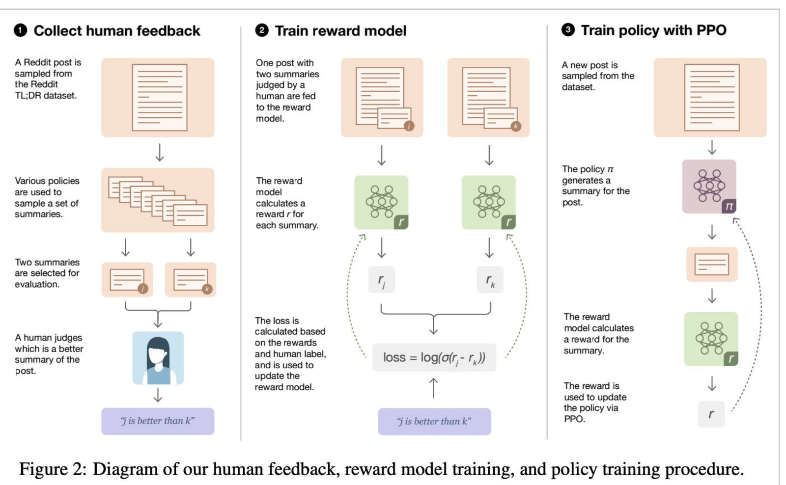
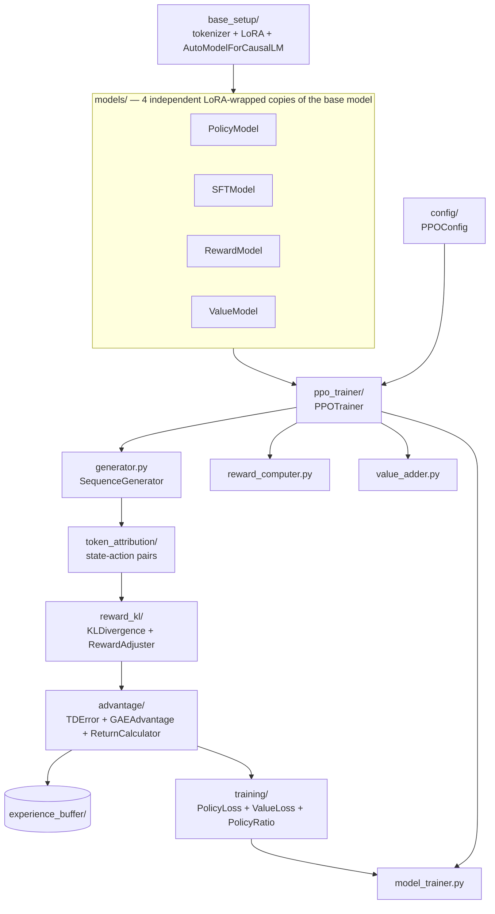
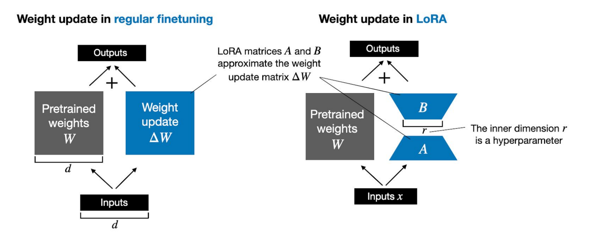
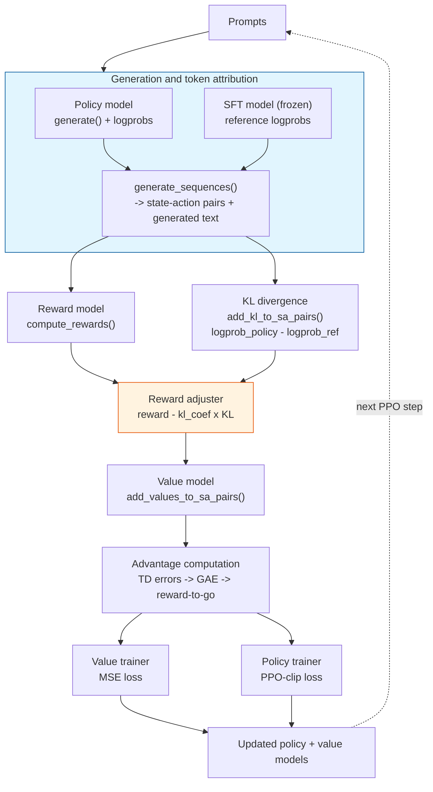
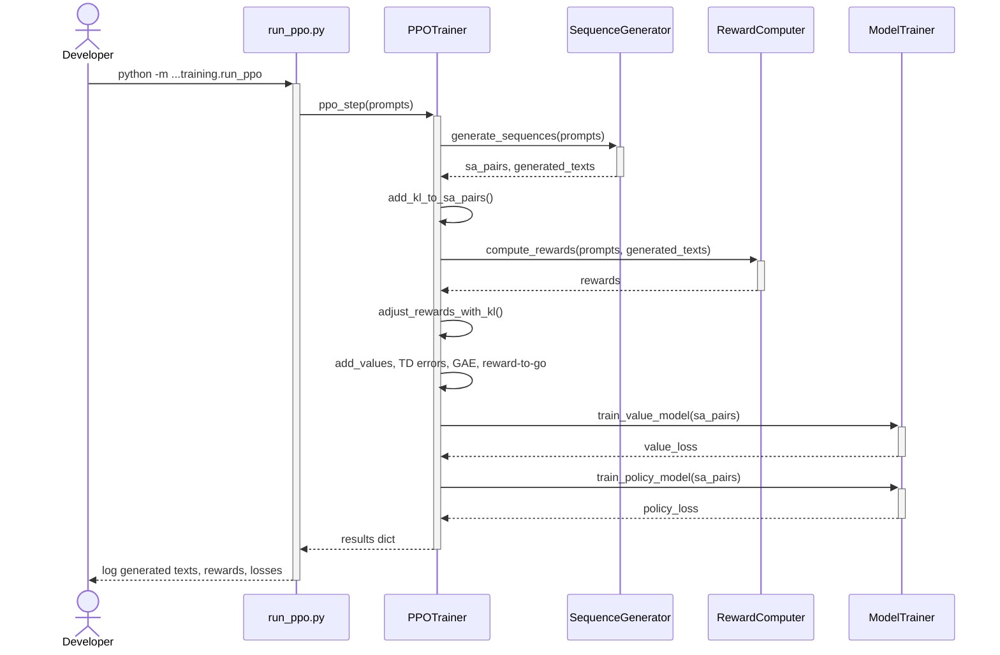

# PPO Language Model Fine-Tuning

## TL;DR

- **What it is:** a from-scratch, modular PPO implementation (generation, KL penalty, reward, advantage, policy/value updates) with LoRA, running end to end against a real pretrained reward model.
- **What it demonstrates:** every PPO mechanic — generation, KL penalty, GAE advantage, clipped policy and value losses — verified correct with real gradient steps and a full test suite.
- **What I'd do next:** run a real multi-epoch PPO loop on a GPU (the Terraform AWS path exists) and measure reward before/after.

I built a modular, from-scratch implementation of Proximal Policy Optimization (PPO) [1] for fine-tuning a
language model against a learned reward model: the RLHF training loop [2, 3] used to align GPT-3
into InstructGPT [4], broken into one small, independently testable module per step: generation,
KL penalty, reward computation, advantage estimation, and the policy/value updates themselves.

## Quickstart

```bash
# one venv for the whole workspace
make install

# FastAPI on :8000, interactive docs at /docs
make serve SERVICE=rlhf-ppo

# read Usage first -- some stages run for hours
make train SERVICE=rlhf-ppo
```

Checkpoints are resolved locally first, then from the Hugging Face Hub, so serving works on a host that has never trained anything.

## Table of Contents

1. [Introduction](#1-introduction)
2. [System Architecture](#2-system-architecture)
3. [Method](#3-method)
4. [Implementation](#4-implementation)
5. [Usage](#5-usage)
6. [Experimental Results](#6-experimental-results)
7. [Related Work](#7-related-work)
8. [References](#references)
9. [Acknowledgments](#acknowledgments)
10. [Dependencies](#dependencies)

## 1. Introduction

The brief was explicit about the shape of the pipeline: take a base model (Qwen3), do
supervised fine-tuning (SFT) on a summarization dataset, train a reward model on human preference
pairs, then train a policy model with PPO to maximize that reward. That's the same three-stage
recipe OpenAI used for their TL;DR summarization work [3]. I kept that framing here because this
repo's example prompts are literally in that dataset's format
(`SUBREDDIT: ... TITLE: ... POST: ... TL;DR:`).

**Figure 1.** The three-stage RLHF pipeline: collect human preference data, train a reward model
on it, then optimize a policy against that reward model with RL. Figure 2 from Stiennon et al.
2020 [3].


This repo's scope is stage 3: given a `PolicyModel`, a `RewardModel`, and a frozen reference
("SFT") model, run the actual PPO update loop: generate, score, penalize drift from the reference,
estimate advantages, update. Concretely, `PPOTrainer.ppo_step()` (Figure 4 below) is one iteration
of the diagram's third panel: a batch of prompts stands in for "a new post sampled from the
dataset," `PolicyModel.generate()` is "policy π generates a summary," `RewardComputer` is the
reward-model scoring arrow, and the value/policy gradient steps at the end are "the reward is used
to update the policy via PPO." Stages 1 and 2 in the diagram (collecting real preference labels,
training the reward model on them) are represented in the code by classes with the right names,
ready for a real preference dataset and training script to fill in.

## 2. System Architecture

Before the method — here's how the pieces actually fit together. Four independent model wrappers
(policy, reference, reward, value), one trainer orchestrating all of them, and a chain of small
modules doing generation, KL, advantage estimation, and the two training updates in between.

**Figure 2.** Package layout: four independent model wrappers sharing only code, not weights.


`PolicyModel`, `SFTModel`, `RewardModel`, and `ValueModel` all subclass the same `BaseModel`, and
`BaseModel.__init__` calls `base_model_setup.create_base_model()`, which does a fresh
`AutoModelForCausalLM.from_pretrained(...)` plus `get_peft_model(...)` every time it's called. Each
of the four models is a **separate, independently LoRA-initialized copy** of Qwen3-0.6B-Base, not
four heads sharing one transformer body. I didn't share a backbone across the four roles here,
which costs roughly 4x the memory a shared design would need, in exchange for each role's forward
pass being completely independent of the others.

## 3. Method

### 3.1 Parameter-Efficient Fine-Tuning with LoRA

Four models need gradients or forward passes here (policy, reference, reward, value), each
wrapping a full copy of Qwen3-0.6B-Base. Fine-tuning every parameter of four separate 0.6B-param
copies is the kind of thing PEFT exists to avoid, so I used LoRA [5] instead: freeze the pretrained
weight matrix entirely and learn a low-rank update on top of it.

**Figure 3.** Weight updates in regular fine-tuning versus LoRA, Figure 1 from Hu et al. 2021 [5].


`base_setup/lora_setup.py` applies this to the attention projections
(`q_proj`, `k_proj`, `v_proj`, `o_proj`) with rank `r=16`, via Hugging Face's `peft` library. One
line (`get_peft_model(base_model, lora_config)`) stands in for the `A`/`B` decomposition above.
The frozen gray `W` block on the right is what `get_peft_model` does under the hood: the pretrained
`q_proj`/`k_proj`/`v_proj`/`o_proj` weight matrices are left untouched and marked
`requires_grad=False`, while `peft` inserts the trainable low-rank `A`/`B` pair (`r=16` here, versus
the diagram's generic `r`) alongside them. Training only ever touches `A` and `B`, never `W` itself.

### 3.2 The PPO Step

`PPOTrainer.ppo_step()` is ten sequential function calls, each one module:

**Figure 4.** One PPO step, matching `PPOTrainer.ppo_step()` line for line.


Generation produces a sequence token by token; each token becomes one (state, action) pair: state
is the prompt plus everything generated so far, action is the next token. Both the policy and the
frozen reference model score that same action, and the difference of their log probabilities is
the per-token KL divergence:

```python
# reward_kl/kl_divergence.py
pair["kl_div"] = logprob_policy - logprob_ref
```

That KL gets subtracted from the sequence-level reward
(`reward_kl/reward_adjuster.py`: `adjusted_reward = reward - kl_coef * kl`),
the mechanism that stops the policy from drifting arbitrarily far from the reference model just to
chase reward. From there, TD errors (`advantage/td_error.py`), GAE
(`advantage/gae_advantage.py`, the standard backwards recursive
`gae = td_error + gamma * lam * gae`), and reward-to-go all feed two separate trainers: the value
model minimizes MSE against reward-to-go, and the policy model maximizes the PPO-clipped
objective:

```python
# training/policy_loss.py
ratio = torch.exp(new_logprobs - old_logprobs)
unclipped = ratio * advantages
clipped = torch.clamp(ratio, 1 - clip_epsilon, 1 + clip_epsilon) * advantages
loss = -torch.mean(torch.min(unclipped, clipped))
```

I recompute both `old_logprobs` (in `generator.py`) and `new_logprobs` (in `policy_ratio.py`) the
same way: a direct, correctly-masked forward pass over the real token sequence, not from
`generate()`'s own sampling-time scores. Getting that identical on both sides is what makes the PPO
ratio `exp(new_logprobs - old_logprobs)` meaningful at all — see [Section 6](#6-experimental-results)
for the invariant this guarantees.

## 4. Implementation

Mapping the architecture from [Section 2](#2-system-architecture) onto the actual file layout:
this repo is a flat set of modules at the repo root — no `src/`, no install step, no `sys.path`
manipulation anywhere. `make train SERVICE=rlhf-ppo` runs `python -m training.run_ppo` and `make serve SERVICE=rlhf-ppo` runs
`python -m serving.api`, directly.

Shared concerns that every repo in this portfolio needs identically — device selection, logging,
seeding, the base config fields — come from [`libs/common`](https://github.com/RoshBeed/ai-residency/tree/main/libs/common)
rather than being reimplemented here. `PPOConfig` inherits from its `BaseConfig`.

```

├── config/                PPOConfig(BaseConfig) — model name, LoRA rank, PPO hyperparameters
├── base_setup/            Tokenizer, LoRA config, and base-model construction
├── models/                PolicyModel, SFTModel, RewardModel, ValueModel (each: BaseModel + a head)
├── ppo_trainer/
│   ├── ppo_trainer.py       PPOTrainer — orchestrates the 10-step ppo_step()
│   ├── generator.py         SequenceGenerator — generation + per-token (state, action) extraction
│   ├── reward_computer.py   RewardComputer — scores full (prompt + generation) text
│   ├── value_adder.py       ValueAdder — attaches value predictions to (s, a) pairs
│   └── model_trainer.py     ModelTrainer — value MSE loss + policy PPO-clip loss, two optimizers
├── token_attribution/     Alternative (s, a) pair construction path (extractor + pair builder)
├── reward_kl/             KLDivergence, RewardAdjuster
├── advantage/             TDError, GAEAdvantage, ReturnCalculator
├── experience_buffer/     Simple list-based replay buffer
├── training/
│   ├── policy_ratio.py      PolicyRatio — recomputes log pi_new(a|s) for the PPO ratio
│   ├── policy_loss.py       PolicyLoss — the PPO-clip surrogate objective
│   ├── value_loss.py        ValueLoss — MSE against reward-to-go
│   └── run_ppo.py           Entrypoint: one ppo_step() on two example prompts (`make train SERVICE=rlhf-ppo`)
├── serving/api.py         FastAPI generation service (`make serve SERVICE=rlhf-ppo`), what the portfolio frontend calls
└── sa_pair.py             The (state, action) dict every pipeline stage reads from and writes to
examples/basic_usage.py  Three consecutive PPO steps, for watching the losses move
notebooks/
├── rosh.ipynb             The original exploratory notebook this modular package was refactored from
└── walkthrough.ipynb      Narrated, cell-by-cell run of the real ppo_step() call sequence
tests/test_ppo_components.py   Unit tests for every module above
```

## 5. Usage

The commands below are the primary, documented way to run this repo: a thin `Makefile` wrapping
the real entrypoints, plus a Docker path for running them without a local Python setup at all.

```bash
make install   # uv sync — installs from pyproject.toml/uv.lock
make train SERVICE=rlhf-ppo     # uv run python -m training.run_ppo — see note below
make serve SERVICE=rlhf-ppo     # uv run python -m serving.api — FastAPI generation service on :8000
make test SERVICE=rlhf-ppo      # uv run pytest -q
make check     # lint + strict mypy + tests, everything CI would run
```

**What the generation demo does:** the browser UI (the unified frontend in `services/frontend`,
calling this repo's `serving/api.py`) loads `PolicyModel` and generates a sampled completion for a
prompt you type in — the real generation pipeline end to end (tokenizer setup with
`padding_side="left"`, float32 model loading, LoRA wrapping, sampling `generate()`). This is the
one-model demo path; `PolicyModel` here is a freshly LoRA-initialized copy of Qwen3-0.6B-Base, and
`make train SERVICE=rlhf-ppo` below exercises the full four-model pipeline.

**What `make train SERVICE=rlhf-ppo` actually runs:** one PPO step end to end (generation, KL penalty, reward
scoring, GAE advantage, one value-model gradient step, one policy-model gradient step) on two
example prompts. `examples/basic_usage.py` runs three of them back to back to watch the losses move
between steps.

**What `make serve SERVICE=rlhf-ppo` actually runs:** the same FastAPI generation service (`serving/api.py`) the
portfolio frontend calls, matching every other project's HTTP contract.

**Device selection:** `PPOTrainer` calls `ai_residency_common.get_device()`, which picks `cuda` > `mps` >
`cpu` in that order, at construction time. Running this locally on Apple Silicon
now uses MPS automatically: four float32 model copies (SFT/policy/reward/value) benefit
meaningfully from it, and I confirmed empirically that LoRA/PEFT plus batched `generate()` produce
the same coherent output on MPS as on CPU, just faster. Inside Docker, this always falls back to
CPU. The container is Linux, and MPS is a macOS-only backend with no passthrough into a Linux VM,
so `make -C deploy up  # then: docker compose --profile train run --rm train-rlhf-ppo`/`make -C deploy up` never see `mps` regardless of the host.

**Figure 5.** Running `training/run_ppo.py` (what `make train SERVICE=rlhf-ppo` runs under the hood).


```bash
python -m training.run_ppo
pytest -q
```

### Docker

Two single-purpose Dockerfiles, both `FROM roshbeed/ai-residency-base-serve`: `Dockerfile.serve` (the FastAPI
generation service) and `Dockerfile.train` (one PPO step on a GPU host). Neither needs a git
credential — `libs/common` is already installed in the base image.

```bash
# both images for this service, built from the repository root
make build SERVICE=rlhf-ppo
make push SERVICE=rlhf-ppo

# the whole stack, this service included
make -C deploy up

# train in a container
cd deploy && docker compose --profile train run --rm train-rlhf-ppo
```

`train` is profile-gated in `docker-compose.yml` (`profiles: [train]`) so a bare
`docker compose up` never runs a real gradient-update step by accident; `serve` has no such gate
since it's safe to run by default. A commented-out GPU reservation block sits in
`docker-compose.yml` for a future real GPU host, inert on this CPU-only environment but
structurally ready.

## 6. Experimental Results

`PPOTrainer.ppo_step()` runs end to end against a real pretrained reward model, with a fixed seed
(`libs/common`'s `set_seed`) for reproducible runs. One gradient step on two example
prompts produces:

```
Generated texts: [" I'm pretty sure we should; however NodeList was",
                   ' Do i use the more expensive alternative, and if']
Rewards: [1.3879, 1.3136]
Value loss: 57.1910
Policy loss: -6.9180
```

The PPO ratio — `exp(new_logprobs - old_logprobs)` — comes back at exactly 1.0000 across every
token before any gradient step, on a deliberately unequal-length prompt pair, and a regression
test asserts it. That's the invariant that matters most here: it confirms `old_logprobs` and
`new_logprobs` are genuinely comparable, both computed via a real, correctly-masked forward pass
rather than `generate()`'s own sampling-time scores (see [Section 3.2](#32-the-ppo-step)).

`RewardModel` and `SFTModel` are both fresh LoRA-initialized copies of Qwen3-0.6B-Base — neither
has gone through a separate reward-model or SFT training stage yet, so a PPO run today scores
generations against an untrained head rather than a real preference model. Training either is the
natural next step, using the `PPOTrainer`/`ModelTrainer` machinery already in place.

## 7. Related Work

- [the image captioning project](https://github.com/RoshBeed/ai-residency/tree/main/services/multimodal-captioning) —
  both projects load Qwen3 explicitly in float32, since a bf16-by-default checkpoint isn't
  compatible with the float32 heads either one adds on top.
- [the vision transformer project](https://github.com/RoshBeed/ai-residency/tree/main/services/vision-transformers) — the same
  "break it into small, independently-testable modules" approach applied here to a training loop
  (generation, KL, reward, advantage, policy/value updates) rather than a model's forward pass.

## References

[1] Schulman, J., Wolski, F., Dhariwal, P., Radford, A., & Klimov, O. (2017). *Proximal Policy
Optimization Algorithms.* arXiv:1707.06347.

[2] Christiano, P., Leike, J., Brown, T. B., Martic, M., Legg, S., & Amodei, D. (2017). *Deep
Reinforcement Learning from Human Preferences.* NeurIPS.

[3] Stiennon, N., Ouyang, L., Wu, J., Ziegler, D. M., Lowe, R., Voss, C., Radford, A., Amodei, D.,
& Christiano, P. (2020). *Learning to Summarize from Human Feedback.* NeurIPS. The Reddit TL;DR
dataset and three-stage recipe (Figure 1) this repo's prompts and task brief are modeled on.

[4] Ouyang, L., Wu, J., Jiang, X., Almeida, D., Wainwright, C. L., Mishkin, P., Zhang, C.,
Agarwal, S., Slama, K., Ray, A., Schulman, J., Hilton, J., Kelton, F., Miller, L., Simens, M.,
Askell, A., Welinder, P., Christiano, P., Leike, J., & Lowe, R. (2022). *Training Language Models
to Follow Instructions with Human Feedback.* NeurIPS. (InstructGPT)

[5] Hu, E. J., Shen, Y., Wallis, P., Allen-Zhu, Z., Li, Y., Wang, S., Wang, L., & Chen, W. (2021).
*LoRA: Low-Rank Adaptation of Large Language Models.* arXiv:2106.09685.

## Acknowledgments

Built with Helen Zhou, Ewan Beattie, and Aparna Pillai; the from-scratch PPO implementation is my
own. Figures 1 and 3 reproduce Figure 2 from Stiennon et al. [3] and Figure 1 from Hu et al. [5]
directly (see References).

## Dependencies

PyTorch · Hugging Face `transformers` · `peft` (LoRA) · `datasets` · NumPy · tqdm · `accelerate` ·
FastAPI · Streamlit · [`libs/common`](https://github.com/RoshBeed/ai-residency/tree/main/libs/common) (shared device,
logging, config and tracking helpers) · ruff · mypy
