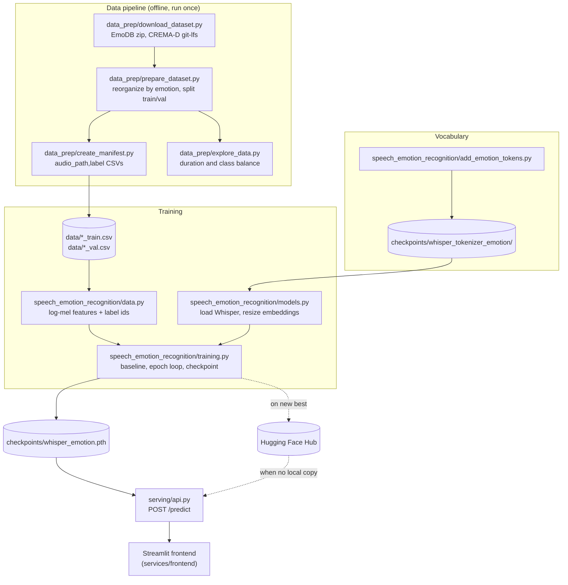
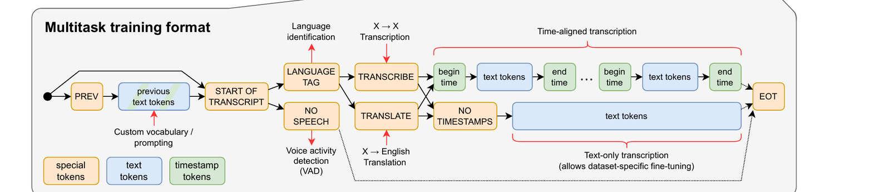
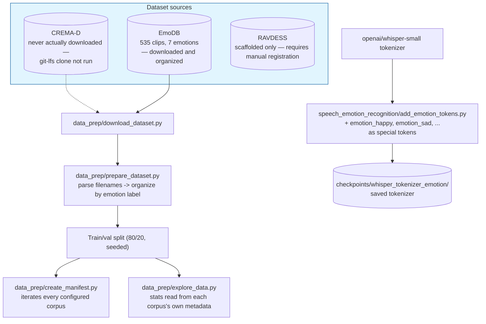

# Emotion-aware Whisper: the emotion is a token, not a head

## TL;DR

- **What it is:** Whisper fine-tuned to emit a special token naming the emotion in a clip, using
  the same mechanism its decoder already has for language and task — not a classifier head bolted
  onto the encoder.
- **Reported against:** the majority-emotion baseline, which on a corpus this size is a genuinely
  competitive score.

Emotion could be a separate head. It is not, here, and the reason is that Whisper's decoder already
emits special tokens — `<|en|>`, `<|transcribe|>` — as ordinary vocabulary entries. Adding
`<emotion_happy>` and its five siblings to that same vocabulary lets the model say what it heard
through machinery it already has, trained by the same cross-entropy that trains everything else.

## Quickstart

```bash
# one venv for the whole workspace
make install

# FastAPI on :8000, interactive docs at /docs
make serve SERVICE=speech-emotion-recognition
```

Training needs the corpora and the extended tokenizer first:

```bash
make -C services/speech-emotion-recognition download-data   # EmoDB downloads; CREMA-D is a slow clone
make -C services/speech-emotion-recognition prepare-data    # organize, split, manifest, explore
make -C services/speech-emotion-recognition add-tokens      # extend the Whisper tokenizer
make train SERVICE=speech-emotion-recognition
```

Checkpoints are resolved locally first, then from the Hugging Face Hub, so serving works on a host
that has never trained anything.

## 1. Introduction

Whisper transcribes. It does not, out of the box, tell you how something was said — and *how* is
often the point: the same sentence read angrily and sadly is the same transcript and a different
message.

The obvious move is a classifier head on the encoder. This does something else, because Whisper's
decoder already emits special tokens for language and task as ordinary vocabulary entries. Adding
one token per emotion to that same vocabulary lets the model say what it heard through machinery
it already has, trained by the same cross-entropy that trains everything else.

The [sibling service](../whisper-fine-tuning) fine-tunes the same model for a different reason: to
get one speaker's name right. They share the base checkpoint and nothing else.

## 2. System Architecture

Two corpora in, one token out. The pipeline's whole job is to turn corpora that disagree about
everything into one uniform `audio_path,label` manifest, so nothing downstream has to know which
corpus a clip came from.

**Figure 2.** From raw corpora to a served prediction.


The dotted edges are the reason this runs on a host that never trained anything: the trainer
publishes to the Hub, and the service resolves its checkpoint locally first, then from the Hub.

## 3. Method

### 3.1 Whisper's Architecture

Whisper [1] is an encoder-decoder transformer trained on 680,000 hours of multilingual,
multitask audio-text data. The encoder side turns a log-Mel spectrogram into a sequence of hidden
states; the decoder side autoregressively generates text tokens, cross-attending to those hidden
states. That's the same encoder-decoder-with-cross-attention pattern as the original Transformer
[2] and the [vision transformer project's seq2seq model](https://github.com/RoshBeed/ai-residency/tree/main/services/vision-transformers)'s own decoder.

**Figure 3.** Whisper's architecture — the "Sequence-to-sequence learning" panel of Figure 1 from
the original paper (Radford et al. [1], arXiv:2212.04356).


`speech_emotion_recognition/models.py` loads this graph through HF `transformers`: a log-Mel
spectrogram goes through the two 1D convolutions plus GELU, gets a sinusoidal positional encoding
added, and runs through the teal encoder blocks; the multitask token sequence gets a learned
positional encoding and runs through the red decoder blocks, cross-attending to the encoder's
output at every layer to produce the next-token prediction shown at top. Every attention block
(both the self-attention inside each stack and the cross-attention bridging them) is the same
mechanism as the original Transformer [2].

Running `whisper-tiny`'s encoder on a real 30-second clip (`n_mels=80`, `n_state=384`) produces
these tensor shapes:

- `(1, 80, 3000)` — the input spectrogram
- `(1, 384, 3000)` — after the first convolution
- `(1, 384, 1500)` — after the stride-2 second convolution, where the sequence length halves
- `(1, 1500, 384)` — after the final permute into `(batch, time, channels)` for the transformer blocks

### 3.2 Multitask Token Format

What makes one Whisper model handle transcription, translation, and language identification is a
structured token prefix, not a different model per task:

**Figure 4.** Whisper's multitask training format — the "Multitask training format" panel of
Figure 1 from the original paper (Radford et al. [1], arXiv:2212.04356).


Every branch in this diagram is a real, still-used code path in Whisper today: a
`PREV` token plus previous text tokens for optional prompting, a `LANGUAGE TAG` for identification,
`TRANSCRIBE` vs. `TRANSLATE` for the task, and either the timestamp-token branch (for
time-aligned transcription) or `NO TIMESTAMPS` for plain text-only output, all terminating in
`EOT`. This repo only ever exercises the single narrowest path through it: `SOT → language →
TRANSCRIBE → text tokens → EOT`, no previous-text prompting, no translation, no timestamps. That's
the shape the emotion token slots into (`sot, language_token, transcribe, *encode(text),
eot`) for a single training example. Concretely, the string
`<|startoftranscript|><|en|><|transcribe|><|notimestamps|>Hello, my name is Bes.<|endoftext|>`
becomes the token sequence `[50258, 50259, 50359, 50363, 15947, 11, 452, 1315, 307, 8190, 13,
50257]`.

### 3.3 The Data Pipeline

The larger goal is teaching Whisper to output an emotion tag alongside the transcript, by adding
special tokens like `<emotion_happy>` to the tokenizer and training on labelled emotional speech.
This part of the repo builds everything up to (but not including) that training run:

**Figure 6.** The emotion data pipeline, and where it actually got to.


CREMA-D (7,442 clips) needs a `git lfs clone` of a multi-gigabyte GitHub repo; EmoDB (535 clips) is
a single ~40MB zip and downloads in seconds. Every stage in this pipeline loops over whichever
configured datasets are present on disk, so pointing it at CREMA-D or RAVDESS instead needs no code
changes. Section 6 runs the real pipeline end to end on EmoDB.


### 3.4 Training Target

The manifests carry `audio_path` and `label`, and nothing else. That is deliberate rather than a
gap: EmoDB and CREMA-D are fixed-sentence corpora — every speaker reads the same handful of
sentences, and what varies is the delivery. There is no per-clip transcript to learn, so the
training target is the emotion token alone.

The decoder is trained with the standard cross-entropy Whisper already uses. Padded label positions
are set to `-100`, which Whisper's loss ignores, so a short label in a batch of longer ones
contributes nothing rather than teaching the model to predict padding.

### 3.5 Reading the Prediction Back

At inference the label is a single token, so the decoder's first step after the forced prefix
already holds the whole answer. Rather than generating text and parsing it back, the service reads
the logits at that step, selects the six emotion-token positions, and softmaxes over just those.

Two things follow from that. Every emotion gets a probability, not only the winner — so the service
returns a distribution the frontend can render as bars. And the prediction cannot be a token
outside the emotion set, because no other token was ever a candidate.

## 4. Implementation

```
services/speech-emotion-recognition/
├── config/                     DATASET_SPECS (where each corpus lives, and how it spells the
│                               emotion inside a filename) plus Config
├── data_prep/
│   ├── download_dataset.py     Fetch the corpora
│   ├── prepare_dataset.py      Reorganize by emotion, split train/val
│   ├── create_manifest.py      Write the audio_path,label CSVs everything downstream reads
│   └── explore_data.py         Duration and class-balance profiling
├── speech_emotion_recognition/
│   ├── add_emotion_tokens.py   Extend the Whisper tokenizer, one token per emotion
│   ├── data.py                 Manifest-backed Dataset: log-mel features + label ids
│   ├── models.py               Load Whisper and resize its embeddings to the extended vocabulary
│   └── training.py             Fine-tuning loop, baseline, checkpointing, Hub upload
├── serving/api.py              FastAPI: POST /predict, /health
└── tests/
```

The one invariant worth stating: **the tokenizer and the model's embedding table must agree about
how many tokens exist.** `add_emotion_tokens` grows the vocabulary; a model loaded against the base
vocabulary has no rows for the new ids. `models.py` calls `resize_token_embeddings` in the same
function that loads either one, so they cannot drift apart.

## 5. Usage

```bash
# 1. Fetch the corpora. EmoDB is a ~40MB zip; CREMA-D is a multi-gigabyte git-lfs clone.
make -C services/speech-emotion-recognition download-data

# 2. Reorganize by emotion, split train/val, write manifests, profile the audio.
make -C services/speech-emotion-recognition prepare-data

# 3. Extend the tokenizer. Writes to checkpoints/ -- it is a trained artifact, not source.
make -C services/speech-emotion-recognition add-tokens

# 4. Fine-tune.
make train SERVICE=speech-emotion-recognition

# 5. Serve.
make serve SERVICE=speech-emotion-recognition
```

Any `Config` field can be overridden with an `AI_RESIDENCY_<FIELD_NAME>` environment variable, so
`AI_RESIDENCY_NUM_EPOCHS=1 make train SERVICE=speech-emotion-recognition` is a smoke run.

Corpora whose manifests have not been generated are skipped rather than raising. CREMA-D needs a
clone a given host may legitimately not have, and EmoDB alone is enough to train against.

## 6. Results

The pipeline runs end to end: corpora organized, manifests written, tokenizer extended, model
fine-tuned against the majority-emotion baseline, checkpoint saved and served through `/predict`,
which returns a probability per emotion.

What the accuracy is depends entirely on what was trained. EmoDB is ~535 clips across six emotions
— enough to exercise every stage honestly, not enough for a number worth quoting against published
speech-emotion benchmarks. The baseline is in the training log and in the checkpoint's metadata
next to the accuracy, so the two are always read together.

`/health` reports `checkpoint_loaded` and `checkpoint_source`, so a service running without a
trained checkpoint says so rather than quietly answering from an untrained model.

## 7. Related Work

- [Whisper fine-tuning](../whisper-fine-tuning) — the same model, adapted to one speaker on a
  single example, sharing nothing but the base checkpoint.
- [Word embeddings](../word-embeddings) — the same idea one level down: a vocabulary of learned
  vectors, where the token is the unit of meaning.

## References

1. Radford, A., Kim, J. W., Xu, T., Brockman, G., McLeavey, C., & Sutskever, I. (2022).
   *Robust Speech Recognition via Large-Scale Weak Supervision.* arXiv:2212.04356.
2. Burkhardt, F., Paeschke, A., Rolfes, M., Sendlmeier, W., & Weiss, B. (2005).
   *A Database of German Emotional Speech.* Interspeech.
3. Cao, H., Cooper, D. G., Keutmann, M. K., Gur, R. C., Nenkova, A., & Verma, R. (2014).
   *CREMA-D: Crowd-sourced Emotional Multimodal Actors Dataset.* IEEE Transactions on Affective
   Computing.

## Dependencies

Python 3.11, PyTorch, Hugging Face `transformers`, `librosa`, FastAPI, and
[`libs/common`](../../libs/common) for device selection, checkpoints, config and tracking.
