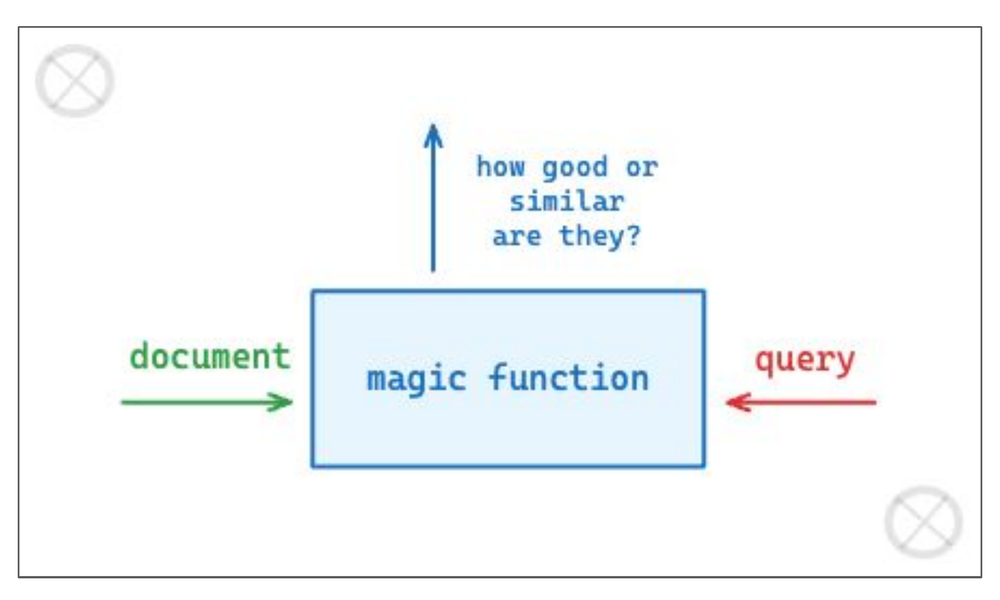
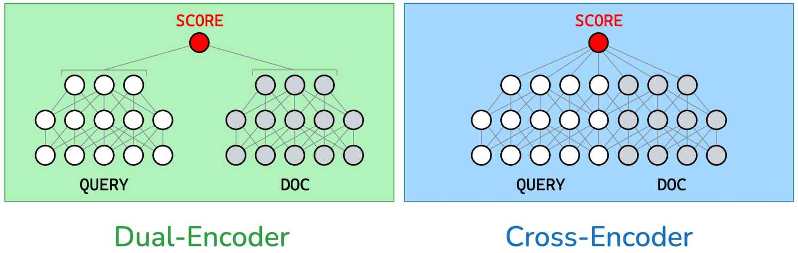
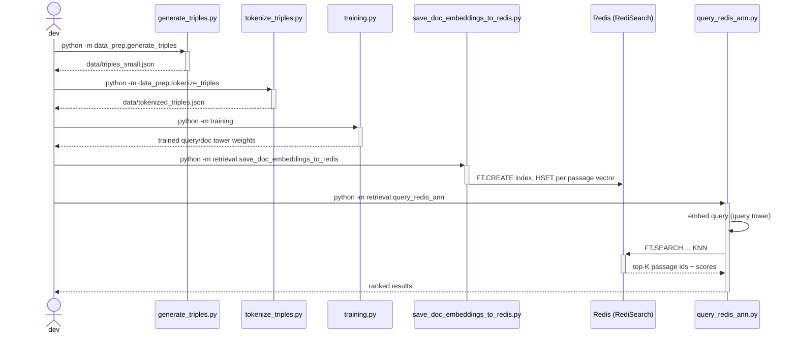
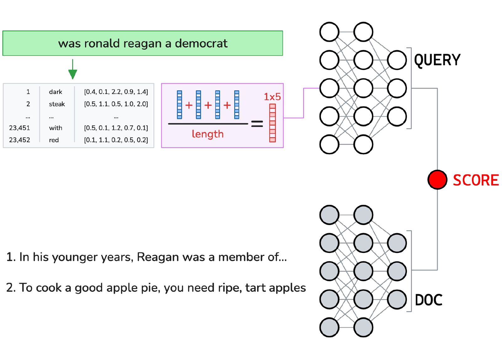

# Two-Tower Dual-Encoder Document Retrieval

## TL;DR

- **What it is:** a dual-encoder retrieval system — a query tower and a document tower trained
  end-to-end with in-batch negatives, with every passage embedded once and indexed for approximate
  nearest-neighbour search.
- **Result:** **recall@10 of 0.3983** against a 5,000-document pool, where chance is 0.0020 and
  untrained towers score 0.0018 — 199x chance, on 88,523 MS MARCO triples. Trained with triplet
  loss instead, the same towers on the same data for the same ten epochs reach 0.1250 (§6).
- **Built:** the full offline/online split — CBOW embeddings, both training objectives behind one
  config field, a recall@K harness against a fixed document pool, and Redis/RediSearch HNSW
  indexing for live queries.
- **What I'd do next:** report Recall@K/MRR against a BM25 baseline, which is the comparison that
  says whether any of this beats term matching.

This repo builds a neural document retrieval system: given a search query, find the most relevant
passage in a corpus. I trained a query tower and a document tower on real search queries
(MS MARCO), so a query's vector lands close to its relevant passage and far from irrelevant
ones. Once trained, every passage gets embedded once and indexed for approximate
nearest-neighbour search, so retrieval at query time is a single vector lookup instead of scoring
every passage in the corpus. This is the dual-encoder architecture behind modern semantic/vector
search.

## Quickstart

```bash
# one venv for the whole workspace
make install

# FastAPI on :8000, interactive docs at /docs
make serve SERVICE=vector-search-retrieval

# read Usage first -- some stages run for hours
make train SERVICE=vector-search-retrieval
```

Stages specific to this service live in its own Makefile (`make -C services/vector-search-retrieval help`):

- `train-cbow` — Build the vocabulary, then train CBOW word embeddings
- `train-triples` — Build and tokenize MS MARCO triples
- `train-encoder` — Train the GRU dual-encoder towers
- `index` — Embed the corpus with the trained doc tower and index it in Redis
- `query` — Index the corpus, then the interactive query CLI (needs Redis running)
- `redis` — Start a throwaway RediSearch-capable Redis on :6390

Checkpoints are resolved locally first, then from the Hugging Face Hub, so serving works on a host that has never trained anything.

## Table of Contents

1. [Introduction](#1-introduction)
2. [System Architecture](#2-system-architecture)
3. [Method](#3-method)
4. [Implementation](#4-implementation)
5. [Usage](#5-usage)
6. [Experimental Results](#6-experimental-results)
7. [Related Work](#7-related-work)
8. [References](#references)
9. [Acknowledgments](#acknowledgments)
10. [Dependencies](#dependencies)

## 1. Introduction

Every search system is, at its core, one function: given a document and a query, score how similar
or relevant they are.

**Figure 1.** The general shape of a ranking problem: a document and a query both feed a function
that scores how similar or relevant they are.


Every technique in this repo is one way of instantiating that "magic function": TF-IDF makes it a
term-overlap statistic, a dual-encoder makes it a learned similarity between two vectors.

Classical information retrieval answers this with hand-built statistics rather than a learned
function: TF-IDF scores a document by how often a query term appears in it, discounted by how
common that term is across the whole corpus, and an inverted index makes looking up "which
documents contain this term" fast at scale. That's genuinely how search engines worked for
decades (and still partly do), but it only matches on literal term overlap: a query for "was
ronald reagan a democrat" won't match a passage that answers the question without using those
exact words. This repo builds the learned alternative instead: encode both query and document as
vectors and score them by similarity, so a match is about meaning, not shared vocabulary.

There are two ways to build that learned function. A **cross-encoder** feeds query and document
tokens into one joint model with full cross-attention between them. That's accurate, but every
candidate document has to be re-encoded together with the query at query time, so it doesn't scale
to a large corpus. A **dual-encoder** ("two-tower") splits query and document into two independent
encoders that never see each other during inference, so every document can be embedded once,
offline, and reused for every future query.

**Figure 2.** Dual-encoder versus cross-encoder. Dual-encoder query and document tokens only
interact after each side is fully encoded (right at the SCORE node); the cross-encoder lets every
query token attend to every document token before scoring.


This repo builds the dual-encoder path: `training.py` implements the
left-hand diagram, a separate GRU stack for QUERY and DOC that never cross-attend.

## 2. System Architecture

Before the method — here's how the whole thing is wired together at a glance. Five stages, split
into an offline half (train embeddings and towers, index the corpus) and an online half (embed and
answer a live query):

**Figure 3.** Full pipeline: embeddings, triples, training, and indexing, split into an offline and
an online half. Left, offline: CBOW word2vec pretraining, MS MARCO triples through the query/doc
towers into the contrastive loss, and the trained doc tower indexing the corpus into Redis. Right,
online: the same query path, but stopping at the tower and going into an ANN search against that
Redis index to return the top-5 passages.
![Left panel, offline: text8 and MS-MARCO feed Train word2vec and a CBOW tokeniser respectively; Query Token and Doc Token pass through a shared Embedding Layer and Average Pooling into a Query Tower and Doc Tower; Query Embedding and Doc Embedding feed a Contrastive Loss node, and Doc Embedding also writes into a Redis Database. Right panel, online: the same text8/MS-MARCO/tokeniser path plus a User Query actor feed the Query Tower; its Query Embedding feeds an ANN Search against the Redis Database, returning the top 5 most relevant documents.](assets/fig7-pipeline-evolution.png)

This is the same pipeline `src/` implements, just with a couple of naming/store differences worth
calling out: the diagram's "Doc Tower"/"Query Tower" boxes are `models/towers.py`'s `GruTower` —
one class, two separately-trained instances, sharing only the frozen embedding layer beneath them —
the "Tokenise with CBOW Tokeniser" + Query/Doc Token split is `data_prep/generate_triples.py` +
`tokenize_triples.py`, and the Redis Database node is written by
`retrieval/save_doc_embeddings_to_redis.py` and read by `retrieval/query_engine.py`, which loads
the trained query tower and is shared by the CLI, the FastAPI service, and the Streamlit UI.

Same pipeline, as a sequence diagram: one node per script, in the order they're actually run.

**Figure 4.** Sequence diagram of the pipeline.


## 3. Method

### 3.1 Encoding Text as a Vector

An encoder, in this sense, is just a function that turns any piece of text into a fixed-size
vector (the same idea covered in depth in the
[word-embeddings/score-prediction project](https://github.com/RoshBeed/ai-residency/tree/main/services/word-embeddings)): tokenize the text, look
up a (frozen, pretrained) word embedding for each token, and pool them into one vector, e.g. by
averaging. Given any sentence, the model produces a vector representation of it; the rest of this
project is about learning *which* vector representation is useful for retrieval specifically.

**Figure 5.** Query and document towers at inference time: a query is looked up in an embedding
table, averaged into a vector, and fed into a QUERY tower; candidate documents are fed into a DOC
tower; both towers converge on a single SCORE.


The diagram's "average, then feed a tower" step is `data_prep/create_triple_embeddings.py` for
the mean-pooling variant, and the tower boxes themselves are
`models/towers.py`'s `GruTower` for the trained variant
actually used for indexing — same shape, learned recurrence instead of a plain average.

Both towers here sit on top of word embeddings trained from scratch with a small CBOW model (see
`cbow/`, the same recipe as the word-embeddings project), frozen and shared between the two towers. I tried two
tower architectures on top of those frozen embeddings:

- **Average-pooling towers** (`create_triple_embeddings.py`) — mean the frozen CBOW word vectors
  over a document/query, no additional learned parameters.
- **GRU towers** (`models/towers.py`, `models/training.py`, `save_doc_embeddings_to_redis.py`,
  `query_redis_ann.py`) — a learned recurrent encoder on top of the frozen embeddings, so word
  order (not just word identity) affects the resulting vector. This is the version actually
  trained with a hyperparameter sweep and used for indexing.

### 3.2 Training Data: MS MARCO

Training needs examples of "this document answers this query" and "this document doesn't."
**MS MARCO v1.1** provides real search queries, a set of candidate passages per query, and a
binary relevance label per passage — everything needed to build a training triple.

**Figure 6.** Turning an MS MARCO example into a training triple: a real screenshot of the actual
v1.1 Hugging Face dataset viewer, with the actual `is_selected` and `passage_text` fields this
repo's own loader reads.
![The MS MARCO v1.1 Dataset Viewer, showing a row with is_selected: [0, 1, 0, 0, 0, 0, 0], passage_text: ["A".."G"], and url: [...]. An arrow points to a JSON snippet marking is_selected==1 entries as "positive" and an is_selected==0 entry as "maybe hard negative".](assets/fig4-ms-marco-triple.png)

`generate_triples.py` builds `(query, positive_doc, negative_doc)` triples this way, and
`tokenize_triples.py` converts each into token ids using the CBOW vocabulary.

### 3.3 Two Training Signals Over the Same Triples

With a triple in hand there are two ways to turn it into a gradient, and `config.loss` picks
between them. Both are in `models/losses.py`; §6 measures them against each other.

**Triplet loss** is the simpler one: push the query embedding toward its positive document and
away from its negative one, by at least a margin $m$.

**Figure 7.** Triplet training signal: the margin geometry (left) and the score/loss wiring (right)
that this repo's own margin (`0.2`, see the code below) and towers implement.


$$
\mathcal{L}_{\text{contrastive}} = \max\big(0,\ m - s_{\cos}(q, d^{+}) + s_{\cos}(q, d^{-})\big)
$$

If the positive is already more similar than the negative by at least the margin, the loss is
zero and there's nothing to correct; otherwise the towers get pushed to widen that gap. The
smallest possible version of this is only a few lines:

```python
qryTower = QryTower()
docTower = DocTower()

qry = qryTower(query_embedding)
pos = docTower(positive_doc_embedding)
neg = docTower(negative_doc_embedding)

dist_pos = torch.nn.functional.cosine_similarity(qry, pos)
dist_neg = torch.nn.functional.cosine_similarity(qry, neg)
margin = torch.tensor(0.2)

loss = torch.max(torch.tensor(0.0), margin - (dist_pos - dist_neg))
loss.backward()
```

`models/training.py` is this same idea with GRU towers instead of a linear layer, trained
with a Weights & Biases sweep over learning rate, hidden size, and margin.

**In-batch negatives**, which the service trains with by default, score each query against every
document in the batch rather than against one sampled negative:

```python
queries = F.normalize(queries, dim=1)
documents = F.normalize(documents, dim=1)

# (batch, batch): row i is query i scored against every document in the batch.
similarities = queries @ documents.T / temperature

# The correct document for query i is at column i, so the diagonal is the label.
targets = torch.arange(len(queries), device=similarities.device)
loss = F.cross_entropy(similarities, targets)
```

One matrix multiply replaces the sampling. The diagonal holds the batch's correct pairs and
everything off it is a negative, so a batch of 64 gives each query 63 wrong answers to be pushed
away from instead of one. The temperature matters: cosine similarities live in [-1, 1], and
without dividing by something small the logits are too flat for cross-entropy to separate.

The cost is that in-batch negatives are *random* documents, not hard ones — a batch rarely
contains a near-miss for a given query. That is what hard-negative mining would add, and §6's
numbers say to spend the effort on a BM25 baseline first.

### 3.4 Indexing and Approximate Nearest-Neighbour Search

Training happens once, offline. After that, the document tower embeds the entire corpus once and
those vectors go into a vector index; at query time, only the query needs to be embedded, and the
index does the work of finding its nearest neighbours.

**Figure 8.** From trained towers to a queryable index, in three stages: train both towers
offline, embed the corpus offline through the doc tower, then embed and search only the query
online.


The reference stack for this project uses ChromaDB for the vector index. I indexed in
**Redis** instead, using the [RediSearch](https://redis.io/docs/stack/search/) module's HNSW
(Hierarchical Navigable Small World) index for approximate nearest-neighbour search — a different
vector store, same role in the pipeline.

## 4. Implementation

Mapping the architecture from [Section 2](#2-system-architecture) onto the actual file layout:

```
src/
├── cbow/                       Standalone CBOW word-embedding trainer (reused from the word-embeddings project)
│   ├── train_tokenizer.py        Build tokenizer/vocab from raw corpus
│   ├── train_word2vec.py         Train CBOW embeddings
│   ├── train_regressor.py        (legacy regressor, not used by the retrieval pipeline)
│   ├── model.py / dataset.py      CBOW model + Wiki dataset
│   └── checkpoints/               Trained embedding weights
│
├── data_prep/                  MS MARCO -> tokenized training triples
│   ├── extract_data.py           (optional) EDA — dump MS MARCO queries/passages to JSON
│   ├── generate_triples.py       Build (query, positive_doc, negative_doc) triples from MS MARCO
│   ├── tokenize_triples.py       Tokenize triples using the CBOW vocabulary
│   ├── load_dataset.py           Standalone script to inspect MS MARCO dataset stats
│   ├── create_embeddings.py      Early experiment: average-pool triples with a randomly-init embedding
│   ├── create_triple_embeddings.py  Average-pool triples with the trained CBOW embeddings, push to Redis
│   └── upload_to_hf.py / download_from_hf.py  Push/pull checkpoints, embeddings and data
│                                    to/from Hugging Face Hub so training can resume elsewhere
│
├── models/                     Dual-encoder tower architectures + training loops
│   ├── dual_encoder.py            First dual-encoder draft (mean-pooled towers + triplet loss)
│   ├── towers.py                  GruTower — the GRU-based query/doc tower architecture
│   └── training.py                Trains the GRU towers, with a W&B sweep (config/sweep.yaml)
│
└── retrieval/                  Indexing + querying against the trained towers
    ├── query_engine.py               Shared core: load tower/vocab, embed a query, run the Redis
    │                                  KNN search — imported by both entry points below
    ├── save_doc_embeddings_to_redis.py  Embed the full document corpus with the trained doc
    │                                     tower and index it in Redis for ANN search
    └── query_redis_ann.py            Interactive CLI on top of query_engine.py

checkpoints/                  Trained query/doc GRU tower weights (qry_tower.pth, doc_tower.pth)
data/                         Generated training data (triples_small.json, tokenized_triples.json)
config/sweep.yaml             W&B hyperparameter sweep config for models/training.py
notebooks/walkthrough.ipynb   Narrates all five pipeline steps with real, importable calls
scripts/script.sh             Reference pipeline: extract → generate triples → tokenize → train
```

## 5. Usage

Requires a running Redis instance with the [RediSearch](https://redis.io/docs/stack/search/)
module (e.g. Redis Cloud or `redis-stack` locally) for the vector index, and `REDIS_HOST` /
`REDIS_PORT` / `REDIS_PASSWORD` in your environment (or a `.env` file).

### Docker Compose (quickest)

```bash
make -C deploy up      # starts Redis + the UI, builds+runs the serve image: index corpus, then interactive query CLI
docker compose --profile train run --rm train-vector-search-retrieval
make build SERVICE=vector-search-retrieval    # build the serve, ui, and train images without running them
make -C deploy down     # stop and remove all Compose services
```

`docker-up` starts a `redis-stack-server` container (RediSearch module, no persistence, throwaway
by design) and then runs the `serve` image, which is this repo's stand-in for a "serve" step:
there's no persistent HTTP server here, so it indexes the corpus and drops into the same
interactive `query_redis_ann.py` CLI described below. `docker-train` runs the offline pipeline
(CBOW embeddings -> triples -> tower training) inside the `train` image, one stage at a time or
all five in order.

### Local (Makefile)

```bash
make install   # uv sync
make train SERVICE=vector-search-retrieval     # train-cbow && train-triples && train-encoder, in order
make serve SERVICE=vector-search-retrieval     # the FastAPI query service (needs Redis already running)
make test SERVICE=vector-search-retrieval      # pytest
```

The interactive query CLI is `python -m retrieval.query_redis_ann` (a local-only loop, not a
server). The browser UI is the unified Streamlit frontend in `services/frontend`, which calls
this repo's `serving/api.py` over HTTP — it is not in this repo.

Local `make train SERVICE=vector-search-retrieval*` is the fast path on Apple Silicon: CBOW training picks up the MPS
backend automatically when available, benchmarked ~3.7x faster than CPU on this repo's own
batch/vocab shape. `make -C deploy up  # then: docker compose --profile train run --rm train-vector-search-retrieval` always runs CPU-only, even on this same Mac (Docker
Desktop's containers run inside a Linux VM with no GPU/MPS passthrough), so it's for portability
and eventual real-GPU-host deployment, not local speed. (The GRU dual-encoder training in
`models/training.py` trains one triple at a time on tiny tensors; benchmarked, MPS is
actually slower there due to per-op dispatch overhead, so it intentionally stays CPU-only.)

### Raw commands (reference)

What the targets above actually run, if you'd rather call the scripts directly:

```bash
uv sync

# 1. Train word embeddings (or download pretrained ones — see data_prep/download_from_hf.py)
uv run python -m cbow.train_tokenizer
uv run python -m cbow.train_word2vec

# 2. Build training triples from MS MARCO
uv run python -m data_prep.generate_triples
uv run python -m data_prep.tokenize_triples

# 3. Train the dual encoder (GRU towers, with a W&B sweep)
uv run python -m training

# 4. Index the document corpus in Redis
uv run python -m retrieval.save_doc_embeddings_to_redis

# 5. Query it interactively (CLI), or call the FastAPI service
uv run python -m retrieval.query_redis_ann
uv run python -m serving.api
```

`scripts/script.sh` documents the same sequence end-to-end. `notebooks/walkthrough.ipynb` narrates
all five steps with real, importable calls into these same scripts, cell by cell.

## 6. Experimental Results

`make evaluate` is the source of every number here: it loads the shipped towers, scores them
against untrained towers of the same shape, and prints the chance rate beside both.

### Recall@10 against a 5,000-document pool

The shipped checkpoint trains on **88,523 MS MARCO triples** for ten epochs and is scored on
10,783 held-out ones:

| | recall@10 | pairwise accuracy |
|---|--:|--:|
| chance | 0.0020 | 0.5000 |
| untrained towers, same shape | 0.0018 | 0.5090 |
| **shipped (in-batch negatives)** | **0.3983** | **0.9470** |

Recall@10 is the metric that matters, and the pool is what makes it mean anything. Each held-out
query is ranked against 5,000 distinct documents with exactly one correct answer among them, so
chance is 10/5000 = 0.0020 and the shipped towers are 199x it. The untrained column is the control
that makes the number readable: towers of the same architecture over the same frozen CBOW
embeddings, with only the GRU weights random, land at 0.0018 — chance, as they should.

**Pairwise accuracy would have hidden most of this.** Asking only whether a query is closer to its
positive than to its one sampled negative starts at 50% chance, and on that metric the two
objectives below are 0.9470 and 0.9037 — nearly tied. Against a real pool they differ threefold.
A retrieval metric has to make the model pick its answer out of a crowd.

On the training queries, positive-document cosine similarity is consistently well above
negative-document similarity:

| Query | sim(query, positive doc) | sim(query, negative doc) |
|---|---|---|
| "what is rba" | 0.2801 | −0.4856 |
| "was ronald reagan a democrat" | 0.3507 | −0.2441 |
| "price to install tile in shower" | 0.3726 | −0.1499 |

A held-out evaluation harness (`pairwise_accuracy()` in `models/training.py`) checks generalization
directly — whether the query lands closer to its positive document than its negative one, on
triples the training loop never saw — rather than trusting the training loss alone.

A live query against the full indexed corpus (1,498 documents in Redis), through the trained query
tower and Redis's HNSW search:

```
Enter your query: was ronald reagan a democrat
Top 5 results:
Rank 1 (score=0.5999): "[ 2 syll. kei (l), ke-il ] The baby boy name Keil is also used as a girl
  name. Its pronunciation is..."
Rank 2 (score=0.6432): "You should consult the doctor immediately. In the abdomen many organs are
  covered and kept in a bag..."
Rank 3 (score=0.6476): "CUPRO \¦k(y)ueˈprō\. üˈprō. n 1: A a regenerated cellulose fiber derived
  from cotton (linter the, ul..."
Rank 4 (score=0.6757): "System Costs. As mentioned in the introduction, residential solar systems
  are typically sized from 3..."
Rank 5 (score=0.6838): "Home » Tramadol Uses, Warnings and Treatment. Tramadol is a
  narcotic-like pain reliever. Tramadol hy..."
```

That transcript is real — captured live from `run_query()` in `retrieval/query_engine.py` against
the trained query tower and the actual indexed corpus.

### In-batch negatives beat triplet loss threefold

Both objectives are in `models/losses.py` behind one config field, and the towers are untouched
between them, so the comparison changes only where the negatives come from. Same 88,523 triples,
same ten epochs, same frozen embeddings, same held-out split, both scored by the same
`make evaluate`:

| loss | recall@10 | against chance | pairwise |
|---|--:|--:|--:|
| triplet, one sampled negative | 0.1250 | 62.5x | 0.9037 |
| **in-batch negatives** | **0.3983** | **199x** | **0.9470** |

Triplet loss scores one sampled negative per query, so most of a batch does no work. In-batch
negatives treat every other document in the batch as a negative for one extra matrix multiply:
with a batch of 64 each query is compared against 63 wrong answers instead of one, and the row of
similarities goes straight into a cross-entropy. The gradient sees which wrong answers were nearly
chosen, which is the information triplet loss throws away by sampling.

**The loss numbers point the opposite way, and that is the lesson.** Triplet converges to 0.0108
from an untrained 0.2004, while in-batch sits at 1.0827 from an untrained 5.0689 — triplet's final
loss is a hundred times lower, and its retrieval is three times worse. The two losses are not on a
common scale, so neither one ranks the other: a margin that is already satisfied contributes
exactly zero, which is why a well-separated easy negative drives triplet's loss toward nothing
while teaching the towers nothing. Rank checkpoints on the retrieval metric, never on a loss
compared across objectives.

This reproduces the [published
post](https://roshbeed.com/posts/2026-06-15-two-tower-search/), which measured 0.2856 against
0.0932 on 78,964 pairs — a 3.06x ratio against the 3.19x here. Both arms score higher on this
run's larger corpus and rebuilt vocabulary; the effect is the same size.

## 7. Related Work

- [The word-embeddings/score-prediction project](https://github.com/RoshBeed/ai-residency/tree/main/services/word-embeddings) — the
  CBOW embedding training reused here as the frozen input representation for both towers.
- [The vision transformer project](https://github.com/RoshBeed/ai-residency/tree/main/services/vision-transformers) — self-attention
  implemented from scratch, a natural upgrade path for the tower encoders in place of a GRU.

## References

[1] Bromley, J., Guyon, I., LeCun, Y., Säckinger, E., & Shah, R. (1994). *Signature Verification
using a "Siamese" Time Delay Neural Network.* NeurIPS. — the original twin-network architecture
that dual-encoders are a direct descendant of.

[2] Karpukhin, V., Oğuz, B., Min, S., Lewis, P., Wu, L., Edunov, S., Chen, D., & Yih, W. (2020).
*Dense Passage Retrieval for Open-Domain Question Answering.* arXiv:2004.04906.

[3] Brin, S., & Page, L. (1998). *The Anatomy of a Large-Scale Hypertextual Web Search Engine.*
Computer Networks and ISDN Systems, 30(1–7). — classical, non-neural context for the ranking
problem this project addresses with a learned model instead.

## Acknowledgments

Built with Ewan Beattie, James Carter, and Melanie Wong.

## Dependencies

PyTorch · MS MARCO (Hugging Face `datasets`) · Redis / RediSearch (HNSW ANN index) ·
Weights & Biases (sweeps) · Hugging Face Hub (artifact storage)
