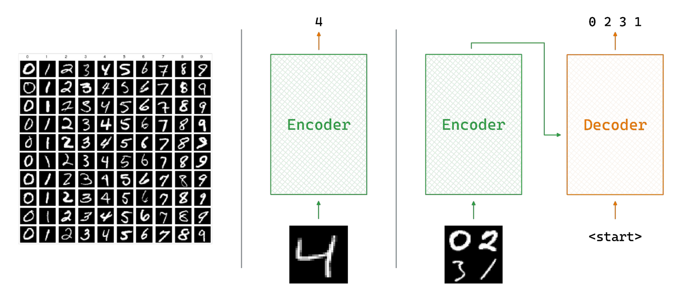
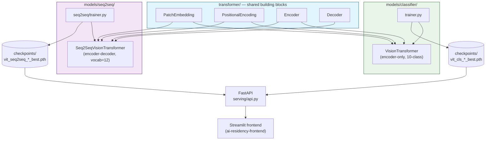
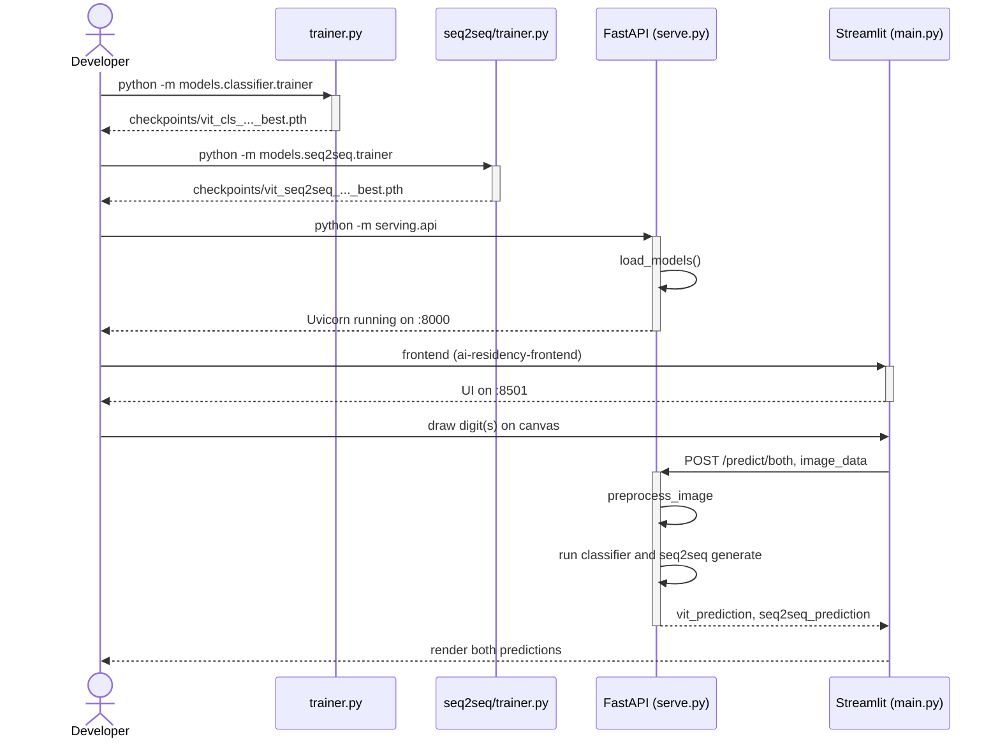
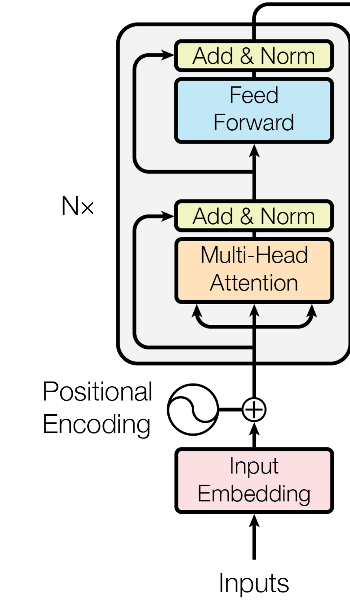
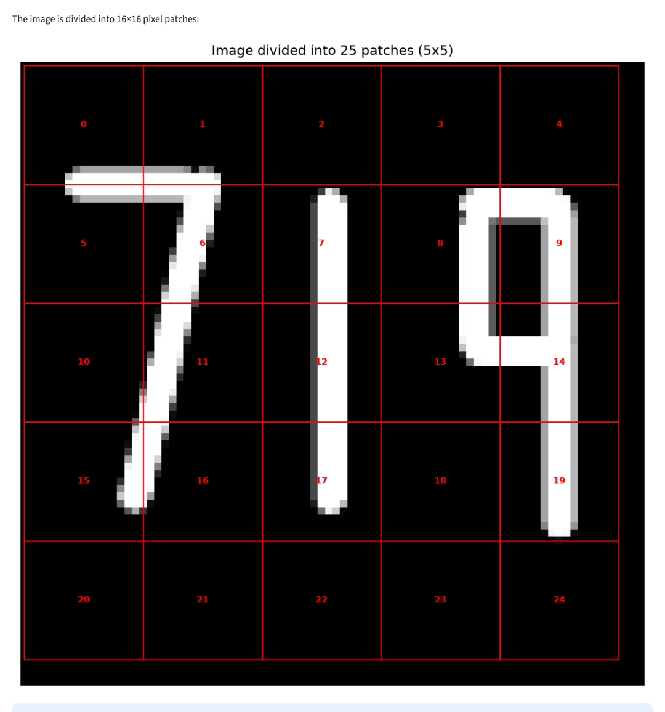

# Vision Transformers from Scratch for Digit Recognition

## TL;DR

- **What it is:** a Vision Transformer — patch embedding, multi-head self-attention, encoder/decoder blocks — written from scratch in raw PyTorch, applied to MNIST classification and multi-digit seq2seq generation.
- **Results:** 95% classifier accuracy; 68% seq2seq exact-match on held-out three-digit sequences.

This repo implements the Vision Transformer (ViT) [1, 2] from scratch: patch embedding,
multi-head self-attention, encoder and decoder blocks, all in raw PyTorch, no
`torch.nn.Transformer` shortcuts. It applies that architecture to two related digit-recognition
tasks: a standard encoder-only classifier for a single MNIST digit, and an encoder-decoder model
that reads an image of three digits side by side and generates the number one token at a time.
Both models are served through a FastAPI backend and an interactive Streamlit frontend.

## Quickstart

```bash
# one venv for the whole workspace
make install

# FastAPI on :8000, interactive docs at /docs
make serve SERVICE=vision-transformers

# read Usage first -- some stages run for hours
make train SERVICE=vision-transformers
```

Stages specific to this service live in its own Makefile (`make -C services/vision-transformers help`):

- `train-classifier` — Train the single-digit classifier
- `train-seq2seq` — Train the multi-digit seq2seq model

Checkpoints are resolved locally first, then from the Hugging Face Hub, so serving works on a host that has never trained anything.

## Table of Contents

1. [Introduction](#1-introduction)
2. [System Architecture](#2-system-architecture)
3. [Method](#3-method)
4. [Implementation](#4-implementation)
5. [Usage](#5-usage)
6. [Experimental Results](#6-experimental-results)
7. [Related Work](#7-related-work)
8. [References](#references)
9. [Acknowledgments](#acknowledgments)
10. [Dependencies](#dependencies)

## 1. Introduction

The [dual-encoder retrieval project](https://github.com/RoshBeed/ai-residency/tree/main/services/vector-search-retrieval)
used self-attention over text. This project asks the same question the original ViT paper asked:
does the same architecture work over *images*, if you just find the right way to turn pixels into
tokens?

The paper's answer is to cut the image into fixed-size patches, flatten and linearly project each
one, and feed the resulting sequence into an unmodified transformer encoder, treating patches just
like word tokens. No convolutions anywhere.

**Figure 1.** The two tasks this repo solves: recognizing one digit versus recognizing several.


This repo implements that same split. `models/classifier/` is the left half: one encoder, one
label out. `models/seq2seq/` is the right half: an encoder feeding a decoder that's seeded
with a learned `START` token and generates one digit at a time, the same `<start>` → `0 2 3 1`
loop the figure draws.

Task 1 only needs an encoder — one image in, one label out, the classification setup from the
original ViT paper [2]. Task 2 needs something closer to the original Transformer [1]: machine
translation restated as "translate an image into a sequence of digit tokens," which is why it
gets a decoder, cross-attention, and autoregressive generation. This same encoder-decoder pattern
reappears in [the image captioning project](https://github.com/RoshBeed/ai-residency/tree/main/services/multimodal-captioning),
where the target sequence is a natural-language caption instead of three digits.

## 2. System Architecture

Before the method: here's how the shared `transformer/` building blocks, the two models, and
the serving layer fit together.

**Figure 2.** How the shared building blocks, the two models, and the serving layer fit together.


The two models never share weights, only code (`transformer/`). `serving/api.py` loads
both checkpoints at startup and exposes both models behind one API, so a single drawn image can be
sent to either model or both at once for comparison.

**Figure 3.** The end-to-end flow: train both models, start the API, start the UI, predict.


## 3. Method

### 3.1 Patches as Tokens

An image doesn't come as a sequence, so the first job is to make it look like one. I cut a 28×28
grayscale MNIST digit into a grid of 4×4 patches (49 of them) and linearly project each flattened
patch to a 128-dimensional vector (`transformer/patch_embedding.py`).

I implemented that projection as a single strided `Conv2d(kernel=4, stride=4)` rather than a
literal flatten-then-matmul. The two are mathematically identical; the convolution kernel does the
sliding-window bookkeeping for free. A learnable `[CLS]` token gets prepended, sinusoidal
positional encodings are added, and the resulting 50×128 sequence goes through six transformer
encoder layers, the same setup as the original ViT [2]:

**Figure 4.** The original Vision Transformer architecture. Figure 1 from Dosovitskiy et al., *An
Image is Worth 16x16 Words: Transformers for Image Recognition at Scale* [2] (arXiv:2010.11929) —
the paper this repo's classifier is built from.


My classifier follows this diagram directly, at MNIST scale: a 28×28×1 digit is cut into 4×4
patches (`transformer/patch_embedding.py`, the strided `Conv2d(kernel=4, stride=4)` standing
in for "Linear Projection of Flattened Patches"), a learnable `[CLS]` token is prepended as shown,
sinusoidal position embeddings are added, and the result goes through 6 encoder layers
(`transformer/encoder.py`, matching the "Transformer Encoder" inset on the right: Norm →
Multi-Head Attention → residual → Norm → MLP → residual). I simplified only the paper's `MLP
Head`: this repo classifies from a single `Linear(128, 10)` rather than a multi-layer MLP, since
10 MNIST digit classes need far less capacity than ImageNet's class vocabulary.

### 3.2 Multi-Head Self-Attention

Every encoder and decoder layer is built around the same scaled dot-product attention [1]:

$$\text{Attention}(Q, K, V) = \text{softmax}\left(\frac{QK^T}{\sqrt{d_k}}\right)V$$

split across 8 heads (16-dim each for the classifier, 32-dim each for the seq2seq model; always
`heads × head_dim == d_model`). The actual implementation (`transformer/attention.py`):

```python
Q = self.W_q(query).view(batch_size, q_len, self.heads, self.head_dim).transpose(1, 2)
K = self.W_k(key).view(batch_size, k_len, self.heads, self.head_dim).transpose(1, 2)
V = self.W_v(value).view(batch_size, k_len, self.heads, self.head_dim).transpose(1, 2)

attn_scores = torch.matmul(Q, K.transpose(-2, -1)) / math.sqrt(self.head_dim)
attn_scores = torch.clamp(attn_scores, min=-100, max=100)  # numerical stability
attn_probs = torch.softmax(attn_scores, dim=-1)
out = torch.matmul(attn_probs, V)
```

The same `MultiHeadAttention` module is reused for three different jobs depending on what's passed
as `query`/`key`/`value`: encoder self-attention (all three are the same input), decoder masked
self-attention (all three are the decoder's own sequence, plus a causal mask), and decoder
cross-attention (query from the decoder, key/value from the encoder output).

### 3.3 Transformer Encoder Block

I built each encoder layer post-norm, matching the original Transformer [1] rather than the
pre-norm variant common in newer models: attention (or feed-forward) output is added to the
residual stream *before* `LayerNorm` is applied, not after.

**Figure 5.** The encoder stack, cropped from the left half of Figure 1 in Vaswani et al.,
*Attention Is All You Need* [1] (arXiv:1706.03762) — the original Transformer paper this repo's
post-norm design follows, as opposed to ViT's own pre-norm variant shown inset in Figure 4 above.


`transformer/encoder.py` implements one of the `N×` blocks shown here: `Multi-Head Attention`
→ residual `Add` → `LayerNorm` → `Feed-Forward (Linear → ReLU → Linear)` → residual `Add` →
`LayerNorm`. The six stacked instances (`N=6`, matching the paper's own default) are the "encoder
layers" referenced throughout Section 3.1 above. This is deliberately the *post-norm* arrangement
the diagram shows (`LayerNorm` after each residual add, not before), which is why Figure 5 is
cropped from the original Transformer paper [1] rather than reused from ViT's own architecture
inset in Figure 4, which uses pre-norm instead.

### 3.4 Classification Head

For the single-digit task, only the `[CLS]` token's final representation is used, the same trick
BERT uses for sequence-level tasks. After the last encoder layer, position 0 of the sequence is
pulled out, passed through dropout, and projected to 10 logits via a single `Linear(128, 10)`.

### 3.5 Sequence Decoding: Encoder–Decoder ViT

The multi-digit task can't use a fixed-size classification head, because the output is a variable
number of digits (0 up to 999). Instead, `models/seq2seq/seq2seq.py` pairs the same
patch-embedding encoder with a transformer decoder over a 12-token vocabulary: digits 0–9, plus
learned `START` (10) and `EOS` (11) tokens.

**Figure 6.** Encoder–decoder ViT for multi-digit sequence generation.


`models/seq2seq/seq2seq.py` implements this pipeline. On the left, a patch-embedding encoder
(`Conv2d(k=16,s=16)` → 25×256 for this repo's real 84×84 three-digit images, larger than the
figure's illustrative 16×64). On the right, a tokenizer/embedding stage over a 12-token vocabulary
— digits 0–9 plus learned `START`/`EOS` tokens, the figure's `<start>`/`<finish>`/`<pad>` table.
The two feed masked self-attention and cross-attention decoder blocks
(`torch.matmul(Q, K.transpose(-2,-1))` per block, matching the figure's `Q`/`Kᵀ`/`A` derivation)
that project back out to next-token logits.

The figure's worked example — feeding in `<start> 7 7 6 9` and reading out `7 7 6 9 <finish>` — is
the same teacher-forced training setup `seq2seq/trainer.py` uses: the whole target sequence goes to
the decoder at once, with a causal mask so position *i* can't see positions after it
(`create_causal_mask`, matching the "Masked Multi-Head Attention" block in the original decoder
[1]). At inference, `generate()` runs the same decoder autoregressively instead — no target
sequence to see, so it starts from `[START]` and feeds each predicted token back in to produce the
next one, one forward pass per digit, until `EOS` (`<finish>`) is produced.

## 4. Implementation

Mapping the architecture from [Section 2](#2-system-architecture) onto the actual file layout:

```
├── config.py                Single source of truth: Config(BaseConfig) plus the two frozen
│                            architecture dataclasses, ClassifierArch and Seq2SeqArch, which
│                            also derive each model's checkpoint file name
├── transformer/             Shared building blocks: attention, encoder, decoder, patch
│                            embedding, positional encoding, feed-forward
├── models/
│   ├── classifier/          VisionTransformer (encoder-only) + trainer.py, trained on MNIST
│   │                        directly
│   └── seq2seq/             Seq2SeqVisionTransformer (encoder-decoder) + trainer.py
├── datasets/
│   ├── mnist_dataset.py      Thin wrapper around torchvision's MNIST with train/val/test splits
│   └── multi_digit_dataset.py  Composites 3 random MNIST digits onto an 84×84 canvas per
│                              sample, with jitter and random affine augmentation, generated
│                              on the fly
└── serving/api.py           FastAPI app: loads both checkpoints, exposes /predict,
                             /predict/vit, /predict/seq2seq, /predict/both
tests/test_week3.py          Shape checks for the from-scratch blocks and a training
                             reproducibility check
checkpoints/                 Committed, pretrained checkpoints for both models
data/                        Raw MNIST cache (torchvision's own download layout), separate
                             from the datasets/ package — that name is code (Dataset classes),
                             not data
notebooks/walkthrough.ipynb  Happy path end to end against the committed checkpoints
infra/                       Terraform + shell scripts for provisioning a GPU training server
```

Device selection, logging, checkpoint I/O, seeding, Hugging Face uploads and W&B tracking come
from `ai-residency-common`, a small package shared by all six repos in this portfolio, rather than being
reimplemented here.

## 5. Usage

Figure 3 ([Section 2](#2-system-architecture)) shows the end-to-end flow. Pretrained checkpoints
for both models are committed under `checkpoints/`, so serving works without training anything
first. A `Makefile` wraps every stage below with a consistent set of targets; the raw command each
target actually runs is kept underneath it, since that's what's really executing.

```bash
make install   # what this runs: uv sync   (installs from pyproject.toml + committed uv.lock)
make serve     # what this runs: uv run python -m serving.api   (FastAPI on :8000)
make check     # lint + type check + tests
```

To retrain from scratch instead:

```bash
make train-classifier  # what this runs:
                        #   uv run python -m models.classifier.trainer
                        # trains on MNIST, saves to checkpoints/
make train-seq2seq     # what this runs:
                        #   uv run python -m models.seq2seq.trainer
                        # trains on composited multi-digit images, ~85min on M1 Max/MPS
```

`make train` is an alias for `make train-classifier` (the faster of the two).

A `notebooks/walkthrough.ipynb` runs the happy path end to end — loading both committed
checkpoints and running real inference — without retraining anything. Its first cell chdirs back
to the repo root so relative paths (checkpoints, MNIST cache) resolve the same way `make serve`'s
do; the package itself is installed, so nothing needs to be put on the import path.

**Docker Compose (Linux/CUDA servers):** two single-purpose Dockerfiles, both
`FROM roshbeed/ai-residency-base` — `Dockerfile.serve` (the FastAPI inference container) and
`Dockerfile.train` (the training image, defaulting to the classifier). `uv.lock` already pins
`torch`/`torchvision` to the CPU-only PyTorch wheel index, which otherwise resolves an unpinned
`torch` to a multi-GB CUDA build on `linux/arm64` — a real GPU host would need its own
CUDA-enabled lockfile rather than overriding this one at build time.

On Apple Silicon, that CPU-only pin isn't just about avoiding a CUDA download. Docker Desktop on
macOS runs containers inside a Linux VM, and that VM has no path to the host's Metal GPU at all
(no MPS passthrough exists, unlike Linux's native NVIDIA passthrough), so a container always
reports `"device": "cpu"` here no matter what the host itself can do. `make serve` /
`make train-classifier` / `make train-seq2seq` run natively and get real MPS acceleration; the
same targets under `make docker-*` are CPU-only on this hardware by construction, not a bug to
chase. Use the native `make` targets for real Apple Silicon speed, and Docker Compose for a
CPU-portable, Linux/CUDA-ready deployment story.

```bash
make docker-up               # what this runs: docker compose up serve
make docker-train            # what this runs: docker compose --profile train run --rm train   (classifier)
make docker-train STAGE=seq2seq  # the slower seq2seq trainer
make docker-down             # what this runs: docker compose down
```

**API:**
- `GET /` and `GET /health` — the same liveness check, reporting which models are loaded and
  on which device. `/health` is the portfolio-wide convention the hub and the Helm probes use.
- `GET /models` — list available models
- `POST /predict` — predict with `model_type: "vit"` or `"seq2seq"`
- `POST /predict/vit`, `POST /predict/seq2seq` — model-specific shortcuts
- `POST /predict/both` — run both models on the same image for comparison

## 6. Experimental Results

Both models ship with a pretrained checkpoint (`checkpoints/`), so the numbers below come from
actually loading them and running real inference: on the real MNIST test set, on a fresh batch of
composited multi-digit images, and through the live FastAPI + Streamlit stack, rather than from
re-describing the training scripts.

**Classifier.** The committed checkpoint was trained for a single epoch
(`checkpoints/training_config.json` records `epochs: 1`):

| | Train loss | Train acc | Val loss | Val acc |
|---|---|---|---|---|
| Epoch 1 | 1.113 | 64.4% | 0.374 | 90.8% |

Running that checkpoint against the actual MNIST **test** set (10,000 held-out images, not seen
during training) gives **91.78% accuracy (9,178 / 10,000)** — consistent with the logged
validation number. For context, always guessing the most common digit in that same test set
(digit 1, 1,135 of 10,000 images) gets 11.35%; the classifier clears that by roughly 8x after a
single epoch on a from-scratch ViT with no pretraining.

**Seq2seq generation** tracks completion per sequence within a batch, so shorter and longer
targets in the same batch each run to their own `EOS` independently. A fresh run over 500 held-out
three-digit numbers the model has never seen (seeded, reproducible) gets **68.00% exact-sequence
accuracy (340/500)** — against a random-chance baseline of 0.10% for guessing uniformly over the
1,000 possible three-digit numbers. Real transcript, matches from that run:

```
target 544 -> generated  544   MATCH
target 948 -> generated  948   MATCH
target 346 -> generated  346   MATCH
target 049 -> generated  049   MATCH
```

**Figure 7.** Patch Division step, real output for a hand-drawn "719".


## 7. Related Work

- [the dual-encoder retrieval project](https://github.com/RoshBeed/ai-residency/tree/main/services/vector-search-retrieval) —
  the self-attention-free encoder, superseded here by a from-scratch transformer.
- [the image captioning project](https://github.com/RoshBeed/ai-residency/tree/main/services/multimodal-captioning) —
  the same encoder-decoder ViT pattern from Section 3.5, applied to natural-language captions
  instead of 3-digit sequences.

## References

[1] Vaswani, A., Shazeer, N., Parmar, N., Uszkoreit, J., Jones, L., Gomez, A. N., Kaiser, Ł., &
Polosukhin, I. (2017). *Attention Is All You Need.* NeurIPS.

[2] Dosovitskiy, A., Beyer, L., Kolesnikov, A., Weissenborn, D., Zhai, X., Unterthiner, T.,
Dehghani, M., Minderer, M., Heigold, G., Gelly, S., Uszkoreit, J., & Houlsby, N. (2021). *An Image
is Worth 16x16 Words: Transformers for Image Recognition at Scale.* ICLR.

[3] LeCun, Y., Bottou, L., Bengio, Y., & Haffner, P. (1998). *Gradient-Based Learning Applied to
Document Recognition.* Proceedings of the IEEE, 86(11). — the original MNIST dataset used
throughout this project.

## Acknowledgments

Built with Joao Esteves, Hikaru Tsujimura, and Felipe Lavratti. Figures 4 and 5 are reproduced directly
from Dosovitskiy et al. [2] and Vaswani et al. [1] respectively.

## Dependencies

PyTorch · torchvision · FastAPI · Streamlit · streamlit-drawable-canvas · OpenCV · Docker Compose ·
Terraform (GPU server provisioning)
