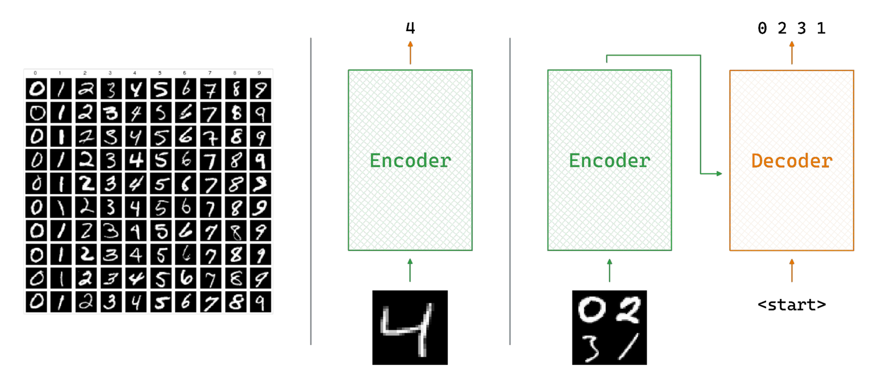
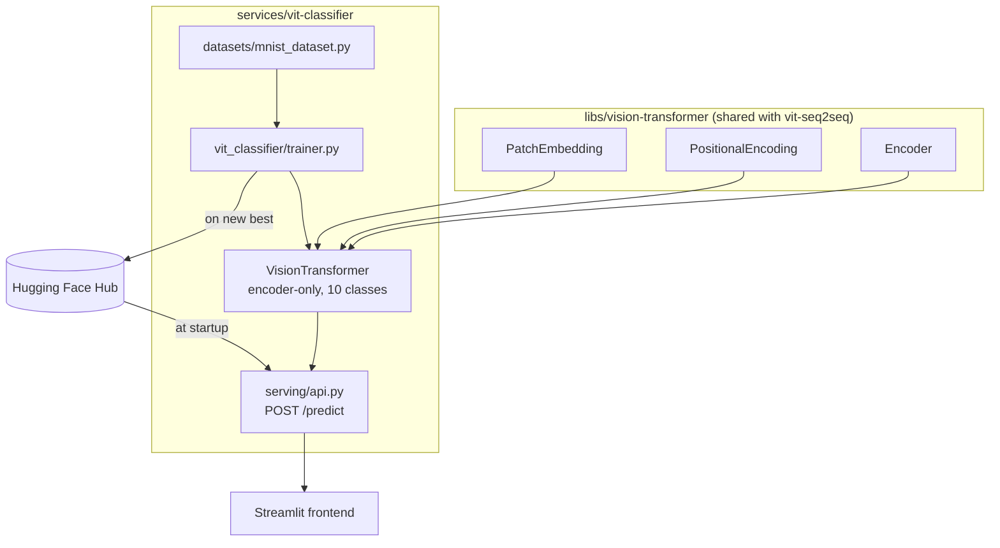
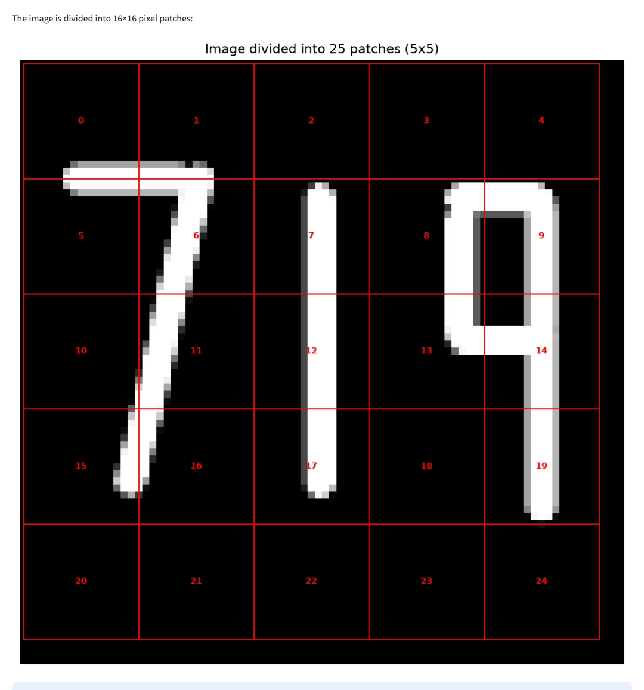

# A Vision Transformer, from scratch, for MNIST digit classification

## TL;DR

- **What it is:** an encoder-only Vision Transformer — patch embedding, multi-head self-attention,
  transformer encoder blocks — written from scratch in raw PyTorch, with no
  `torch.nn.Transformer` shortcuts, classifying a single MNIST digit.
- **Result:** 91.78% on the held-out MNIST test set after one epoch, against 11.35% for always
  guessing the most common digit.

An image is not a sequence, so the first thing a Vision Transformer has to do is invent one: cut
the image into fixed-size patches, project each into a vector, and hand the transformer a sequence
of patch tokens the way a language model gets a sequence of word tokens. Everything after that is
the transformer architecture applied unchanged to a new modality.

## Quickstart

```bash
# one venv for the whole workspace
make install

# FastAPI on :8000, interactive docs at /docs
make serve SERVICE=vit-classifier

# read Usage first
make train SERVICE=vit-classifier
```

Checkpoints are resolved locally first, then from the Hugging Face Hub, so serving works on a host
that has never trained anything.

The transformer building blocks this model is made of — patch embedding, multi-head
self-attention, the encoder block and the positional encodings — are not duplicated here. They live
in [`libs/vision-transformer`](../../libs/vision-transformer), shared with
[the multi-digit seq2seq model](../vit-seq2seq), because both models are the same blocks wired
differently. Sections 3.1–3.3 below describe what that library implements.

## 1. Introduction

The [retrieval project](../vector-search-retrieval) used self-attention over text. This one asks
what the original ViT paper asked: does the same architecture work over *images*, if you find the
right way to turn pixels into tokens?

The paper's answer is to cut the image into fixed-size patches, flatten and linearly project each
one, and feed the resulting sequence into an unmodified transformer encoder — treating patches
exactly like word tokens. No convolutions anywhere.

MNIST is the smallest honest test of that claim. A 28x28 digit becomes 49 patches of 4x4, and a
`[CLS]` token pooled from the final layer produces the ten-way prediction.

**Figure 1.** Recognizing one digit — the task this service solves. Its sibling,
[vit-seq2seq](../vit-seq2seq), handles the multi-digit case on the right.


## 2. System Architecture

The blocks come from the shared library; this service adds the classification head, the MNIST
wrapper its trainer reads, and the FastAPI app that serves the result.

**Figure 2.** From an image to a digit, and where each piece lives.


The checkpoint never travels as a file on disk between the two halves: the trainer pushes to the
Hub and the service pulls from it, so a host that has never trained still serves.

## 3. Method

### 3.1 The transformer blocks

Patch embedding, multi-head self-attention and the encoder block are shared with the sibling
service and live in [`libs/vision-transformer`](../../libs/vision-transformer), which is also
where they are explained: how an image becomes a sequence of patch tokens, how attention is
computed, and why the block is post-norm like the original Transformer paper rather than
pre-norm like ViT.

What follows is what this service adds on top of them.

### 3.2 Classification Head

For the single-digit task, only the `[CLS]` token's final representation is used, the same trick
BERT uses for sequence-level tasks. After the last encoder layer, position 0 of the sequence is
pulled out, passed through dropout, and projected to 10 logits via a single `Linear(128, 10)`.

## 4. Implementation

Mapping the architecture from [Section 2](#2-system-architecture) onto the actual file layout:

```
libs/vision-transformer/     Shared with vit-seq2seq: attention, encoder, decoder, patch
                             embedding, positional encoding, feed-forward
services/vit-classifier/
├── config/                  Config(BaseConfig) plus ClassifierArch, the frozen architecture
│                            dataclass that also derives the checkpoint file name
├── vit_classifier/
│   ├── classifier.py        VisionTransformer: patch embedding -> encoder stack -> class head
│   └── trainer.py           Training loop, early stopping, checkpointing and Hub upload
├── datasets/
│   └── mnist_dataset.py     Thin wrapper around torchvision's MNIST, with train/val/test splits
├── serving/api.py           FastAPI app: /predict (aliased /predict/vit), /health, /models
└── tests/                   Shape checks for the from-scratch blocks, and a training
                             reproducibility check that trains twice from the same seed
```

## 5. Usage

Figure 3 ([Section 2](#2-system-architecture)) shows the end-to-end flow. Pretrained checkpoints
for both models are committed under `checkpoints/`, so serving works without training anything
first. A `Makefile` wraps every stage below with a consistent set of targets; the raw command each
target actually runs is kept underneath it, since that's what's really executing.

```bash
make install   # what this runs: uv sync   (installs from pyproject.toml + committed uv.lock)
make serve SERVICE=vit-classifier     # what this runs: uv run python -m serving.api   (FastAPI on :8000)
make check     # lint + type check + tests
```

To retrain from scratch instead:

```bash
make train SERVICE=vit-classifier-classifier  # what this runs:
                        #   uv run python -m vit_classifier.trainer
                        # trains on MNIST, saves to checkpoints/
make train SERVICE=vit-classifier-seq2seq     # what this runs:
                        #   uv run python -m vit_seq2seq.trainer
                        # trains on composited multi-digit images, ~85min on M1 Max/MPS
```

`make train SERVICE=vit-classifier` is an alias for `make train SERVICE=vit-classifier-classifier` (the faster of the two).

A `notebooks/walkthrough.ipynb` runs the happy path end to end — loading both committed
checkpoints and running real inference — without retraining anything. Its first cell chdirs back
to the repo root so relative paths (checkpoints, MNIST cache) resolve the same way `make serve SERVICE=vit-classifier`'s
do; the package itself is installed, so nothing needs to be put on the import path.

**Docker Compose (Linux/CUDA servers):** two single-purpose Dockerfiles, both
`FROM roshbeed/ai-residency-base` — `Dockerfile.serve` (the FastAPI inference container) and
`Dockerfile.train` (the training image, defaulting to the classifier). `uv.lock` already pins
`torch`/`torchvision` to the CPU-only PyTorch wheel index, which otherwise resolves an unpinned
`torch` to a multi-GB CUDA build on `linux/arm64` — a real GPU host would need its own
CUDA-enabled lockfile rather than overriding this one at build time.

On Apple Silicon, that CPU-only pin isn't just about avoiding a CUDA download. Docker Desktop on
macOS runs containers inside a Linux VM, and that VM has no path to the host's Metal GPU at all
(no MPS passthrough exists, unlike Linux's native NVIDIA passthrough), so a container always
reports `"device": "cpu"` here no matter what the host itself can do. `make serve SERVICE=vit-classifier` /
`make train SERVICE=vit-classifier-classifier` / `make train SERVICE=vit-classifier-seq2seq` run natively and get real MPS acceleration; the
same targets under `make docker-*` are CPU-only on this hardware by construction, not a bug to
chase. Use the native `make` targets for real Apple Silicon speed, and Docker Compose for a
CPU-portable, Linux/CUDA-ready deployment story.

```bash
make -C deploy up               # what this runs: docker compose up serve
docker compose --profile train run --rm train-vit-classifier
make -C deploy up  # then: docker compose --profile train run --rm train-vit-classifier STAGE=seq2seq  # the slower seq2seq trainer
make -C deploy down             # what this runs: docker compose down
```

**API:**
- `GET /` and `GET /health` — the same liveness check, reporting which models are loaded and
  on which device. `/health` is the portfolio-wide convention the hub and the Helm probes use.
- `GET /models` — list available models
- `POST /predict` — predict with `model_type: "vit"` or `"seq2seq"`
- `POST /predict/vit`, `POST /predict/seq2seq` — model-specific shortcuts
- `POST /predict/both` — run both models on the same image for comparison

## 6. Experimental Results

The numbers below come from loading the shipped checkpoint and running real inference on the MNIST
test set, not from re-describing the training script.

The committed checkpoint was trained for a single epoch (`checkpoints/training_config.json`
records `epochs: 1`):

| | Train loss | Train acc | Val loss | Val acc |
|---|---|---|---|---|
| Epoch 1 | 1.113 | 64.4% | 0.374 | 90.8% |

Against the actual MNIST **test** set — 10,000 held-out images, never seen during training — that
checkpoint gets **91.78% accuracy (9,178 / 10,000)**, consistent with the logged validation number.

The baseline matters for reading that. Always guessing the most common digit in the same test set
(digit 1, 1,135 of 10,000) gets 11.35%. The classifier clears it by roughly 8x, after one epoch,
from scratch, with no pretraining.

**Figure 7.** The patch-division step, real output for a hand-drawn "719".


## 7. Related Work

- [the dual-encoder retrieval project](https://github.com/RoshBeed/ai-residency/tree/main/services/vector-search-retrieval) —
  the self-attention-free encoder, superseded here by a from-scratch transformer.
- [the image captioning project](https://github.com/RoshBeed/ai-residency/tree/main/services/multimodal-captioning) —
  the same encoder-decoder ViT pattern from Section 3.5, applied to natural-language captions
  instead of 3-digit sequences.

## References

[1] Vaswani, A., Shazeer, N., Parmar, N., Uszkoreit, J., Jones, L., Gomez, A. N., Kaiser, Ł., &
Polosukhin, I. (2017). *Attention Is All You Need.* NeurIPS.

[2] Dosovitskiy, A., Beyer, L., Kolesnikov, A., Weissenborn, D., Zhai, X., Unterthiner, T.,
Dehghani, M., Minderer, M., Heigold, G., Gelly, S., Uszkoreit, J., & Houlsby, N. (2021). *An Image
is Worth 16x16 Words: Transformers for Image Recognition at Scale.* ICLR.

[3] LeCun, Y., Bottou, L., Bengio, Y., & Haffner, P. (1998). *Gradient-Based Learning Applied to
Document Recognition.* Proceedings of the IEEE, 86(11). — the original MNIST dataset used
throughout this project.

## Acknowledgments

Built with Joao Esteves, Hikaru Tsujimura, and Felipe Lavratti. Figures 4 and 5 are reproduced directly
from Dosovitskiy et al. [2] and Vaswani et al. [1] respectively.

## Dependencies

PyTorch · torchvision · FastAPI · Streamlit · streamlit-drawable-canvas · OpenCV · Docker Compose ·
Terraform (GPU server provisioning)
