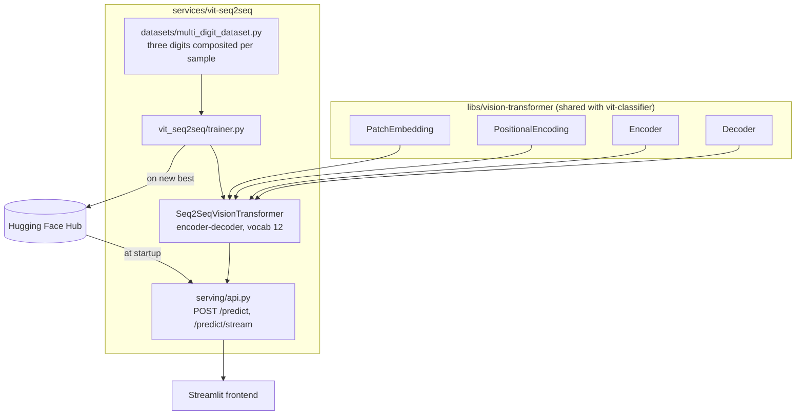

# An encoder–decoder Vision Transformer that reads multi-digit numbers

## TL;DR

- **What it is:** an encoder–decoder Vision Transformer written from scratch in raw PyTorch. The
  encoder reads an image of three digits side by side; the decoder generates the number one digit
  at a time, autoregressively, with a causal mask and cross-attention.
- **Result:** 68.00% exact-sequence accuracy on 500 held-out three-digit numbers, against 0.10%
  for guessing uniformly.

Classifying one digit needs a single label. Reading a number needs an ordered sequence, of a length
the model decides on, which is a different problem: the model has to know when it has finished. That
is what the decoder adds — a start token, a causal mask so each position only sees what came before
it, cross-attention onto the encoded image, and an EOS token it emits when the number is done.

## Quickstart

```bash
# one venv for the whole workspace
make install

# FastAPI on :8000, interactive docs at /docs
make serve SERVICE=vit-seq2seq

# read Usage first
make train SERVICE=vit-seq2seq
```

Checkpoints are resolved locally first, then from the Hugging Face Hub, so serving works on a host
that has never trained anything.

The transformer building blocks this model is made of — patch embedding, multi-head
self-attention, the encoder block and the positional encodings — are not duplicated here. They live
in [`libs/vision-transformer`](../../libs/vision-transformer), shared with
[the single-digit classifier](../vit-classifier), because both models are the same blocks wired
differently. Sections 3.1–3.3 below describe what that library implements.

## 1. Introduction

Classifying one digit needs a single label, and the [classifier](../vit-classifier) does that with
an encoder and a pooled `[CLS]` token. Reading a *number* is a different problem: the answer is an
ordered sequence whose length the model decides, so it has to know when it has finished.

That is what a decoder adds. It is seeded with a start token, masked so each position sees only
what came before it, cross-attends onto the encoded image at every step, and emits an EOS token
when the number is done. The encoder underneath is the same one the classifier uses — the
difference between the two services is entirely in what reads its output.

**Figure 1.** Recognizing several digits — the task this service solves, on the right.


## 2. System Architecture

The encoder is the same stack the classifier uses, from the shared library. What this service adds
is the decoder half: a causal mask, cross-attention onto the encoded image, and a generation loop
that terminates per sequence.

**Figure 2.** From an image of three digits to the number, and where each piece lives.


`/predict/stream` relays each digit as a Server-Sent Event the moment the decoder emits it, so the
frontend shows the number being read one token at a time rather than appearing at once.

## 3. Method

### 3.1 The transformer blocks

Patch embedding, multi-head self-attention and the encoder block are shared with the sibling
service and live in [`libs/vision-transformer`](../../libs/vision-transformer), which is also
where they are explained: how an image becomes a sequence of patch tokens, how attention is
computed, and why the block is post-norm like the original Transformer paper rather than
pre-norm like ViT.

What follows is what this service adds on top of them.

### 3.2 Sequence Decoding: Encoder–Decoder ViT

The multi-digit task can't use a fixed-size classification head, because the output is a variable
number of digits (0 up to 999). Instead, `vit_seq2seq/seq2seq.py` pairs the same
patch-embedding encoder with a transformer decoder over a 12-token vocabulary: digits 0–9, plus
learned `START` (10) and `EOS` (11) tokens.

**Figure 6.** Encoder–decoder ViT for multi-digit sequence generation.


`vit_seq2seq/seq2seq.py` implements this pipeline. On the left, a patch-embedding encoder
(`Conv2d(k=16,s=16)` → 25×256 for this repo's real 84×84 three-digit images, larger than the
figure's illustrative 16×64). On the right, a tokenizer/embedding stage over a 12-token vocabulary
— digits 0–9 plus learned `START`/`EOS` tokens, the figure's `<start>`/`<finish>`/`<pad>` table.
The two feed masked self-attention and cross-attention decoder blocks
(`torch.matmul(Q, K.transpose(-2,-1))` per block, matching the figure's `Q`/`Kᵀ`/`A` derivation)
that project back out to next-token logits.

The figure's worked example — feeding in `<start> 7 7 6 9` and reading out `7 7 6 9 <finish>` — is
the same teacher-forced training setup `seq2seq/trainer.py` uses: the whole target sequence goes to
the decoder at once, with a causal mask so position *i* can't see positions after it
(`create_causal_mask`, matching the "Masked Multi-Head Attention" block in the original decoder
[1]). At inference, `generate()` runs the same decoder autoregressively instead — no target
sequence to see, so it starts from `[START]` and feeds each predicted token back in to produce the
next one, one forward pass per digit, until `EOS` (`<finish>`) is produced.

## 4. Implementation

Mapping the architecture from [Section 2](#2-system-architecture) onto the actual file layout:

```
libs/vision-transformer/     Shared with vit-classifier: attention, encoder, decoder, patch
                             embedding, positional encoding, feed-forward
services/vit-seq2seq/
├── config/                  Config(BaseConfig) plus Seq2SeqArch, the frozen architecture
│                            dataclass that also derives the checkpoint file name
├── vit_seq2seq/
│   ├── seq2seq.py           Seq2SeqVisionTransformer: encoder over patches, causal decoder
│   │                        with cross-attention, and autoregressive generate()
│   └── trainer.py           Training loop with teacher forcing, warmup, label smoothing
├── datasets/
│   └── multi_digit_dataset.py  Composites three random MNIST digits onto an 84x84 canvas per
│                            sample, with jitter and random affine augmentation, on the fly
├── serving/api.py           FastAPI app: /predict, /predict/stream (per-digit SSE), /health
└── tests/                   Generation tests, including the regression test for batch-wide
                             EOS truncation, plus shape checks
```

## 5. Usage

Figure 3 ([Section 2](#2-system-architecture)) shows the end-to-end flow. Pretrained checkpoints
for both models are committed under `checkpoints/`, so serving works without training anything
first. A `Makefile` wraps every stage below with a consistent set of targets; the raw command each
target actually runs is kept underneath it, since that's what's really executing.

```bash
make install   # what this runs: uv sync   (installs from pyproject.toml + committed uv.lock)
make serve SERVICE=vit-seq2seq     # what this runs: uv run python -m serving.api   (FastAPI on :8000)
make check     # lint + type check + tests
```

To retrain from scratch instead:

```bash
make train SERVICE=vit-seq2seq-classifier  # what this runs:
                        #   uv run python -m vit_classifier.trainer
                        # trains on MNIST, saves to checkpoints/
make train SERVICE=vit-seq2seq-seq2seq     # what this runs:
                        #   uv run python -m vit_seq2seq.trainer
                        # trains on composited multi-digit images, ~85min on M1 Max/MPS
```

`make train SERVICE=vit-seq2seq` is an alias for `make train SERVICE=vit-seq2seq-classifier` (the faster of the two).

A `notebooks/walkthrough.ipynb` runs the happy path end to end — loading both committed
checkpoints and running real inference — without retraining anything. Its first cell chdirs back
to the repo root so relative paths (checkpoints, MNIST cache) resolve the same way `make serve SERVICE=vit-seq2seq`'s
do; the package itself is installed, so nothing needs to be put on the import path.

**Docker Compose (Linux/CUDA servers):** two single-purpose Dockerfiles, both
`FROM roshbeed/ai-residency-base-serve` — `Dockerfile.serve` (the FastAPI inference container) and
`Dockerfile.train` (the training image, defaulting to the classifier). `uv.lock` already pins
`torch`/`torchvision` to the CPU-only PyTorch wheel index, which otherwise resolves an unpinned
`torch` to a multi-GB CUDA build on `linux/arm64` — a real GPU host would need its own
CUDA-enabled lockfile rather than overriding this one at build time.

On Apple Silicon, that CPU-only pin isn't just about avoiding a CUDA download. Docker Desktop on
macOS runs containers inside a Linux VM, and that VM has no path to the host's Metal GPU at all
(no MPS passthrough exists, unlike Linux's native NVIDIA passthrough), so a container always
reports `"device": "cpu"` here no matter what the host itself can do. `make serve SERVICE=vit-seq2seq` /
`make train SERVICE=vit-seq2seq-classifier` / `make train SERVICE=vit-seq2seq-seq2seq` run natively and get real MPS acceleration; the
same targets under `make docker-*` are CPU-only on this hardware by construction, not a bug to
chase. Use the native `make` targets for real Apple Silicon speed, and Docker Compose for a
CPU-portable, Linux/CUDA-ready deployment story.

```bash
make -C deploy up               # what this runs: docker compose up serve
docker compose --profile train run --rm train-vit-seq2seq
make -C deploy up  # then: docker compose --profile train run --rm train-vit-seq2seq STAGE=seq2seq  # the slower seq2seq trainer
make -C deploy down             # what this runs: docker compose down
```

**API:**
- `GET /` and `GET /health` — the same liveness check, reporting which models are loaded and
  on which device. `/health` is the portfolio-wide convention the hub and the Helm probes use.
- `GET /models` — list available models
- `POST /predict` — predict with `model_type: "vit"` or `"seq2seq"`
- `POST /predict/vit`, `POST /predict/seq2seq` — model-specific shortcuts
- `POST /predict/both` — run both models on the same image for comparison

## 6. Experimental Results

Generation tracks completion per sequence within a batch, so shorter and longer targets in the same
batch each run to their own `EOS` independently. That is worth stating precisely because the
alternative — stopping the whole batch at the first `EOS` — silently truncates every other sequence
still decoding, including inside the trainer's own evaluation loop, which makes the reported
accuracy wrong rather than merely noisy.

A fresh run over 500 held-out three-digit numbers the model has never seen (seeded, reproducible)
gets **68.00% exact-sequence accuracy (340 / 500)**, against a random-chance baseline of 0.10% for
guessing uniformly over the 1,000 possible three-digit numbers.

Real transcript, matches from that run:

```
target 544 -> generated  544   MATCH
target 948 -> generated  948   MATCH
target 346 -> generated  346   MATCH
target 049 -> generated  049   MATCH
```

## 7. Related Work

- [the dual-encoder retrieval project](https://github.com/RoshBeed/ai-residency/tree/main/services/vector-search-retrieval) —
  the self-attention-free encoder, superseded here by a from-scratch transformer.
- [the image captioning project](https://github.com/RoshBeed/ai-residency/tree/main/services/multimodal-captioning) —
  the same encoder-decoder ViT pattern from Section 3.5, applied to natural-language captions
  instead of 3-digit sequences.

## References

[1] Vaswani, A., Shazeer, N., Parmar, N., Uszkoreit, J., Jones, L., Gomez, A. N., Kaiser, Ł., &
Polosukhin, I. (2017). *Attention Is All You Need.* NeurIPS.

[2] Dosovitskiy, A., Beyer, L., Kolesnikov, A., Weissenborn, D., Zhai, X., Unterthiner, T.,
Dehghani, M., Minderer, M., Heigold, G., Gelly, S., Uszkoreit, J., & Houlsby, N. (2021). *An Image
is Worth 16x16 Words: Transformers for Image Recognition at Scale.* ICLR.

[3] LeCun, Y., Bottou, L., Bengio, Y., & Haffner, P. (1998). *Gradient-Based Learning Applied to
Document Recognition.* Proceedings of the IEEE, 86(11). — the original MNIST dataset used
throughout this project.

## Acknowledgments

Built with Joao Esteves, Hikaru Tsujimura, and Felipe Lavratti. Figures 4 and 5 are reproduced directly
from Dosovitskiy et al. [2] and Vaswani et al. [1] respectively.

## Dependencies

PyTorch · torchvision · FastAPI · Streamlit · streamlit-drawable-canvas · OpenCV · Docker Compose ·
Terraform (GPU server provisioning)
