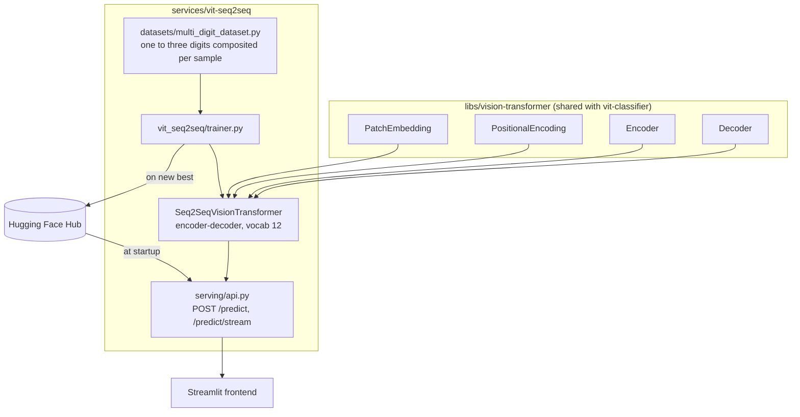

# An encoder–decoder Vision Transformer that reads multi-digit numbers

## TL;DR

- **What it is:** an encoder–decoder Vision Transformer written from scratch in raw PyTorch. The
  encoder reads an image holding one, two or three handwritten digits; the decoder generates the
  number one digit at a time, autoregressively, with a causal mask and cross-attention, and stops
  when it emits EOS.
- **Result:** **93.77% exact-sequence accuracy** on 3,000 held-out composites of one to three
  digits, against 3.33% for always answering the commonest number in the split and 0.10% for
  guessing uniformly over 0–999. EOS lands in the right place 100% of the time, and the number
  the API returns is the same number: the two paths answer identically.

  That figure is lower than the 98.53% this README used to quote, and it describes far more.
  Every composite used to be built at one cell size in a centred strip, so the old number held
  only for digits occupying about a quarter of the canvas — scored anywhere else, the same
  checkpoint read **3.3% at 20 pixels and 10.0% at 95**. The generator now draws the cell size
  and the position per composite, and `make evaluate` reports accuracy by ink height so a
  collapse at one scale cannot hide inside an average again.

Classifying one digit needs a single label. Reading a number needs an ordered sequence, of a length
the model decides on, which is a different problem: the model has to know when it has finished. That
is what the decoder adds — a start token, a causal mask so each position only sees what came before
it, cross-attention onto the encoded image, and an EOS token it emits when the number is done.

## Quickstart

No clone, no build, no credentials. The published image pulls its own checkpoint from the
Hugging Face Hub at startup:

```bash
docker run --rm -d --pull always --name vit-seq2seq -p 8000:8000 \
  roshb/ai-residency-vit-seq2seq-serve

# /ready answers 503 until the weights are loaded, so retry rather than sleep
curl -fsS --retry 60 --retry-delay 1 --retry-all-errors http://localhost:8000/ready

open http://localhost:8000/docs   # the request shapes, and a form to post them

docker rm -f vit-seq2seq
```

To run it with its Streamlit page instead, see
[With the UI](../../README.md#with-the-ui) -- same image, one more container.

From the source, with the workspace installed:

```bash
# one venv for the whole workspace
make install

# FastAPI on :8000, interactive docs at /docs
make serve SERVICE=vit-seq2seq

# read Usage first
make train SERVICE=vit-seq2seq
```

Checkpoints are resolved locally first, then from the Hugging Face Hub, so serving works on a host
that has never trained anything.

The transformer building blocks this model is made of — patch embedding, multi-head
self-attention, the encoder block and the positional encodings — are not duplicated here. They live
in [`libs/vision-transformer`](../../libs/vision-transformer), shared with
[the single-digit classifier](../vit-classifier), because both models are the same blocks wired
differently. Sections 3.1–3.3 below describe what that library implements.

## 1. Introduction

Classifying one digit needs a single label, and the [classifier](../vit-classifier) does that with
an encoder and a pooled `[CLS]` token. Reading a *number* is a different problem: the answer is an
ordered sequence whose length the model decides, so it has to know when it has finished.

That is what a decoder adds. It is seeded with a start token, masked so each position sees only
what came before it, cross-attends onto the encoded image at every step, and emits an EOS token
when the number is done. The encoder underneath is the same one the classifier uses — the
difference between the two services is entirely in what reads its output.

**Figure 1.** Recognizing several digits — the task this service solves, on the right.


## 2. System Architecture

The encoder is the same stack the classifier uses, from the shared library. What this service adds
is the decoder half: a causal mask, cross-attention onto the encoded image, and a generation loop
that terminates per sequence.

**Figure 2.** From an image of digits to the number, and where each piece lives.


`/predict/stream` relays each digit as a Server-Sent Event the moment the decoder emits it, so the
frontend shows the number being read one token at a time rather than appearing at once.

## 3. Method

### 3.1 The transformer blocks

Patch embedding, multi-head self-attention and the encoder block are shared with the sibling
service and live in [`libs/vision-transformer`](../../libs/vision-transformer), which is also
where they are explained: how an image becomes a sequence of patch tokens, how attention is
computed, and why the block is post-norm like the original Transformer paper rather than
pre-norm like ViT.

What follows is what this service adds on top of them.

### 3.2 Sequence Decoding: Encoder–Decoder ViT

The multi-digit task can't use a fixed-size classification head, because the output is a variable
number of digits (0 up to 999). Instead, `vit_seq2seq/seq2seq.py` pairs the same
patch-embedding encoder with a transformer decoder over a 12-token vocabulary: digits 0–9, plus
learned `START` (10) and `EOS` (11) tokens.

**Figure 6.** Encoder–decoder ViT for multi-digit sequence generation.
![Encoder-decoder architecture for the sequence task: a 1x112x112 composite is cut into 7x7 patches of 16x16, linearly projected and passed through six encoder blocks to a 49x256 encoder output; in parallel the target tokens <start> 2 0 6 are embedded to 4x256 and passed through six decoder blocks whose cross-attention takes Q from the decoder and K, V from the encoder output, then projected by nn.Linear(256, 12) into 4x12 next-token logits producing 2 0 6 <eos>, over a 12-token vocabulary of the ten digits plus start and eos and no pad id](assets/seq2seq_slide_architecture.png)

`vit_seq2seq/seq2seq.py` implements this pipeline, and every shape in the figure is read off
`Seq2SeqArch` and a real forward pass. On the left, a patch-embedding encoder
(`Conv2d(k=16, s=16)`) turns a 112×112 composite into 49 patch tokens at `d_model` 256. On the
right, an embedding over the 12-token vocabulary turns `<start> 2 0 6` into 4×256. The two feed
masked self-attention and cross-attention decoder blocks — `torch.matmul(Q, K.transpose(-2, -1))`
per block, with `Q` from the decoder and `K`, `V` from the encoder output — and
`nn.Linear(256, 12)` projects back out to next-token logits.

The figure's worked example — feeding in `<start> 2 0 6` and reading out `2 0 6 <eos>` — is
the same teacher-forced training setup `vit_seq2seq/trainer.py` uses: the whole target sequence goes to
the decoder at once, with a causal mask so position *i* can't see positions after it
(`create_causal_mask`, matching the "Masked Multi-Head Attention" block in the original decoder
[1]). At inference, `generate()` runs the same decoder autoregressively instead — no target
sequence to see, so it starts from `START` and feeds each predicted token back in to produce the
next one, one forward pass per digit, until `EOS` is produced.

### 3.3 The data has to exercise the EOS token

An architecture that supports a variable-length answer only demonstrates one if the training data
asks for one. Labels are the number's own digits, so `7` is one token long and `407` is three, and
each length contributes the same number of training examples.

That balance is deliberate. There are 10 one-digit numbers, 90 two-digit and 900 three-digit, so
drawing uniformly from `range(1000)` would make 90% of examples three digits long and "stop after
the third digit" would be the right answer almost always. Stopping has to cost something to get
wrong before it measures anything.

Padding is EOS repeated rather than a new `PAD` id. A pad token would widen the decoder's output
head and make every earlier checkpoint unloadable, which would destroy the before/after
comparison. The trainer masks every position after the first EOS out of the loss, so the repeats
are never trained against.

Each digit is pasted at MNIST's native 28px and then warped: rotation up to ±15°, shear up to
±12°, scale 0.75–1.15, plus a sub-cell translation, applied to every digit rather than a fraction
of them. The whole group is offset within whatever slack a shorter number leaves, so a two-digit
number is not always flush left. Without that the three cells of an evenly divided canvas are
memorisable, and the encoder can learn each cell's appearance instead of finding a glyph.

The canvas is 112px, which is 7×16. The patch embedding is a strided convolution, so any canvas
that is not a multiple of the patch size silently drops the remainder: at 84px the 5×5 grid covers
80 pixels and the last four columns never reach the model at all. 112px keeps every pixel inside a
patch, at 49 patch tokens instead of 25.

## 4. Implementation

Mapping the architecture from [Section 2](#2-system-architecture) onto the actual file layout:

```
libs/vision-transformer/     Shared with vit-classifier: attention, encoder, decoder, patch
                             embedding, positional encoding, feed-forward
services/vit-seq2seq/
├── config/                  Config(BaseConfig) plus Seq2SeqArch, the frozen architecture
│                            dataclass that also derives the checkpoint file name
├── vit_seq2seq/
│   ├── seq2seq.py           Seq2SeqVisionTransformer: encoder over patches, causal decoder
│   │                        with cross-attention, and autoregressive generate()
│   └── trainer.py           Training loop with teacher forcing, warmup, label smoothing
├── datasets/
│   └── multi_digit_dataset.py  Composites one to three random MNIST digits onto a 112x112
│                            canvas per sample, each digit warped and jittered, on the fly
├── serving/api.py           FastAPI app: /predict, /predict/stream (per-digit SSE), /health
└── tests/                   Generation tests, including the regression test for batch-wide
                             EOS truncation, plus shape checks
```

## 5. Usage

Figure 3 ([Section 2](#2-system-architecture)) shows the end-to-end flow. Trained checkpoints
live on the Hugging Face Hub and are pulled on first use, so serving works without training
anything first and nothing large is committed here. A `Makefile` wraps every stage below with a consistent set of targets; the raw command each
target actually runs is kept underneath it, since that's what's really executing.

```bash
make install   # what this runs: uv sync   (installs from pyproject.toml + committed uv.lock)
make serve SERVICE=vit-seq2seq     # what this runs: uv run python -m serving.api   (FastAPI on :8000)
make -C services/vit-seq2seq evaluate   # what this runs: uv run python -m vit_seq2seq.evaluate
                                        # every number in Section 6, from the shipped checkpoint
make -C services/vit-seq2seq evaluate-sampled   # the same, decoding by sampling
                                        # what the greedy decode rule is worth, 21.5 points
make check     # lint + type check + tests
```

To retrain from scratch instead:

```bash
make train SERVICE=vit-seq2seq   # what this runs: uv run python -m vit_seq2seq.trainer
                                 # composites multi-digit images from MNIST and trains on them;
                                 # ~10 min an epoch at 112px on M1 Max/MPS, 15 epochs
```

The single-digit classifier is a [separate service](../vit-classifier) with its own trainer; the
two share the encoder through `libs/vision-transformer`, not a training entry point.

A `notebooks/vit-seq2seq/walkthrough.ipynb` runs the happy path end to end — pulling the
checkpoint from the Hub and running real inference — without retraining anything. Its first cell chdirs back
to the repo root so relative paths (checkpoints, MNIST cache) resolve the same way `make serve SERVICE=vit-seq2seq`'s
do; the package itself is installed, so nothing needs to be put on the import path.

**Docker Compose (Linux/CUDA servers):** one `Dockerfile.serve` and one `Dockerfile.train` at the
repository root, parameterised by `--build-arg SERVICE=`, so this service has no Dockerfile of its
own. The serving image builds `FROM roshb/ai-residency-base-serve` and the training image from the
CUDA base. `uv.lock` already pins
`torch`/`torchvision` to the CPU-only PyTorch wheel index, which otherwise resolves an unpinned
`torch` to a multi-GB CUDA build on `linux/arm64` — a real GPU host would need its own
CUDA-enabled lockfile rather than overriding this one at build time.

On Apple Silicon, that CPU-only pin isn't just about avoiding a CUDA download. Docker Desktop on
macOS runs containers inside a Linux VM, and that VM has no path to the host's Metal GPU at all
(no MPS passthrough exists, unlike Linux's native NVIDIA passthrough), so a container always
reports `"device": "cpu"` here no matter what the host itself can do. `make serve
SERVICE=vit-seq2seq` and `make train SERVICE=vit-seq2seq` run natively and get real MPS
acceleration; the same work inside a container is CPU-only on this hardware by construction, not
a bug to chase. Use the native `make` targets for real Apple Silicon speed, and Docker Compose for a
CPU-portable, Linux/CUDA-ready deployment story.

```bash
make -C deploy up               # what this runs: docker compose up serve
docker compose --profile train run --rm train-vit-seq2seq
make -C deploy down             # what this runs: docker compose down
```

**API:**
- `GET /health` — liveness, always 200, so a slow or missing checkpoint never restarts a pod
- `GET /ready` — readiness, 503 until the checkpoint is loaded and the service can answer
- `GET /models` — the one model, with the `img_size` and `patch_size` it reads at
- `POST /predict` and `POST /predict/seq2seq` — read the number in a base64 `image_data` field;
  the response carries the digits, the sequence confidence and a per-digit trace
- `POST /predict/stream` — the same decode as server-sent events, one per digit as it is
  emitted, ending in a `done` event with the full prediction

## 6. Experimental Results

Generation tracks completion per sequence within a batch, so shorter and longer targets in the
same batch each run to their own `EOS` independently. That is worth stating precisely because the
alternative, stopping the whole batch at the first `EOS`, silently truncates every other sequence
still decoding, including inside the trainer's own evaluation loop, which makes the reported
accuracy wrong rather than merely noisy.

`make evaluate` scores the shipped checkpoint on 3,000 held-out composites, balanced across one,
two and three digits, with freshly composed handwriting.

| metric | result |
|---|--:|
| **exact-sequence accuracy** | **93.77%** |
| commonest-number baseline | 3.33% |
| uniform guess over 0–999 | 0.10% |
| one digit | 98.60% |
| two digits | 94.50% |
| three digits | 88.20% |
| EOS in the right place | 100.00% |
| per-digit, aligned by position | 96.53% |

Accuracy depends on how large the digits are drawn, so `make evaluate` reports that too — by
the height of the ink in the model's own 112-pixel input:

| ink height | exact-sequence | examples |
|---|--:|--:|
| tiny, up to 16px | 81.88% | 629 |
| small, 17–28px | 94.75% | 1,028 |
| medium, 29–48px | 98.27% | 923 |
| large, over 48px | 99.29% | 420 |

A number written small is genuinely harder: at 10 pixels a digit is a dozen strokes' worth of
ink. The point of the breakdown is that the weakness is visible rather than averaged away.

Exact-sequence is the strict metric: two correct digits out of three scores zero. Sequences are
compared digit by digit rather than read back as an integer, because an integer comparison cannot
tell a dropped zero from a correct answer. Composites are generated per access, so a second pass
scores a different draw of handwriting and the figure moves by about two tenths of a point.

Per-digit accuracy is 96.53%, and it slopes with length (98.60% on one-digit targets, 97.05% on
two, 95.50% on three) because a three-digit number has to fit the same canvas and so is drawn
smaller. Exact-sequence falls faster still, since three independent reads all have to be right at
once.

Every sequence stops in the right place, so what is left is a misread digit rather than a decoder
that cannot count.

### What the decode rule was worth

Both decode loops drew each token from the softmax with `torch.multinomial`. For a task with one
right answer that trades accuracy for variety nothing wants: an image of 206 depicts 206, and
sampling at temperature 1 picks a low-probability token every so often, losing the whole sequence
with it. Greedy decoding is the default now, and `sample=True` is opt-in.

| decode rule | exact-sequence | EOS correct | per-digit |
|---|--:|--:|--:|
| sampled, temperature 1 | 72.60% | 90.30% | 87.07% |
| **greedy** | **93.77%** | **100.00%** | **96.53%** |

Same checkpoint, same split, 21.2 points — `make evaluate-sampled` is the first row and
`make evaluate` the second, so both are reproducible from one command. The trainer's own
validation pass sampled as well, so the number it reported each epoch agreed with the number
`make evaluate` reported afterwards, and two agreeing numbers look like a verified one.

EOS is where sampling does most of its damage, and the length spread says how: decoding 1,000
one-digit targets, sampling emits nothing 11 times, two digits 71 times and three digits 3 times.
Each of those is one unlucky draw on a distribution the model got right.

### The number above is the number the service returns

Training builds a composite in memory; the API decodes a PNG someone posted. Those are two
preprocessing paths for one model, and a model is only as good as the worse one. Scored on the
same 3,000 composites, routing one copy through a real PNG encode and the service's own
`preprocess_image`:

| path | exact-sequence | correct length | per-digit |
|---|--:|--:|--:|
| the loader's tensors | 92.97% | 100.00% | 96.25% |
| re-encoded as PNG and preprocessed as the API does | 93.00% | 100.00% | 96.27% |

The two paths disagree on 3 of 3,000 composites, all of them borderline cases pushed over by
8-bit PNG quantisation — the largest per-pixel difference between the two tensors is 0.006, which
is exactly one 255th divided by the normalisation's standard deviation. The dataset normalises once, on the finished composite,
with the same mean and standard deviation the API applies, and
`test_a_composite_survives_the_round_trip_the_api_puts_it_through` fails if that stops being
true. (Both figures here are one draw of handwriting below the table above; composites are
generated per access.)

### The layout has to be augmented, not just the handwriting

This is the failure worth reading, because every structural check passed through all of it.

The generator used to paste each digit at exactly `digit_size` into one of `max_digits` evenly
spaced slots in a centred strip, and apply rotation, scale, shear and translation *inside* that
fixed cell. The handwriting varied; the geometry was identical in all 270,000 training composites.
So the model learned the layout, and scoring it by cell size shows exactly that:

| cell size at 112px | 1 digit | 2 digits | 3 digits |
|---|--:|--:|--:|
| 9–14px | — | 0.0% | 0.0% |
| 20px | — | — | 3.3% |
| 28–47px | 99–100% | 94–100% | 92–99% |
| 61px | 58.3% | — | — |
| 78–95px | 10–21% | — | — |

It worked between about 22 and 47 pixels and collapsed outside. The frontend offers a 280×280
canvas and a 14-pixel brush; a person draws a single digit filling most of it, which is near 95
pixels once scaled to the model's input. **The one input a human can produce sat in the worst part
of that curve**, and the README quoted 98.53% because the evaluation only ever built composites the
same way the training data did.

The cell size, the gaps and the group's position are now drawn per composite — 8–85px for one
digit, 8–54 for two, 8–38 for three, bounded by what physically fits rather than by a constant.
Scored the way the canvas actually produces input, digits sized as a fraction of the canvas width:

| fill of canvas | 1 digit | 2 digits | 3 digits |
|---|--:|--:|--:|
| 25% | 99.2% *(was 100.0)* | 65.0% *(was 0.0)* | 0.8% *(was 0.0)* |
| 40% | 99.2% *(was 99.2)* | 95.8% *(was 94.2)* | 79.2% *(was 0.0)* |
| 55% | **99.2%** *(was 58.3)* | 98.3% *(was 99.2)* | 90.8% *(was 3.3)* |
| 70% | **99.2%** *(was 20.8)* | 98.3% *(was 100.0)* | 94.2% *(was 91.7)* |
| 85% | **99.2%** *(was 10.0)* | 99.2% *(was 94.2)* | 96.7% *(was 99.2)* |

Three digits crammed into a quarter of the canvas are 9 pixels each and still unreadable, which is
honest rather than fixed — at that size a digit is a dozen strokes' worth of ink.

`test_composites_vary_in_scale_and_position_not_just_handwriting` samples the generator and fails
unless ink heights span small to large and the position moves; restoring the fixed cell fails it
with `no small digits: smallest is 28px`. And `make evaluate` reports accuracy by ink height, so a
collapse at one scale shows up instead of averaging away.

Verified through the published image on input built by the frontend's own `canvas_to_png_bytes`,
at the sizes a person draws — not composites from the training generator, which is the mistake
that let this through:

```
drew 8    -> 8     0.922
drew 9    -> 9     0.920
drew 47   -> 47    0.891
drew 206  -> 206   0.925
```

### Against the fixed-length predecessor

The previous checkpoint trained on labels built with `str(number).zfill(3)`, so every target was
three digits and EOS always landed at position 4. Scored on the variable-length task, greedy, the
same way:

| | exact-sequence | one digit | two digits | three digits | correct length |
|---|--:|--:|--:|--:|--:|
| fixed-length, 84px | 23.20% | 0.00% | 0.00% | 69.60% | 33.33% |
| **this checkpoint** | **93.77%** | **98.60%** | **94.50%** | **88.20%** | **100.00%** |

Zero on one- and two-digit numbers is not a perception failure. It emits three digits whatever it
sees, because that is the only thing its training data ever asked for.

Real transcript from the shipped checkpoint:

```
target   2 -> generated   2   MATCH
target  72 -> generated  72   MATCH
target 313 -> generated 313   MATCH
target   9 -> generated   3   miss
target 206 -> generated 205   miss
```

## 7. Related Work

- [the dual-encoder retrieval project](https://github.com/RoshBeed/ai-residency/tree/main/services/vector-search-retrieval) —
  the self-attention-free encoder, superseded here by a from-scratch transformer.
- [the image captioning project](https://github.com/RoshBeed/ai-residency/tree/main/services/multimodal-captioning) —
  the same encoder-decoder ViT pattern from [Section 3.2](#32-sequence-decoding-encoderdecoder-vit),
  applied to natural-language captions instead of digit sequences.

## References

[1] Vaswani, A., Shazeer, N., Parmar, N., Uszkoreit, J., Jones, L., Gomez, A. N., Kaiser, Ł., &
Polosukhin, I. (2017). *Attention Is All You Need.* NeurIPS.

[2] Dosovitskiy, A., Beyer, L., Kolesnikov, A., Weissenborn, D., Zhai, X., Unterthiner, T.,
Dehghani, M., Minderer, M., Heigold, G., Gelly, S., Uszkoreit, J., & Houlsby, N. (2021). *An Image
is Worth 16x16 Words: Transformers for Image Recognition at Scale.* ICLR.

[3] LeCun, Y., Bottou, L., Bengio, Y., & Haffner, P. (1998). *Gradient-Based Learning Applied to
Document Recognition.* Proceedings of the IEEE, 86(11). — the original MNIST dataset used
throughout this project.

## Acknowledgments

Built with Joao Esteves, Hikaru Tsujimura, and Felipe Lavratti. Figures 4 and 5 are reproduced directly
from Dosovitskiy et al. [2] and Vaswani et al. [1] respectively.

## Dependencies

PyTorch · torchvision · FastAPI · Streamlit · streamlit-drawable-canvas · OpenCV · Docker Compose ·
Terraform (GPU server provisioning)
