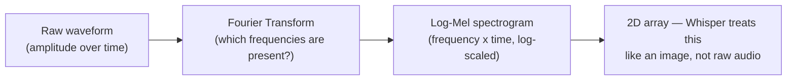
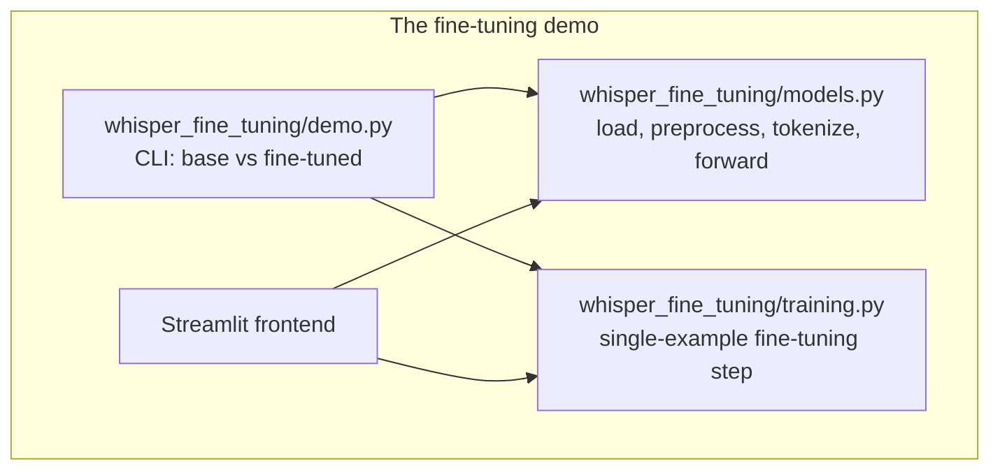
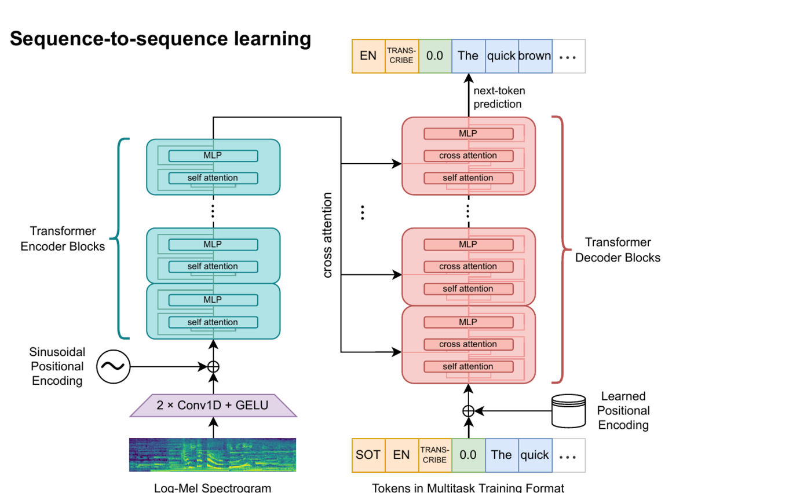
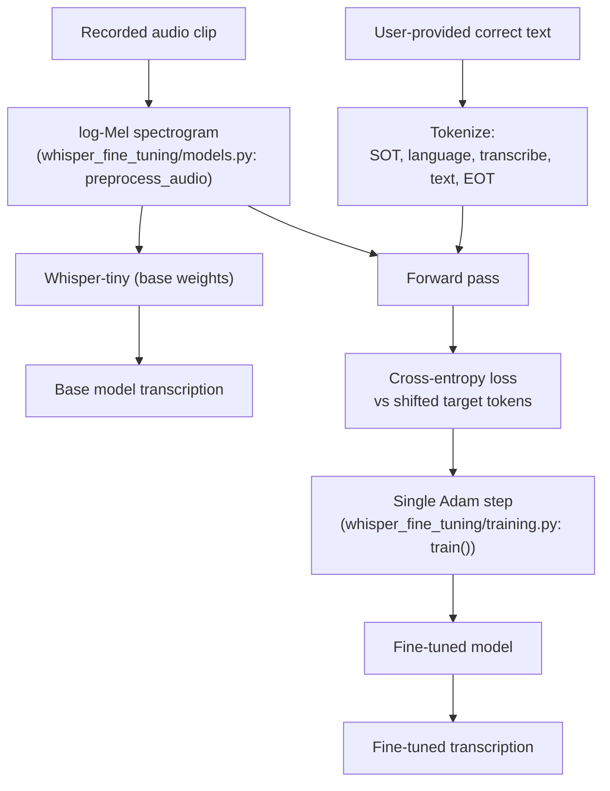
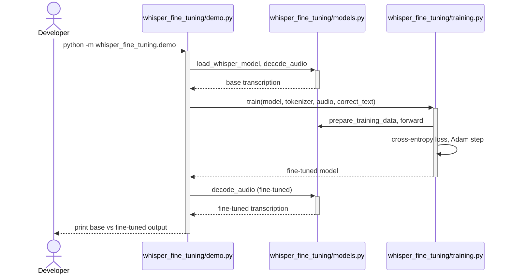
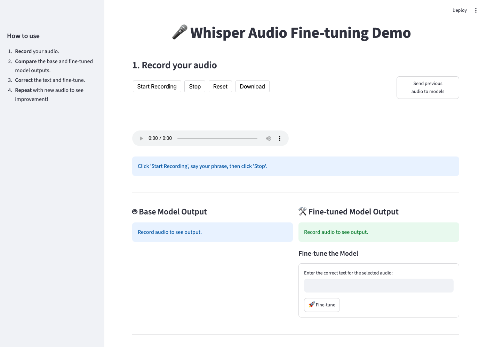

# Fine-tuning Whisper on a single example

## TL;DR

- **What it is:** Whisper-tiny fine-tuned on one clip, live, so the effect of a handful of
  gradient steps is visible rather than statistical.
- **Result:** `"My name is Roosh."` becomes `"My name is Rosh"` — a name the base model
  consistently mishears, corrected in one gradient step, and word error rate on twelve
  held-out sentences of other speech does not move (0.1642 before, 0.1642 after).

Fine-tuning is usually reported as a number moving on a held-out set, which is honest and
completely opaque. One example makes the mechanism visible instead: the base model mishears a
name, a few gradient steps on that single clip fix it, and the loss falling to near zero is the
model memorizing one thing — which is exactly what it should do given one example, and exactly
what overfitting looks like when you scale it up.

## Quickstart

No clone, no build, no credentials. The published image pulls its own checkpoint from the
Hugging Face Hub at startup:

```bash
docker run --rm -d --pull always --name whisper-fine-tuning -p 8000:8000 \
  roshb/ai-residency-whisper-fine-tuning-serve

# /ready answers 503 until the weights are loaded, so retry rather than sleep
curl -fsS --retry 60 --retry-delay 1 --retry-all-errors http://localhost:8000/ready

open http://localhost:8000/docs   # the request shapes, and a form to post them

docker rm -f whisper-fine-tuning
```

To run it with its Streamlit page instead, see
[With the UI](../../README.md#with-the-ui) -- same image, one more container.

From the source, with the workspace installed:

```bash
# one venv for the whole workspace
make install

# FastAPI on :8000, interactive docs at /docs
make serve SERVICE=whisper-fine-tuning
```

No system packages needed. Audio is read through libsndfile, which handles the demo clip's
MP3 directly. This used to require the **ffmpeg binary**, because `openai-whisper` shelled
out to it; moving onto `libs/speech` removed that.

Checkpoints are resolved locally first, then from the Hugging Face Hub, so serving works on a host
that has never trained anything.

## 1. Introduction

Every project so far has worked on text or images. Audio is a third modality,
and the first question is how to make it look like something a transformer can already handle.
Raw waveform samples are too dense and too weakly structured to feed a transformer directly at
30,000+ samples per second — the practical move (and the one Whisper itself makes) is to unbundle
the signal into frequencies first.

**Figure 1.** From raw waveform to something transformer-shaped.


A Fourier Transform decomposes a signal into how much each frequency contributes to it; doing that
in short overlapping windows across a clip produces a spectrogram: frequency on one axis, time on
the other, intensity as the value. That's a 2D array, the same shape a small stack of convolutions
(and then a transformer) can consume. This is also, not coincidentally, close to how the
[ViT classifier](https://github.com/RoshBeed/ai-residency/tree/main/services/vit-classifier) treats images: turn
the input into patches/tokens a transformer encoder can attend over.

Once the audio is a spectrogram, the actual task ("what words are these" or "what emotion is
this") is a sequence-generation problem no different in kind from the vision transformer project's multi-digit decoding or
the image captioning project's captioning: an encoder makes sense of the input, a decoder generates tokens one at a
time.

## 2. System Architecture

Before the method — here's how the two parts of this repo actually fit together, and how little
they share.

**Figure 2.** Repo layout: the two parts don't share code, only the underlying Whisper model.


## 3. Method

### 3.1 Whisper's Architecture

Whisper [1] is an encoder-decoder transformer trained on 680,000 hours of multilingual,
multitask audio-text data. The encoder side turns a log-Mel spectrogram into a sequence of hidden
states; the decoder side autoregressively generates text tokens, cross-attending to those hidden
states. That's the same encoder-decoder-with-cross-attention pattern as the original Transformer
[2] and the [ViT seq2seq service](https://github.com/RoshBeed/ai-residency/tree/main/services/vit-seq2seq)'s own decoder.

**Figure 3.** Whisper's architecture — the "Sequence-to-sequence learning" panel of Figure 1 from
the original paper (Radford et al. [1], arXiv:2212.04356).


This repo's `whisper_fine_tuning/models.py` builds this graph via `whisper.load_model('tiny')`: a log-Mel
spectrogram goes through the two 1D convolutions plus GELU, gets a sinusoidal positional encoding
added, and runs through the teal encoder blocks; the multitask token sequence gets a learned
positional encoding and runs through the red decoder blocks, cross-attending to the encoder's
output at every layer to produce the next-token prediction shown at top. Every attention block
(both the self-attention inside each stack and the cross-attention bridging them) is the same
mechanism as the original Transformer [2].

Running `whisper-tiny`'s encoder on a real 30-second clip (`n_mels=80`, `n_state=384`) produces
these tensor shapes:

- `(1, 80, 3000)` — the input spectrogram
- `(1, 384, 3000)` — after the first convolution
- `(1, 384, 1500)` — after the stride-2 second convolution, where the sequence length halves
- `(1, 1500, 384)` — after the final permute into `(batch, time, channels)` for the transformer blocks

### 3.2 Multitask Token Format

What makes one Whisper model handle transcription, translation, and language identification is a
structured token prefix, not a different model per task:

**Figure 4.** Whisper's multitask training format — the "Multitask training format" panel of
Figure 1 from the original paper (Radford et al. [1], arXiv:2212.04356).


Every branch in this diagram is a real, still-used code path in Whisper today: a
`PREV` token plus previous text tokens for optional prompting, a `LANGUAGE TAG` for identification,
`TRANSCRIBE` vs. `TRANSLATE` for the task, and either the timestamp-token branch (for
time-aligned transcription) or `NO TIMESTAMPS` for plain text-only output, all terminating in
`EOT`. This service exercises the single narrowest path through it: `SOT → language →
TRANSCRIBE → NO TIMESTAMPS → text tokens → EOT`, with no previous-text prompting and no
translation. Concretely, the string
`<|startoftranscript|><|en|><|transcribe|><|notimestamps|>Hello, my name is Bes.<|endoftext|>`
becomes `[50258, 50259, 50359, 50363, 15947, 11, 452, 1315, 307, 8190, 13, 50257]`.

That sequence now comes from the tokenizer, via `speech.encode_target`. It used to be
assembled by hand from special-token ids, and the hand-built version left out `50363`
— `<|notimestamps|>` — so the code trained against a sequence this very paragraph
described correctly and the implementation did not produce. Reading the two side by
side is what turned that up; they lived in different files, so nothing compared them.

`encode_target` also drops the leading `50258`. Whisper's model prepends
`decoder_start_token_id` itself when it shifts labels right, and that token *is* `SOT`
— leaving the tokenizer's copy in makes the decoder input start `[50258, 50258, …]`
and trains the model one position out of step with what it is asked at inference.

### 3.3 Fine-Tuning on One Example

The live demo does the smallest possible version of fine-tuning: one audio clip, one corrected
transcript, one gradient step, on the *entire* Whisper-tiny model (no adapter, no frozen layers,
every parameter gets a gradient).

**Figure 5.** The fine-tuning step, end to end.


The original demo ran this mechanism on a spoken "Hello, my name is Bes.": the base model
mis-transcribed the unusual name as "Bass," one Adam step (`lr=0.0001`) dropped the loss from
whatever the base loss was to 0.540 but *still* output "Bass," and a second step dropped it to
0.177 and finally produced "Bes." correctly. Section 6 reproduces this same experiment end to end
with a real spoken phrase, using this repo's actual `train()` function (a single step per call).

## 4. Implementation

Mapping the architecture from [Section 2](#2-system-architecture) onto the actual file layout:

```
services/whisper-fine-tuning/
├── config/                 Config(BaseConfig): the model, the demo clip and its ground truth
├── whisper_fine_tuning/
│   ├── models.py           Whisper loading, audio preprocessing, tokenization, forward pass
│   ├── training.py         The single-example fine-tuning step
│   └── demo.py             CLI: base vs fine-tuned transcription of one clip
├── serving/api.py          FastAPI: POST /transcribe, /transcribe/stream, /health
├── data/audio.mp3          The demo clip (gitignored -- supply or synthesize your own)
└── tests/
```

## 5. Usage

**Figure 7.** Actually running the demo.


## 6. Experimental Results

No microphone is available in this environment, so the demo clip is synthesized with
macOS's built-in text-to-speech (`say -o clip.aiff "My name is Rosh"`, converted to mp3) — genuine
audio through the real pipeline, just not captured live through a browser mic. Running
`whisper_fine_tuning/demo.py` end to end:

```
Base model output:       My name is Roosh.
Fine-tuned model output:  == My name is Rosh
```

The base model mishears the uncommon name as "Roosh"; one Adam step (`lr=1e-4`) drops the loss from
**2.882 → 1.574** and corrects it to "Rosh." Whisper-tiny has no dropout anywhere in its
architecture, so the forward/backward pass is deterministic given fixed weights and input — this
result reproduces byte-for-byte on rerun.

### What the step costs everywhere else

A demo that memorizes one clip owes an answer about the other speech. `make collateral`
transcribes twelve sentences the model never trained on, before and after the step, and
reports word error rate against the base model as the baseline.

The clips are CREMA-D, chosen because the corpus is twelve fixed sentences read by 91
actors with the sentence encoded in every filename, so a known reference comes free. One
neutral-emotion clip per sentence, lowest actor id, so the set is the same every run.

| steps | WER over 12 held-out sentences | sentences altered |
|---|--:|--:|
| Whisper-tiny, base weights | 0.1642 | — |
| 1 (`make demo`, `num_epochs`) | **0.1642** | 0/12 |
| 2 | 0.1493 | 2/12 |
| **3** (`/transcribe`, `serve_num_steps`) | **0.1493** | **2/12** |
| 4 | 0.1642 | 2/12 |
| 5 | 0.2687 | 4/12 |

**One step is free, and five is the only count that does damage.** At one step the demo
clip is corrected and not one of the twelve held-out transcripts changes by a single word.

The count of altered sentences says more than the rate does. Through four steps the two
that change were *already wrong* before any fine-tuning — whisper-tiny hears "it's eleven
o'clock" as "Give us a lemon a clock" either way, and the step just garbles it differently.
At five, transcripts the base model got right start breaking: "The airplane is almost full"
becomes "The airplay is almost full", and "Don't forget a jacket" collapses to "Go for it".

`serve_num_steps` was 5 on the strength of two data points, one step and five. Measuring
every count in between moved it to **3**: the demo correction still lands, three streamed
steps still show a trajectory, word error rate sits *below* the base model's, and nothing
that worked is broken.

The two paths differ deliberately. `/transcribe` streams a transcript between every step, so
three steps show more of the trajectory than one does, and the fine-tune is per-request and
thrown away — that WER lands on the response, never on a stored checkpoint. `make demo`
takes the single step, which is all the correction needs.

That split is worth stating rather than smoothing over: the number this service exists to
show up is reached at step one, and everything after it is presentation. The loss falling
to near zero on a single example is the thing to be suspicious of, not the thing to run
further.

Word error rate here is computed on normalised words, punctuation dropped. The target text
has no final period, so after the step the model stops emitting one and every raw
transcript differs while no word does — counting that would report damage that isn't there.

**Figure 8.** The Streamlit UI (now in `services/frontend`).



## 7. Related Work

- [The ViT seq2seq service](https://github.com/RoshBeed/ai-residency/tree/main/services/vit-seq2seq) — the same
  encoder-decoder-with-cross-attention pattern (Figure 3), and the same "turn the input into a 2D
  array a transformer can consume" move (Figure 1) applied to images instead of audio.
- [The image captioning project](https://github.com/RoshBeed/ai-residency/tree/main/services/multimodal-captioning) —
  another frozen-pretrained-model fine-tuning project; where the image captioning project trains a small adapter and
  freezes everything else, this repo's Part 1 fine-tunes the entire (much smaller) Whisper-tiny
  model directly.

## References

[1] Radford, A., Kim, J. W., Xu, T., Brockman, G., McLeavey, C., & Sutskever, I. (2022). *Robust
Speech Recognition via Large-Scale Weak Supervision.* arXiv:2212.04356.

[2] Vaswani, A., Shazeer, N., Parmar, N., Uszkoreit, J., Jones, L., Gomez, A. N., Kaiser, Ł., &
Polosukhin, I. (2017). *Attention Is All You Need.* NeurIPS.

[3] Burkhardt, F., Paeschke, A., Rolfes, M., Sendlmeier, W., & Weiss, B. (2005). *A Database of
German Emotional Speech.* Interspeech. — EmoDB, the dataset actually used in Section 6.

[4] Cao, H., Cooper, D. G., Keutmann, M. K., Gur, R. C., Nenkova, A., & Verma, R. (2014). *CREMA-D:
Crowd-Sourced Emotional Multimodal Actors Dataset.* IEEE Transactions on Affective Computing. — the
dataset this repo scaffolds but never actually downloads in this environment.

## Acknowledgments

Built with Ben Bethell and Felipe Lavratti. Figures 3 and 4 reproduce the two panels of Figure 1 from the
original Whisper paper [1] (arXiv:2212.04356) directly.

## Dependencies

PyTorch · OpenAI `whisper` · Hugging Face `transformers` (`WhisperTokenizer`) · Streamlit ·
`streamlit-audiorec` · librosa · matplotlib / seaborn · CREMA-D / EmoDB
datasets
