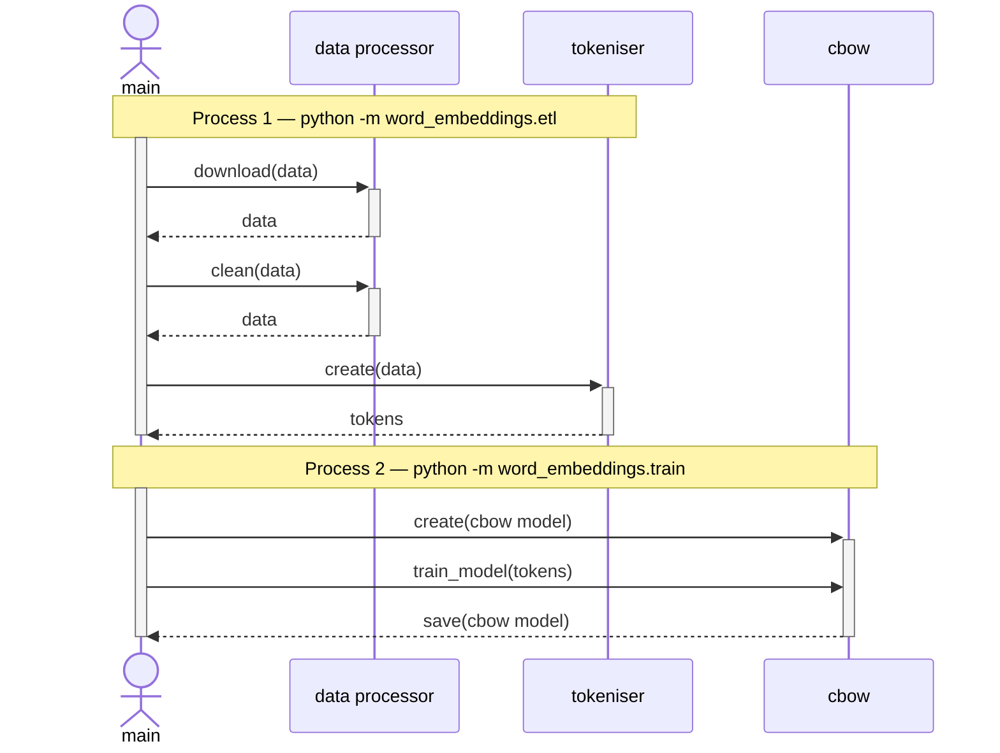
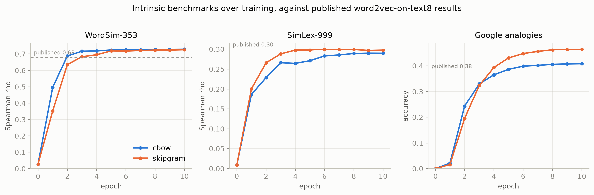
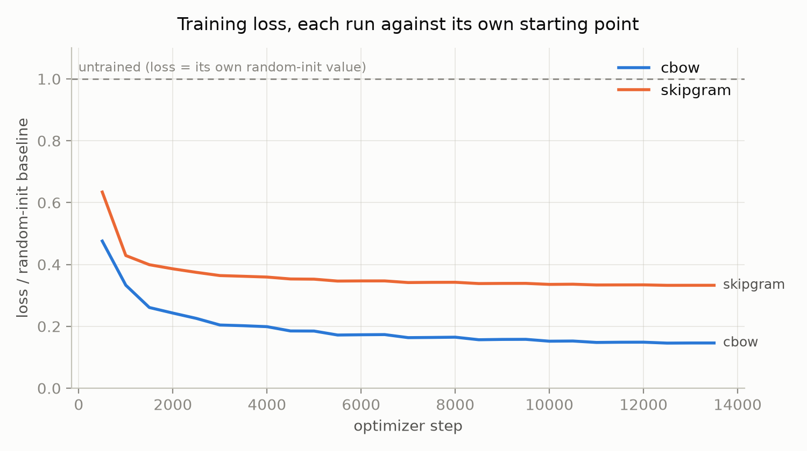
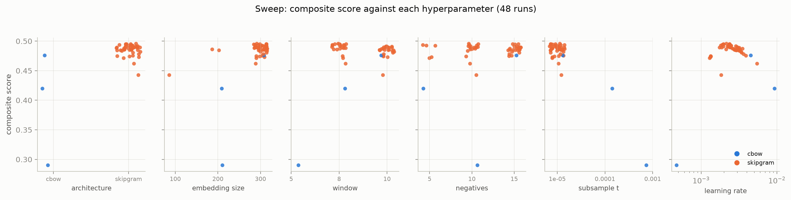
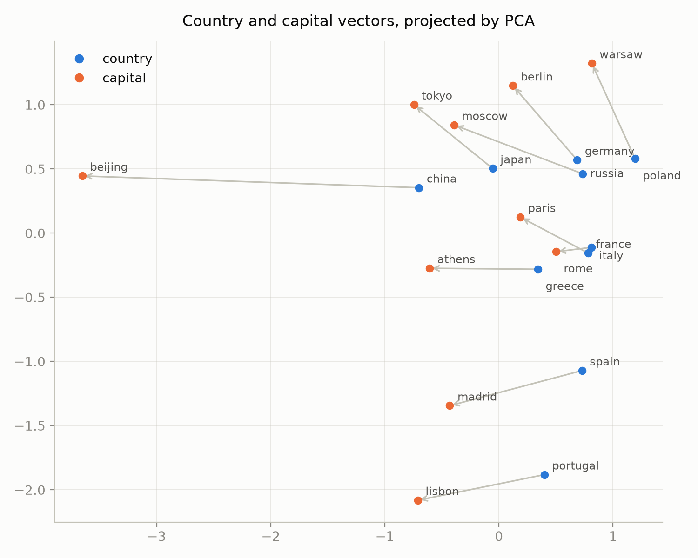

# Word Embeddings from Scratch (CBOW and Skip-gram, Negative Sampling)

## TL;DR

- **What it is:** word2vec trained from scratch — CBOW and skip-gram, negative sampling, no pretrained models — on the `text8` Wikipedia corpus.
- **Result today:** WordSim-353 ρ **0.73**, SimLex-999 ρ **0.30**, Google analogies **46.4%** — at or above published word2vec-on-text8 results on all three. See [Experimental Results](#6-experimental-results).
- **What I'd do next:** carry the vectors into the downstream [content-scoring project](https://github.com/RoshBeed/ai-residency/tree/main/services/content-scoring) and measure whether the better intrinsic scores move the extrinsic one — the sweep says window size and negative count are the knobs *not* to spend more time on.

This service trains the word vectors the rest of the portfolio builds on. I trained them from
scratch — word2vec with negative sampling [1, 2], no pretrained models — on `text8`, then published
the frozen vectors to the Hugging Face Hub where the content-scoring project consumes them. The
whole thing runs behind a FastAPI nearest-neighbour/analogy backend. This doc covers the method,
how it's wired together, and the results.

I trained on `text8` alone rather than on a merged corpus of my own because it is *the* word2vec
benchmark corpus: published WordSim-353 and analogy scores are quoted against these exact 17M
tokens, so a number here can be compared to something rather than only to itself.

## Quickstart

```bash
# one venv for the whole workspace
make install

# FastAPI on :8000, interactive docs at /docs
make serve SERVICE=word-embeddings

# train on text8 -- the corpus is fetched from the Hub on first use
make train SERVICE=word-embeddings
```

Stages specific to this service live in its own Makefile (`make -C services/word-embeddings help`):

- `train` — Train word vectors on text8 (~75s/epoch on an M1 Max; 10 epochs by default)
- `train-sample` — Train on a tiny slice of the corpus — seconds, writes a separate checkpoint
- `time` — Measure throughput and project how long a full run takes, without training
- `sweep` — Run a W&B sweep agent: `make sweep SWEEP=<id> [HOURS=12] [COUNT=n]`
- `evaluate` — Score the trained checkpoint on WordSim-353, SimLex-999 and the Google analogies
- `visualise` — Score the checkpoint and write a t-SNE plot of the embedding space to assets/

Checkpoints are resolved locally first, then from the Hugging Face Hub, so serving works on a host that has never trained anything.

## Table of Contents

1. [Introduction](#1-introduction)
2. [System Architecture](#2-system-architecture)
3. [Method](#3-method)
4. [Implementation](#4-implementation)
5. [Usage](#5-usage)
6. [Experimental Results](#6-experimental-results)
7. [Related Work](#7-related-work)
8. [References](#references)
9. [Acknowledgments](#acknowledgments)
10. [Dependencies](#dependencies)

## 1. Introduction

Turning free text into something a model can use is the problem this repo is about. A title
doesn't reduce to numbers the way a timestamp or comment count does, and unlike a bounded category
("city" → population, income, crime rate), there's no fixed decomposition to fall back on — the
space of possible titles is unbounded.

**Figure 1.** Ordinal, one-hot, and learned encodings of a single word (`master`, one of five
education levels).

![Four encodings of "master" side by side: ordinal (3), years-of-schooling (17), one-hot ([0,0,0,1,0]), and a 5-dimensional learned embedding — each traced through a small lookup diagram](assets/fig5-word-encodings.png)

Ordinal and one-hot encoding, the two standard categorical encodings, both fail on individual
words, for the same reason they fail on any large, unordered category. What actually works, and
what I built: a **learned embedding** — a trainable vector per word, positioned so similar words
land close together. `nn.Embedding` in `word_embeddings/model.py` is that "Learned Embeddings"
column, for real. The rest of this doc is how that training actually works.

## 2. System Architecture

Before the method — here's how the whole thing is wired together at a glance. Two stages: build
the corpus, pretrain the embeddings. The trained vectors are then published for the
content-scoring project to consume frozen.

**Figure 2.** Pipeline architecture.


Same pipeline as a sequence diagram. Each `Note over` label marks a separate process run, not one
continuous script, matching the commands in [Section 5](#5-usage):

**Figure 3.** Sequence diagram of the pipeline.


## 3. Method

### 3.1 The Distributional Hypothesis

The training signal here comes from the distributional hypothesis [3]: words that show up in
similar contexts tend to mean similar things. Classic illustration — you've probably never seen
the word *bardiwac* before, but you can guess what it means just from context:

> *"He handed her a glass of **bardiwac**."*
> *"I dined off bread, cheese and this excellent **bardiwac**."*

Glasses, dinner, pairing with food — that's enough to tell you *bardiwac* is a drink, probably
wine. Word2vec [1] turns that same intuition into a training signal directly, with zero labeling
cost. Here's how, piece by piece.

### 3.2 Tokenization and Normalization

Before any of this, words need normalizing so `"running"`, `"runs"`, and `"ran"` all map to the
same vocab entry. Suffix-stripping (*stemming*) is cheap but breaks on irregular forms, so I used
part-of-speech-tagged **lemmatization** instead.

**Figure 4.** Stemming versus lemmatization. The "remove ['ing', 's']" stemming rule correctly
handles `run`/`running`/`runs` but leaves `ran` unresolved (`?`); lemmatization's vocab mapping
correctly resolves all four, including `was → be`.


**This service does neither.** `text8` arrives already lowercased and stripped to `[a-z ]`, so
there is no normalization left to do, and I train on surface forms.

That is not just a convenience. Nine of the fourteen Google analogy categories are syntactic —
`gram3-comparative` (good:better), `gram7-past-tense` (walk:walked), `gram8-plural` (car:cars) —
and they are 10,675 of the 19,544 questions. Lemmatizing collapses `walk`, `walks` and `walked`
onto one vector, which makes 55% of the analogy benchmark unanswerable by construction. An earlier
version of this pipeline lemmatized with NLTK's POS tagger and `WordNetLemmatizer`; that code is
still in `word_embeddings/etl.py`, where it builds the Hacker News corpus the sibling
content-scoring service uses, but nothing on this training path calls it.

Each word gets an integer id, which indexes a row in a trainable embedding table. Ids are assigned
in descending frequency order, so "the 300 most frequent words" is the slice `[:300]` — which is
what every plot and probe here actually wants.

**Figure 5.** Tokenization and embedding lookup.

![A tokenizer mapping "hello", "polymorphism" (split into polym/orphism/circul/ation), and "code" to vocabulary indices 22172-775, with "orphism" (index 28611) highlighted feeding into an embedding matrix row [0.34, -0.5, 0.15, 0.19]](assets/fig7-tokenization-embedding-lookup.png)

### 3.3 CBOW and Skip-gram Architectures

Word2vec [1] turns the distributional hypothesis into a prediction task two ways: **CBOW**, which
predicts a center word from its surrounding context, and **Skip-gram**, which predicts the context
from the center word.

**Figure 6.** CBOW and Skip-gram architectures, Figure 1 from the original word2vec paper [1].


`word_embeddings/` implements the left half. There was a Skip-gram package beside it for a while,
but nothing in the pipeline ever called it, so it was removed rather than left to imply a choice
the repo does not actually offer. Here's the CBOW forward pass with real tensor shapes: 4-word
context window in, tokenize it, look up embeddings, average them, project back onto the
vocabulary:

**Figure 7.** CBOW forward pass with tensor shapes, toy vocabulary, embedding size 9. The Python
block below reproduces this same example directly (same vocab, same class).


That's vanilla CBOW, trained with cross-entropy against the true word via a full softmax over the
whole vocabulary. Minimal version:

```python
vocab = {"Hello": 72, "my": 44, "name": 21, "is": 93, "Bes": 11}
sentence = ["Hello", "my", "is", "Bes"]


class CBOW(torch.nn.Module):
    def __init__(self):
        super().__init__()
        self.emb = torch.nn.Embedding(128, 9)
        self.linear = torch.nn.Linear(9, 128)

    def forward(self, inputs):
        embs = self.emb(inputs)
        embs = embs.mean(dim=1)
        out = self.linear(embs)
        probs = F.log_softmax(out, dim=1)
        return probs
```

which corresponds to the loss

$$
\mathcal{L}_{\text{softmax}} = -\log \frac{\exp(\mathbf{v}_c^{\top}\mathbf{v}_{w_t})}{\sum_{w \in V} \exp(\mathbf{v}_c^{\top}\mathbf{v}_w)}
$$

Fine for a small toy vocabulary. Doesn't scale, though, and that's the problem the next section
actually solves.

### 3.4 Training Objective: Negative Sampling

That full softmax has to touch every word in the vocabulary on every single training step just to
get one gradient. Too slow for a real vocabulary. Negative sampling [2] replaces it with cheap
binary classification instead: does this (context, target) pair look real, or fake?

**Figure 8.** Negative sampling objective — the boxed loss $J(v_c, v_w, v_{n_1}, \ldots, v_{n_k})$
matches the equation below it, and the sigmoid/logarithm reference curves show why $\log
\sigma(\cdot)$ is the right shape for a real-or-fake binary classifier.


For each real context/target pair, $k$ random negative words are sampled, giving the loss:

$$
\mathcal{L}_{\text{NS}} = -\log \sigma(\mathbf{v}_c^{\top} \mathbf{v}_t) - \sum_{i=1}^{k} \log \sigma(-\mathbf{v}_c^{\top} \mathbf{v}_{n_i})
$$

`Word2Vec._negative_sampling_loss()` in
[`libs/word2vec`](https://github.com/RoshBeed/ai-residency/tree/main/libs/word2vec) is this loss
directly — `positive` and `negative` are the two terms above. Only $k+1$ embeddings get touched per
step instead of the whole vocabulary, which is what makes training on a real-sized corpus practical
at all.

Which distribution the $k$ negatives are drawn from matters more than it looks. Uniform sampling
spends almost every negative on a rare word the model already scores near zero; the raw unigram
distribution spends almost all of them on `the`. Mikolov et al. raise the frequencies to the 3/4
power, which sits between the two, and that is what `NegativeSampler` implements.

One asymmetry worth naming, because it decides whether the two architectures are comparable at all:
CBOW scores one positive per row and skip-gram scores $2w$ of them. Drawing $k$ negatives per *row*
would leave skip-gram with ten positives pulling scores up against five pushing them down. The
negatives are drawn per positive pair instead, so both architectures see the same ratio at the same
`num_negatives`.

### 3.5 Embedding Evaluation

Once I had trained embeddings, the obvious next question was whether they were any good — and
answering that without labeled data took some creativity.

#### 3.5.1 Analogy and Similarity Tests

There are no labels anywhere in this pipeline, just raw text, so I needed label-free ways to check
the embeddings actually learned something. Two checks, both lifted from the original word2vec
papers. First, the classic vector-arithmetic analogy test:
$\mathbf{v}_{\text{king}} - \mathbf{v}_{\text{man}} + \mathbf{v}_{\text{woman}}$ should land near
$\mathbf{v}_{\text{queen}}$, its nearest neighbor by cosine similarity if the embedding space is
any good.

**Figure 9.** Vector-arithmetic analogy test, Figure 2 from Mikolov et al. 2013b [2]. A real 2D PCA
projection of the paper's own trained Skip-gram vectors: each country's offset to its capital city
is roughly the same direction and magnitude across 15 pairs — the same $v_a - v_b + v_c \approx
v_d$ arithmetic as king−man+woman≈queen, just shown across a whole relation instead of one example.


I score three standard benchmarks rather than hand-picked examples, all in
`word_embeddings/benchmarks.py` and all run at the end of every epoch so I can watch quality climb
during a run rather than only after it:

| benchmark | size | what it measures |
|---|---|---|
| **WordSim-353** | 353 pairs | relatedness, by Spearman rank correlation against human scores |
| **SimLex-999** | 999 pairs | *similarity* specifically — built so a model that only captures relatedness does badly |
| **Google analogies** | 19,544 questions | analogy accuracy, 5 semantic categories and 9 syntactic |

Spearman rather than a straight difference: the question is not "are the numbers equal" but "do
they rank the pairs the same way".

An earlier version of this section reported a Spearman correlation of **1.0**. It was computed over
three hand-picked pairs, and with $n = 3$ the statistic can only take the values
$\{-1, -0.5, 0.5, 1\}$ — so it carried about one bit of information and happened to land on the
good one. Three real benchmarks are the fix.

Two details decide whether an analogy score means anything:

- **All three query words are excluded from the answer.**
  $\mathbf{v}_{\text{king}} - \mathbf{v}_{\text{man}} + \mathbf{v}_{\text{woman}}$ lands nearest
  to `king` itself far more often than to `queen`, so a scorer that does not exclude $a$, $b$ and
  $c$ reports a near-constant zero no matter how good the vectors are.
- **Candidates are restricted to the 30,000 most frequent words**, the usual convention. Searching
  the full tail lets a rare word with an under-trained vector win by accident, and makes the score
  depend on `min_count` rather than on the embeddings.

I also report **coverage** — the fraction of pairs or questions whose words are in the vocabulary —
next to every score. A correlation over the 60% of pairs a small vocabulary happens to cover is not
comparable to one over 95%, and quoting the score alone is the easiest way to overstate a result by
accident.

Everything above goes to Weights & Biases against `epoch`, alongside per-step loss and learning
rate against `train/step`, and a table of nearest neighbours for a fixed probe list each epoch —
which is the cheapest honest signal that a run is working. A loss curve falls for a model that has
learned only word frequency; `king → queen, prince, throne` does not happen by accident.

#### 3.5.2 Dimensionality Reduction

Those checks only cover a handful of hand-picked pairs. To eyeball the *entire* embedding space
(thousands of words, hundreds of dimensions), I used **t-SNE** to compress every embedding down to
2D while preserving which points were close together in the original space, so it can be
scattered on an ordinary chart. `word_embeddings/evaluate.py` does this — see
[Section 6](#6-experimental-results) for the actual plot.

### 3.6 Relation to Transformer Language Models

Everything above shares one constraint: CBOW and Skip-gram only ever look at a small, fixed window
of neighbouring words. Swap that fixed window for self-attention over the whole sequence and you
land on the two pretraining setups behind most modern transformers:

**Figure 10.** Fixed-context word2vec compared with attention-based masked and causal language
modeling, using the running `"Hello my name is Bes"` example throughout: word2vec predicts one
masked word from an averaged window, BERT predicts multiple masked positions from the full
bidirectional sequence, GPT predicts the next token causally.


I implement self-attention itself separately; see the
[vision transformer project](https://github.com/RoshBeed/ai-residency/tree/main/services/vision-transformers) for a from-scratch implementation.

## 4. Implementation

Mapping the architecture from [Section 2](#2-system-architecture) onto the actual file layout:

```
word_embeddings/          The word-embedding package
├── corpus.py              Fetch text8, build the frequency-ordered vocabulary, encode it
├── data.py                Subsampling + the tensor batcher that feeds training
├── model.py               build_word2vec — this service's view of libs/word2vec
├── train.py               train — the epoch loop, tracking and checkpointing
├── benchmarks.py          WordSim-353, SimLex-999 and Google-analogy scoring
├── evaluate.py            Score a saved checkpoint; t-SNE projection
├── report.py              The figures in Section 6, drawn from the W&B runs
└── etl.py                 The Hacker News corpus, for the sibling content-scoring service
config/__init__.py        Config(BaseConfig) — every hyperparameter and path in one dataclass
serving/api.py            FastAPI app: loads the checkpoint, exposes /nearest and /analogy
checkpoints/              Trained artifacts, under checkpoints/<architecture>/
data/                     text8 and the benchmark files (gitignored, fetched from the Hub)
tests/                    Vocabulary, batcher, benchmark-scoring and reproducibility tests
```

`word_embeddings` is a plain Python package run as modules — `python -m word_embeddings.train` —
with `config/` and `serving/` alongside it. No install step, no `PYTHONPATH` juggling, no
`sys.path` manipulation anywhere.

The word2vec math itself is not here. It lives in
[`libs/word2vec`](https://github.com/RoshBeed/ai-residency/tree/main/libs/word2vec), shared with
the vector-search-retrieval service, which had grown its own copy — the two were not rival CBOWs
but the same pair of matrices under different objectives. This package is the service's view of
it: which corpus, which hyperparameters, how a run is tracked and checkpointed.

Shared behaviour — device selection, logging, checkpoint format, seeding, Hub upload and W&B
tracking — comes from [`libs/common`](https://github.com/RoshBeed/ai-residency/tree/main/libs/common), pinned by tag, so it
is defined once for the whole portfolio instead of reimplemented per repo.

## 5. Usage

There is no corpus stage. `text8` is fetched from the Hub the first time training runs, so
reproducing this is one command.

**Figure 11.** Reproduction pipeline.


**Running locally is the fast path on Apple Silicon.** Training selects the device through
`ai_residency_common.get_device()`, which prefers CUDA, then MPS, then CPU. Docker Desktop on macOS
runs containers inside a Linux VM with no GPU/MPS passthrough, so training in a container is
CPU-only here regardless — fine for portability and as the on-ramp to a real GPU host later, but
about half the speed on this machine.

### 5.1 Training

```bash
make install
cp .env.example .env   # HF_TOKEN, WANDB_API_KEY -- both optional
make train SERVICE=word-embeddings
```

What it runs: `uv run python -m word_embeddings.train`.

Neither credential is required. Without `WANDB_API_KEY` the run logs offline and can be synced
later; without `HF_TOKEN` the checkpoint stays local. Both are also read from an existing
`wandb login` or `huggingface-cli login`, so a machine that is already logged in needs no `.env`
at all.

Every hyperparameter lives in `Config` (in `config/`), and any of them can be overridden from the
environment without editing code:

```bash
AI_RESIDENCY_NUM_EPOCHS=1 AI_RESIDENCY_EMBED_SIZE=64 make train SERVICE=word-embeddings
AI_RESIDENCY_ARCHITECTURE=skipgram make train SERVICE=word-embeddings

make -C services/word-embeddings train-sample   # a tiny slice of the corpus, seconds
make -C services/word-embeddings time           # measure throughput, train nothing
make -C services/word-embeddings evaluate       # score a saved checkpoint
```

The best epoch's checkpoint saves to `checkpoints/<architecture>/<architecture>_model.pt` and
pushes to the Hub. The vocabulary is stored inside it, so the embeddings and the mapping that
indexes them cannot drift apart.

It stores no optimizer state. Adam's two moment buffers are the same size as the two embedding
matrices, so carrying them made the artifact 515MB where 173MB says everything, and nothing reads
them: serving and content-scoring want `in_embed.weight`, and a run worth keeping has finished.

### 5.2 Sweeps

Sweeps aren't expanded by hand inside the trainer. `sweep.yaml` defines the search and W&B runs it:

```bash
wandb sweep services/word-embeddings/sweep.yaml    # prints a sweep id
make -C services/word-embeddings sweep SWEEP=<id> HOURS=12
```

The parameter names in that file are the `AI_RESIDENCY_*` environment overrides, so the agent needs
no sweep-specific plumbing in the training code at all.

`HOURS` bounds the sweep by wall clock rather than by run count. Run times here span roughly 6 to
31 minutes depending on architecture, embedding size and how much the subsampling threshold keeps,
so a `COUNT` chosen for the average finishes anywhere between half and double the intended budget.
Stopping an agent early costs nothing — every finished run is already recorded, and the Bayes
search reads them back on the next agent.

Two settings in `sweep.yaml` matter more than they look:

- **The metric is `best/score`, not loss.** Loss is not comparable across these runs at all. The
  random-init value is $(p + pk)\ln 2$ for $p$ positives and $k$ negatives, which is 4.16 for CBOW
  at 5 negatives and 41.59 for skip-gram at the same setting — so a sweep minimising loss would
  rank runs by their architecture and negative count rather than by how good the vectors are.
- **`min_count` and `num_epochs` are held fixed.** `min_count` changes the vocabulary, which
  changes benchmark coverage, which makes scores incomparable between runs; a sweep that varied it
  would reward runs for being evaluated on an easier subset. Fixing `num_epochs` keeps run times
  close enough for a wall-clock budget to mean something.


### 5.3 Deployment

Two single-purpose Dockerfiles: `Dockerfile.serve` builds `FROM
roshb/ai-residency-base-serve` (CPU torch — the FastAPI container Kubernetes runs), and
`Dockerfile.train` builds `FROM roshb/ai-residency-base-train` (CUDA torch — what a rented GPU
host pulls).
Neither needs a git credential. `libs/common` used to be a private git dependency, which meant every build mounted a token; it is a workspace member now and arrives with the source.

```bash
# both images for this service, built from the repository root
make build SERVICE=word-embeddings
make push SERVICE=word-embeddings

# the whole stack, this service included
make -C deploy up

# train in a container
cd deploy && docker compose --profile train run --rm train-word-embeddings
```

The checkpoint isn't baked into either image: serving pulls it from the Hugging Face Hub, so the
container always serves whatever was most recently trained rather than a stale snapshot. The
training service is gated behind a Compose *profile*, so a plain `docker compose up` never
accidentally starts a training run.

Without Docker:

```bash
make serve SERVICE=word-embeddings                # uv run python -m serve
```

The Streamlit UI no longer lives in this repo — it is a thin HTTP client in
`services/frontend`, calling the nearest-neighbour/analogy API this repo serves.

## 6. Experimental Results

**Scale.** `text8` is 17.0M tokens and 253,854 distinct words. At `min_count=5` the vocabulary is
**71,290 words**, keeping 98.3% of tokens — the standard figure for this corpus, which is a useful
sanity check that the tokenization matches everyone else's. Subsampling at $t = 10^{-5}$ leaves
about 5.6M training positions per epoch, redrawn each epoch.

**Every number below is measured against two baselines**: an untrained model with the same
architecture, and the published word2vec results for this corpus. A score with nothing beside it
is not a result.

### 6.1 Headline

The published skip-gram checkpoint, 10 epochs at the sweep's best configuration
(dim 300, window 8, 10 negatives, $t = 10^{-5}$, lr $2.2 \times 10^{-3}$):

| benchmark | untrained | **skip-gram** | CBOW | published word2vec on text8 | coverage |
|---|---|---|---|---|---|
| WordSim-353 (Spearman ρ) | 0.028 | 0.726 | **0.730** | 0.68 | 99.4% |
| SimLex-999 (Spearman ρ) | 0.008 | **0.297** | 0.290 | 0.30 | 99.3% |
| Google analogies (accuracy) | 0.000 | **0.464** | 0.408 | 0.38 | 62.8% |

Analogy accuracy splits into **60.2% semantic** and **39.5% syntactic**. Coverage on that benchmark
is 62.8% because answers are restricted to the 30,000 most frequent words and many
`capital-world` and `city-in-state` entries name places rarer than that; the accuracies are over
the covered questions, not diluted by the rest.

Both beat the published references on WordSim-353 and the analogy set, and both land within 0.01
of it on SimLex-999.

**CBOW wins WordSim-353** — 0.730 against skip-gram's 0.726, the highest of all 50 runs — and loses
the analogy set by 5.6 points. Skip-gram is what the API serves because analogies are a third of
the composite and the gap there is much the larger of the two, but "skip-gram is better" would be
too strong: it is better at analogies, and marginally worse at relatedness. Both are trained,
published and switchable with `AI_RESIDENCY_ARCHITECTURE=cbow`, no rebuild needed.

Each headline number was reproduced by re-running its configuration from scratch after the sweep:
skip-gram scored 0.4956 both times and CBOW 0.4758 both times, to four decimals.

The untrained column is not a formality. It is the check that caught what was wrong with the
previous version of this service: its shipped checkpoint reported a loss of 10.02, which reads
like a trained model right up until you notice that an untrained one reports 11.09.

Nearest neighbours from the served checkpoint, which is the check no aggregate score can stand in
for:

| word | five nearest by cosine |
|---|---|
| `king` | kings, throne, fitzalan, ermengarde, son |
| `france` | french, paris, bienville, spain, nazaire |
| `computer` | computers, hardware, computing, software, datasheet |
| `three` | four, two, five, one, six |
| `river` | tributaries, rivers, tributary, headwaters, confluence |
| `war` | troops, allied, army, fought, fended |

`three → four, two, five, one, six` is the one to look at. Nothing in the corpus labels those as
numbers; they cluster because they appear in the same positions, which is the distributional
hypothesis from [Section 3.1](#31-the-distributional-hypothesis) showing up directly in the
output.

And four analogies, straight off the running `/analogy` endpoint, with the three query words
excluded:

| query | top 3 |
|---|---|
| `bigger - big + small` | **smaller**, larger, large |
| `walked - walk + run` | **ran**, running, runs |
| `paris - france + italy` | bologna, turin, **rome** |
| `king - man + woman` | throne, ermengarde, anjou |

Three of the four put the intended answer in the top three, two of them first. The fourth is the
example everyone quotes, and it misses — so it is worth saying exactly why, because the obvious reading is wrong.

**It is not that the gender direction was never learned.** Four of six family analogies land on the
right word outright:

| query | top 3 |
|---|---|
| `father : mother :: son : ?` | **daughter**, wife, granddaughter |
| `brother : sister :: grandson : ?` | **granddaughter**, daughter, grandchildren |
| `man : woman :: son : ?` | **daughter**, wife, mother |
| `boy : girl :: father : ?` | **mother**, wife, daughter |

The axis is there. What fails is `king` in particular, and the neighbours say why: `throne`, `anjou`,
`childless`, `marrying`. In 17M tokens of Wikipedia, `king` occurs overwhelmingly in regnal lists
and succession prose, so its vector encodes *monarchy and lineage* far more strongly than it
encodes *male*. Push it along the gender axis and you land on the nearest female role in that same
dynastic context. `queen` comes 15th; `daughter` is 3rd once candidates are restricted to the
30,000 most frequent words as the benchmark does — a coherent answer to the question the vectors
actually represent, and not the one the demo wants.

Corpus size is the rest of it. `queen` appears 1,940 times here and `woman` 1,753; the canonical
demo comes from Google News at 100 billion words, about 6,000 times more text. Category accuracy
matches that story — `gram6-nationality-adjective` 93.2%, `capital-common-countries` 86.2%,
`gram8-plural` 71.4%, against `family` at 39.9%, the weakest of the semantic categories.

Reporting the miss rather than dropping it is the point: at 46.4% overall, showing only the
queries that work would be choosing the sample to fit the claim.

**Figure 12.** Benchmarks over training, both architectures, against the published references.



**Figure 13.** Training loss, each architecture divided by its own random-init baseline.



Loss is plotted relative to each run's own starting point rather than in absolute terms. CBOW at 5
negatives starts at 4.16 and skip-gram at 41.59, because skip-gram scores $2w$ positives per row
where CBOW scores one — so an absolute plot would compare the number of terms in a sum, not the
quality of two models. The alternative, a second y-axis, can be made to show whatever you like.

**Read Figures 12 and 13 together.** CBOW drives its loss down to 0.15 of its starting value while
skip-gram only reaches 0.33 — and skip-gram produces the better vectors. The objective and the
thing you actually want are related but not the same, which is why the sweep ranks on benchmark
score and why a loss curve alone would have picked the wrong architecture.

### 6.2 The sweep

48 runs over 12 hours on one M1 Max, Bayesian search over architecture, embedding size, window,
negatives, subsampling threshold and learning rate, ranked on the composite score.

**Figure 14.** Composite score against each hyperparameter, one panel each, coloured by architecture.



What actually moved the number, strongest first:

- **Subsampling threshold, by a distance.** $t = 10^{-3}$ scored 0.290 against 0.486 at
  $t = 10^{-5}$ — a wider spread than any other parameter produced. Discarding frequent words
  aggressively is the single highest-leverage setting here, which is consistent with it being the
  one the previous implementation did not do at all.
- **Architecture.** Skip-gram averaged 0.485 against CBOW's 0.395, and every one of the top eight
  runs is skip-gram. But the split is not as clean as the means suggest: **CBOW's one well-tuned
  run scored the highest WordSim-353 of the entire sweep, 0.730**, and lost on analogies (0.408 vs
  0.464), not on similarity. Skip-gram wins the composite because analogies are a third of it.
- **Learning rate**, a clear inverted-U peaking near $2 \times 10^{-3}$. Both tails cost real
  accuracy.
- **Window and negatives: essentially nothing.** Holding architecture, dimension and threshold at
  their best values, window 8 vs 10 is 0.4883 vs 0.4847, and 5 / 10 / 15 negatives are 0.4844 /
  0.4873 / 0.4862. Worth knowing that these are the knobs *not* to spend the next sweep on.

**Two caveats, because the sweep design creates them.** Bayesian search exploits: 45 of 48 runs are
skip-gram, 46 of 48 use $t = 10^{-5}$, and 43 of 48 use 300 dimensions. So the top-of-table ranking
is solid, but the per-hyperparameter marginals rest on one or two runs each at the losing settings
— "subsampling mattered most" is a direction, not a measured effect size. And the window/negatives
comparisons above are drawn from a slice with everything else held fixed, which is the only way to
read a marginal out of a search that was never designed to be balanced. A grid would answer these
properly; it would also have cost far more than twelve hours.

### 6.3 More epochs made it worse

**26 of the 48 runs peaked before their final epoch.** Extending the winning configuration from 10
epochs to 20 confirmed it directly: the score peaked at epoch 7 and then fell away, WordSim-353
from 0.722 to 0.684 and SimLex-999 from 0.295 to 0.244, while analogy accuracy held flat.

Part of that is ordinary over-training, and part is an interaction worth naming: the learning rate
decays linearly to zero across `num_epochs`, so lengthening a run also stretches the schedule. At
20 epochs the rate is still high where the score peaks, and the run never gets the annealing that
the 10-epoch schedule delivers exactly where it matters. The number of epochs is not an
independent knob you can raise for free — it is part of the schedule.

The trainer keeps the best epoch by score rather than the last one, so this costs quality but never
a checkpoint.

### 6.4 The embedding space

**Figure 15.** t-SNE projection of the 200 most frequent words. Nothing labelled any of these
groups; they fall out of co-occurrence alone.


The legible clusters sit at the edges: the number words (`zero` through `nine`) in one tight group
at lower left, nationalities (`french`, `german`, `english`, `british`, `american`) just above
them, and the modals (`can`, `may`, `will`, `would`, `could`) together on the right. The centre is
function words, which are frequent, appear in every context, and are correspondingly hard to
separate — 200 words rather than 300 because past roughly that the centre packs into illegibility.

**Figure 16.** Country-capital offsets in the trained space — the same plot as Mikolov et al.'s
Figure 2, but drawn on these vectors rather than the paper's.



Figure 9 earlier in this document is the paper's version. This is the same claim made about the
vectors this service actually trained, which is the one worth checking — and it is worth reporting
what it shows rather than what the paper's shows.

Nine of the ten offsets run up and to the left at broadly similar angles, which is the relation
being encoded as a direction. They are not the clean parallel bundle of the published figure: the
lengths vary noticeably, and `china → beijing` is a long outlier running almost horizontally. That
is consistent with the number in the table — 60.2% on semantic analogies means the relation is
real and roughly consistent, not that it is exact.

## 7. Related Work

- [the content-scoring project](https://github.com/RoshBeed/ai-residency/tree/main/services/content-scoring) —
  the regression head that consumes these frozen vectors, and where the honest downstream result
  lives.
- [the dual-encoder retrieval project](https://github.com/RoshBeed/ai-residency/tree/main/services/vector-search-retrieval) —
  recurrent (GRU) query/document towers trained with a triplet objective, an alternative to
  average-pooled embeddings for sequence representation.
- [the vision transformer project](https://github.com/RoshBeed/ai-residency/tree/main/services/vision-transformers) — self-attention and transformer encoder/decoder
  implemented from scratch.
- [the RLHF/PPO project](https://github.com/RoshBeed/ai-residency/tree/main/services/rlhf-ppo) — reward modeling and policy optimization; the same
  scalar-head-over-frozen-embeddings shape, trained on human preferences instead of raw counts.

## References

[1] Mikolov, T., Chen, K., Corrado, G., & Dean, J. (2013). *Efficient Estimation of Word
Representations in Vector Space.* arXiv:1301.3781.

[2] Mikolov, T., Sutskever, I., Chen, K., Corrado, G., & Dean, J. (2013). *Distributed
Representations of Words and Phrases and their Compositionality.* arXiv:1310.4546.

[3] Harris, Z. S. (1954). Distributional Structure. *Word*, 10(2–3), 146–162.

## Acknowledgments

Built with Peter O'Keeffe, Ben Williams, and Miguel Parracho. Figures 6 and 9 reproduce Figure 1
and Figure 2 from the original word2vec papers [1, 2] directly.

## Dependencies

PyTorch · FastAPI · NLTK · Weights & Biases · Hugging Face Hub · PostgreSQL · Docker ·
Docker Compose · Make
