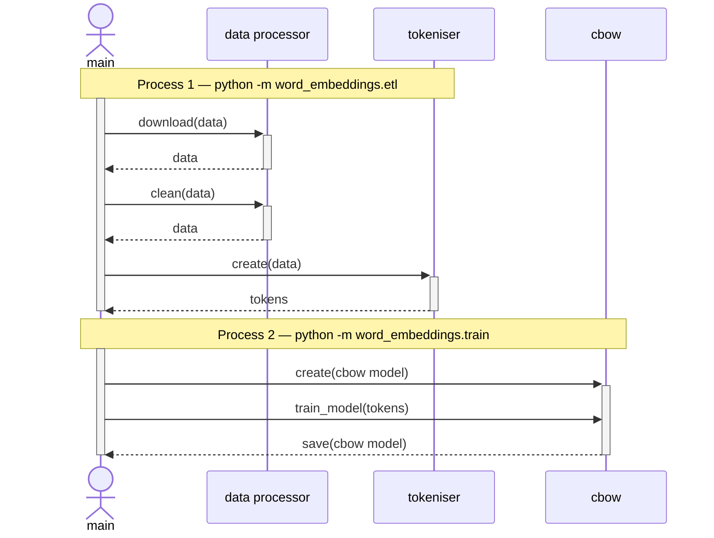
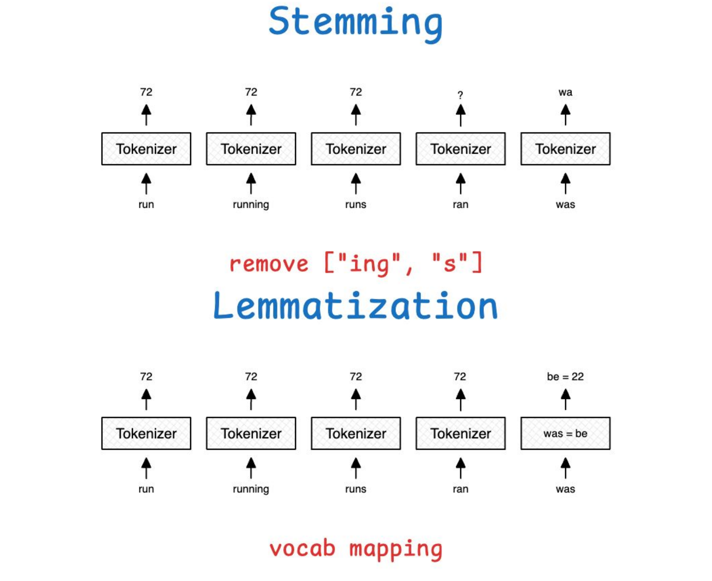
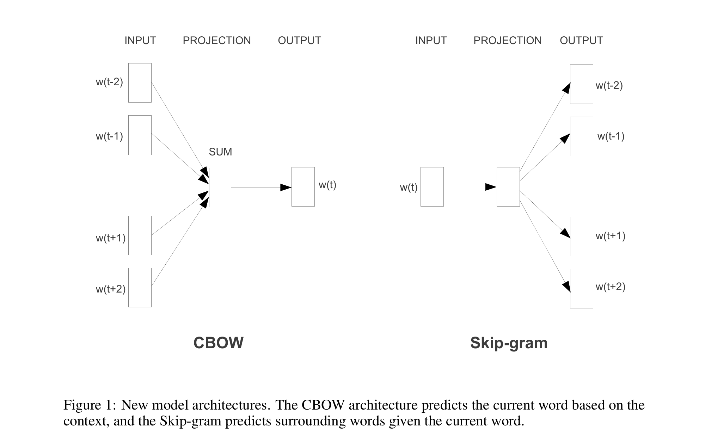
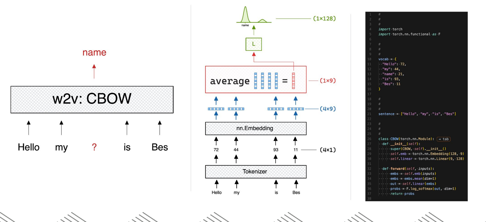
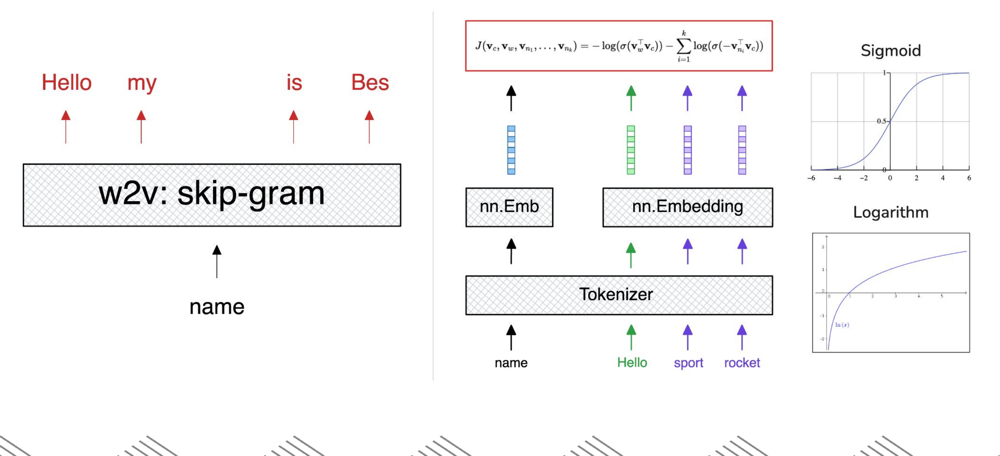
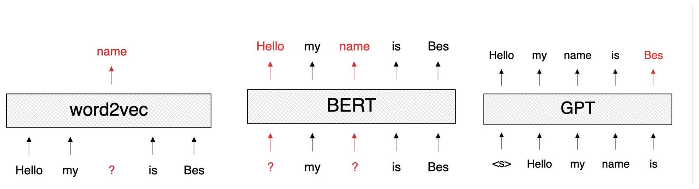
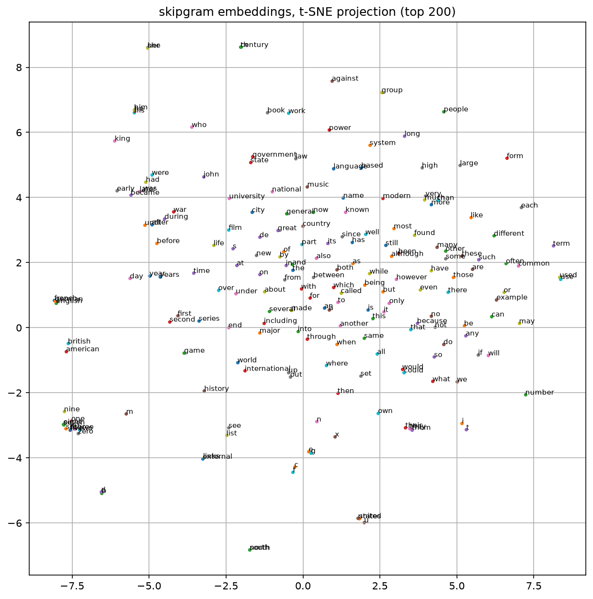

# Word Embeddings from Scratch (CBOW + Negative Sampling)

## TL;DR

- **What it is:** CBOW word embeddings trained from scratch — negative sampling, no pretrained models — on Wikipedia text plus real Hacker News posts and comments.
- **Result today:** the embeddings show real unsupervised structure (t-SNE clusters of geography terms, function words, technology terms), consumed downstream by the [content-scoring project](https://github.com/RoshBeed/ai-residency/tree/main/services/content-scoring).
- **What I'd do next:** add Skip-gram and concatenate its vectors alongside CBOW, sweep more aggressively over the negative-sampling count.

This repo trains the word vectors that the rest of the portfolio builds on. I trained them from
scratch — CBOW word2vec with negative sampling [1, 2], no pretrained models — on the `text8`
Wikipedia corpus plus real HN posts and comments, then published the frozen vectors to the Hugging
Face Hub where the content-scoring project consumes them. The whole thing runs behind a FastAPI
nearest-neighbour/analogy backend. This doc covers the method, how it's wired together, and the
results.

## Quickstart

```bash
# one venv for the whole workspace
make install

# FastAPI on :8000, interactive docs at /docs
make serve SERVICE=word-embeddings

# read Usage first -- some stages run for hours
make train SERVICE=word-embeddings
```

Stages specific to this service live in its own Makefile (`make -C services/word-embeddings help`):

- `train-corpus` — Stage 1: build the merged vocabulary/corpus
- `train-cbow` — Stage 2: pretrain CBOW embeddings (hours on the real corpus)
- `train-cbow-sample` — Stage 2 against a tiny built-in corpus — seconds, writes a separate checkpoint
- `sweep` — Run a W&B sweep agent: make sweep SWEEP=<id from `wandb sweep sweep.yaml`>
- `visualise` — Write a t-SNE plot of the learned embedding space to assets/

Checkpoints are resolved locally first, then from the Hugging Face Hub, so serving works on a host that has never trained anything.

## Table of Contents

1. [Introduction](#1-introduction)
2. [System Architecture](#2-system-architecture)
3. [Method](#3-method)
4. [Implementation](#4-implementation)
5. [Usage](#5-usage)
6. [Experimental Results](#6-experimental-results)
7. [Related Work](#7-related-work)
8. [References](#references)
9. [Acknowledgments](#acknowledgments)
10. [Dependencies](#dependencies)

## 1. Introduction

Turning free text into something a model can use is the problem this repo is about. A title
doesn't reduce to numbers the way a timestamp or comment count does, and unlike a bounded category
("city" → population, income, crime rate), there's no fixed decomposition to fall back on — the
space of possible titles is unbounded.

**Figure 1.** Ordinal, one-hot, and learned encodings of a single word (`master`, one of five
education levels).

![Four encodings of "master" side by side: ordinal (3), years-of-schooling (17), one-hot ([0,0,0,1,0]), and a 5-dimensional learned embedding — each traced through a small lookup diagram](assets/fig5-word-encodings.png)

Ordinal and one-hot encoding, the two standard categorical encodings, both fail on individual
words, for the same reason they fail on any large, unordered category. What actually works, and
what I built: a **learned embedding** — a trainable vector per word, positioned so similar words
land close together. `nn.Embedding` in `word_embeddings/model.py` is that "Learned Embeddings"
column, for real. The rest of this doc is how that training actually works.

## 2. System Architecture

Before the method — here's how the whole thing is wired together at a glance. Two stages: build
the corpus, pretrain the embeddings. The trained vectors are then published for the
content-scoring project to consume frozen.

**Figure 2.** Pipeline architecture.


Same pipeline as a sequence diagram. Each `Note over` label marks a separate process run, not one
continuous script, matching the commands in [Section 5](#5-usage):

**Figure 3.** Sequence diagram of the pipeline.


## 3. Method

### 3.1 The Distributional Hypothesis

The training signal here comes from the distributional hypothesis [3]: words that show up in
similar contexts tend to mean similar things. Classic illustration — you've probably never seen
the word *bardiwac* before, but you can guess what it means just from context:

> *"He handed her a glass of **bardiwac**."*
> *"I dined off bread, cheese and this excellent **bardiwac**."*

Glasses, dinner, pairing with food — that's enough to tell you *bardiwac* is a drink, probably
wine. Word2vec [1] turns that same intuition into a training signal directly, with zero labeling
cost. Here's how, piece by piece.

### 3.2 Tokenization and Normalization

Before any of this, words need normalizing so `"running"`, `"runs"`, and `"ran"` all map to the
same vocab entry. Suffix-stripping (*stemming*) is cheap but breaks on irregular forms, so I used
part-of-speech-tagged **lemmatization** instead.

**Figure 4.** Stemming versus lemmatization. The "remove ['ing', 's']" stemming rule correctly
handles `run`/`running`/`runs` but leaves `ran` unresolved (`?`); lemmatization's vocab mapping
correctly resolves all four, including `was → be`.



Lemmatization lives in `word_embeddings/data.py`, using NLTK's POS tagger and
`WordNetLemmatizer`, so `"was"` correctly folds into `"be"` instead of getting mangled by a suffix
rule. Each normalized word then gets an integer id, which indexes a row in a trainable embedding
table.

**Figure 5.** Tokenization and embedding lookup.

![A tokenizer mapping "hello", "polymorphism" (split into polym/orphism/circul/ation), and "code" to vocabulary indices 22172-775, with "orphism" (index 28611) highlighted feeding into an embedding matrix row [0.34, -0.5, 0.15, 0.19]](assets/fig7-tokenization-embedding-lookup.png)

### 3.3 CBOW and Skip-gram Architectures

Word2vec [1] turns the distributional hypothesis into a prediction task two ways: **CBOW**, which
predicts a center word from its surrounding context, and **Skip-gram**, which predicts the context
from the center word.

**Figure 6.** CBOW and Skip-gram architectures, Figure 1 from the original word2vec paper [1].



`word_embeddings/` implements the left half. There was a Skip-gram package beside it for a while,
but nothing in the pipeline ever called it, so it was removed rather than left to imply a choice
the repo does not actually offer. Here's the CBOW forward pass with real tensor shapes: 4-word
context window in, tokenize it, look up embeddings, average them, project back onto the
vocabulary:

**Figure 7.** CBOW forward pass with tensor shapes, toy vocabulary, embedding size 9. The Python
block below reproduces this same example directly (same vocab, same class).



That's vanilla CBOW, trained with cross-entropy against the true word via a full softmax over the
whole vocabulary. Minimal version:

```python
vocab = {"Hello": 72, "my": 44, "name": 21, "is": 93, "Bes": 11}
sentence = ["Hello", "my", "is", "Bes"]


class CBOW(torch.nn.Module):
    def __init__(self):
        super().__init__()
        self.emb = torch.nn.Embedding(128, 9)
        self.linear = torch.nn.Linear(9, 128)

    def forward(self, inputs):
        embs = self.emb(inputs)
        embs = embs.mean(dim=1)
        out = self.linear(embs)
        probs = F.log_softmax(out, dim=1)
        return probs
```

which corresponds to the loss

$$
\mathcal{L}_{\text{softmax}} = -\log \frac{\exp(\mathbf{v}_c^{\top}\mathbf{v}_{w_t})}{\sum_{w \in V} \exp(\mathbf{v}_c^{\top}\mathbf{v}_w)}
$$

Fine for a small toy vocabulary. Doesn't scale, though, and that's the problem the next section
actually solves.

### 3.4 Training Objective: Negative Sampling

That full softmax has to touch every word in the vocabulary on every single training step just to
get one gradient. Too slow for a real vocabulary. Negative sampling [2] replaces it with cheap
binary classification instead: does this (context, target) pair look real, or fake?

**Figure 8.** Negative sampling objective — the boxed loss $J(v_c, v_w, v_{n_1}, \ldots, v_{n_k})$
matches the equation below it, and the sigmoid/logarithm reference curves show why $\log
\sigma(\cdot)$ is the right shape for a real-or-fake binary classifier.



For each real context/target pair, $k$ random negative words are sampled, giving the loss:

$$
\mathcal{L}_{\text{NS}} = -\log \sigma(\mathbf{v}_c^{\top} \mathbf{v}_t) - \sum_{i=1}^{k} \log \sigma(-\mathbf{v}_c^{\top} \mathbf{v}_{n_i})
$$

`CBOWNS.forward()` in `word_embeddings/model.py` is this loss directly — `pos_loss` and
`neg_loss` are the two terms above. Only $k+1$ embeddings get touched per step instead of the whole
vocabulary, which is what makes training on a real-sized corpus practical at all.

### 3.5 Embedding Evaluation

Once I had trained embeddings, the obvious next question was whether they were any good — and
answering that without labeled data took some creativity.

#### 3.5.1 Analogy and Similarity Tests

There are no labels anywhere in this pipeline, just raw text, so I needed label-free ways to check
the embeddings actually learned something. Two checks, both lifted from the original word2vec
papers. First, the classic vector-arithmetic analogy test:
$\mathbf{v}_{\text{king}} - \mathbf{v}_{\text{man}} + \mathbf{v}_{\text{woman}}$ should land near
$\mathbf{v}_{\text{queen}}$, its nearest neighbor by cosine similarity if the embedding space is
any good.

**Figure 9.** Vector-arithmetic analogy test, Figure 2 from Mikolov et al. 2013b [2]. A real 2D PCA
projection of the paper's own trained Skip-gram vectors: each country's offset to its capital city
is roughly the same direction and magnitude across 15 pairs — the same $v_a - v_b + v_c \approx
v_d$ arithmetic as king−man+woman≈queen, just shown across a whole relation instead of one example.


I run the same style of check during training — see `evaluate_embeddings()` in
`word_embeddings/evaluate.py`, using the king/man/woman/queen version. Second check is
rank-based similarity: a handful of word pairs get a human-labelled similarity score
(`king`~`queen` = 0.95, `king`~`dog` = 0.2), compared against the model's own cosine similarities
via **Spearman's rank correlation** — not "are the numbers equal" but "do they rank the pairs the
same way." Both get logged to Weights & Biases every 100 batches, so I can see embedding quality
during training, not just after it.

#### 3.5.2 Dimensionality Reduction

Those checks only cover a handful of hand-picked pairs. To eyeball the *entire* embedding space
(thousands of words, hundreds of dimensions), I used **t-SNE** to compress every embedding down to
2D while preserving which points were close together in the original space, so it can be
scattered on an ordinary chart. `word_embeddings/evaluate.py` does this — see
[Section 6](#6-experimental-results) for the actual plot.

### 3.6 Relation to Transformer Language Models

Everything above shares one constraint: CBOW and Skip-gram only ever look at a small, fixed window
of neighbouring words. Swap that fixed window for self-attention over the whole sequence and you
land on the two pretraining setups behind most modern transformers:

**Figure 10.** Fixed-context word2vec compared with attention-based masked and causal language
modeling, using the running `"Hello my name is Bes"` example throughout: word2vec predicts one
masked word from an averaged window, BERT predicts multiple masked positions from the full
bidirectional sequence, GPT predicts the next token causally.



I implement self-attention itself separately; see the
[vision transformer project](https://github.com/RoshBeed/ai-residency/tree/main/services/vision-transformers) for a from-scratch implementation.

## 4. Implementation

Mapping the architecture from [Section 2](#2-system-architecture) onto the actual file layout:

```
word_embeddings/          The CBOW word-embedding package
├── etl.py                 Corpus construction: download text8, merge HN titles, lemmatise
├── data.py                Vocabulary loading + the negative-sampling dataset
├── model.py               CBOWNS + CBOWConfig (the word2vec math) + load_cbow_embeddings
├── train.py               train_cbow — pretrain the word vectors
└── evaluate.py            Analogy and similarity checks + t-SNE projection
config/__init__.py        Config(BaseConfig) — every hyperparameter and path in one dataclass
serving/api.py            FastAPI app: loads the checkpoint, exposes /nearest and /analogy
checkpoints/              Trained artifacts: the CBOW checkpoint under checkpoints/cbow/
data/                     Generated vocabulary files and corpora (gitignored, produced by the ETL stage)
tests/                    Normalization, model-construction and reproducibility tests
```

`word_embeddings` is a plain Python package run as modules — `python -m word_embeddings.train` —
with `config/` and `serving/` alongside it. No install step, no `PYTHONPATH` juggling, no
`sys.path` manipulation anywhere. This is an application, not a library: a reader can open
`word_embeddings/model.py` and see the whole of word2vec in one file, with the data plumbing tucked
into `word_embeddings/data.py`.

Shared behaviour — device selection, logging, checkpoint format, seeding, Hub upload and W&B
tracking — comes from [`libs/common`](https://github.com/RoshBeed/ai-residency/tree/main/libs/common), pinned by tag, so it
is defined once for the whole portfolio instead of reimplemented per repo.

## 5. Usage

Reproducing the whole thing end to end is two commands, one per pipeline stage:

**Figure 11.** Reproduction pipeline.


A `Makefile` wraps each stage below in a target of the same name (`make train SERVICE=word-embeddings-corpus`,
`make train SERVICE=word-embeddings-cbow`). `make help` lists all of them, including the Docker equivalents. The raw
commands are kept underneath each target as a reference for what actually runs.

**Local `make train SERVICE=word-embeddings*` is the fast path on Apple Silicon.** Training selects the device through
`ai_residency_common.get_device()`, which prefers CUDA, then MPS, then CPU. Docker Desktop on macOS
runs containers inside a Linux VM with no GPU/MPS passthrough, so `make -C deploy up  # then: docker compose --profile train run --rm train-word-embeddings` is always
CPU-only here regardless — fine for portability and as the on-ramp to a real GPU host later, but
not what I'd reach for if I cared about speed on this machine. Run the `train-*` targets directly
on the host to actually use MPS.

### 5.1 Corpus Construction

```bash
make install
cp .env.example .env   # HF_TOKEN, WANDB_API_KEY
make train SERVICE=word-embeddings-corpus
```
What `train-corpus` runs:
```bash
uv sync                                                          # make install
uv run python -m word_embeddings.etl                             # make train SERVICE=word-embeddings-corpus
```

Downloads the Wikipedia `text8` corpus, pulls HN posts and comments from the public read-only
Postgres mirror, tokenizes and lemmatizes both, and writes the merged vocabulary and corpus to
`data/`.

That mirror is externally hosted and not always reachable. The stage checks reachability with a
short timeout and falls back to the last cleaned extract in `data/`, so it completes either way.
Point it somewhere else with `HN_DATABASE_URL`.

### 5.2 Embedding Pretraining

```bash
make train SERVICE=word-embeddings-cbow
```
What it runs: `uv run python -m word_embeddings.train`.

Every hyperparameter lives in `Config` (in `config/`), and any of them can be overridden from the
environment without editing code:

```bash
AI_RESIDENCY_CBOW_NUM_EPOCHS=1 AI_RESIDENCY_CBOW_EMBED_SIZE=64 make train SERVICE=word-embeddings-cbow
make train SERVICE=word-embeddings-cbow-sample        # a tiny built-in corpus, seconds, its own checkpoint
```

The best checkpoint saves to `checkpoints/cbow/cbow_model.pt` and pushes to the Hub when `HF_TOKEN`
is set. The vocabulary is stored inside it, so embeddings and their index-to-word mapping can never
drift out of sync.

**Sweeps** aren't expanded by hand inside the trainer. `sweep.yaml` defines the search and W&B runs
it:

```bash
wandb sweep sweep.yaml        # prints a sweep id
make sweep SWEEP=<id>
```

The parameter names in that file are the `AI_RESIDENCY_*` environment overrides, so the agent needs no
sweep-specific plumbing in the training code at all.

### 5.3 Deployment

Two single-purpose Dockerfiles: `Dockerfile.serve` builds `FROM
roshb/ai-residency-base-serve` (CPU torch — the FastAPI container Kubernetes runs), and
`Dockerfile.train` builds `FROM roshb/ai-residency-base-train` (CUDA torch — what a rented GPU
host pulls).
Neither needs a git credential. `libs/common` used to be a private git dependency, which meant every build mounted a token; it is a workspace member now and arrives with the source.

```bash
# both images for this service, built from the repository root
make build SERVICE=word-embeddings
make push SERVICE=word-embeddings

# the whole stack, this service included
make -C deploy up

# train in a container
cd deploy && docker compose --profile train run --rm train-word-embeddings
```

The CBOW checkpoint isn't baked into either image: serving pulls it from the Hugging Face Hub when
none is bind-mounted (see `docker-compose.yml`), so the container always serves whatever was most
recently trained rather than a stale snapshot. The training service is gated behind a Compose
*profile*, so a plain `docker compose up` never accidentally kicks off a multi-hour training run.

Without Docker:

```bash
make serve SERVICE=word-embeddings                # uv run python -m serve
```

The Streamlit UI no longer lives in this repo — it is a thin HTTP client in
`services/frontend`, calling the nearest-neighbour/analogy API this repo serves.

## 6. Experimental Results

Here's what training actually produced.

**Scale.** The merged vocabulary (Wikipedia's text8 corpus, ~17.0M tokens, plus HN post
titles/comments) is 258,196 words after lemmatization.

**Hyperparameter sweep.** CBOW was swept over learning rate ($10^{-3}$, $10^{-2}$), embedding size
(128, 256), and window size (4, 8) via Weights & Biases. Learning rate dominated convergence
speed: the $10^{-2}$ runs dropped batch loss from ~30 to under 5 within ~1,000 batches, versus
~2,000 batches at $10^{-3}$.

**Embedding evaluation.** A t-SNE projection of the top 100 embeddings shows CBOW clustering
related words correctly with zero supervision: Channel Islands geography terms (`guernsey`,
`jersey`, `chausey`, `normandes`, `bailiwicks`, `archipel`) cluster together, and so do common
function words (`of`, `to`, `and`, `in`, `the`, `a`). The similarity check against the small
hand-labelled pair set comes back with a Spearman correlation of 1.0.

**Figure 12.** t-SNE projection of learned CBOW embeddings (top 100 by frequency), from re-running
this repo's pipeline end to end. A technology/telecom cluster emerges unsupervised (`printer`,
`fax`, `telecopy`, `phone`, `modem`, `scanner`, `document`), alongside a cluster of function words
(`the`, `of`, `and`, `where`, `into`).



## 7. Related Work

- [the content-scoring project](https://github.com/RoshBeed/ai-residency/tree/main/services/content-scoring) —
  the regression head that consumes these frozen vectors, and where the honest downstream result
  lives.
- [the dual-encoder retrieval project](https://github.com/RoshBeed/ai-residency/tree/main/services/vector-search-retrieval) —
  recurrent (GRU) query/document towers trained with a triplet objective, an alternative to
  average-pooled embeddings for sequence representation.
- [the vision transformer project](https://github.com/RoshBeed/ai-residency/tree/main/services/vision-transformers) — self-attention and transformer encoder/decoder
  implemented from scratch.
- [the RLHF/PPO project](https://github.com/RoshBeed/ai-residency/tree/main/services/rlhf-ppo) — reward modeling and policy optimization; the same
  scalar-head-over-frozen-embeddings shape, trained on human preferences instead of raw counts.

## References

[1] Mikolov, T., Chen, K., Corrado, G., & Dean, J. (2013). *Efficient Estimation of Word
Representations in Vector Space.* arXiv:1301.3781.

[2] Mikolov, T., Sutskever, I., Chen, K., Corrado, G., & Dean, J. (2013). *Distributed
Representations of Words and Phrases and their Compositionality.* arXiv:1310.4546.

[3] Harris, Z. S. (1954). Distributional Structure. *Word*, 10(2–3), 146–162.

## Acknowledgments

Built with Peter O'Keeffe, Ben Williams, and Miguel Parracho. Figures 6 and 9 reproduce Figure 1
and Figure 2 from the original word2vec papers [1, 2] directly.

## Dependencies

PyTorch · FastAPI · NLTK · Weights & Biases · Hugging Face Hub · PostgreSQL · Docker ·
Docker Compose · Make
